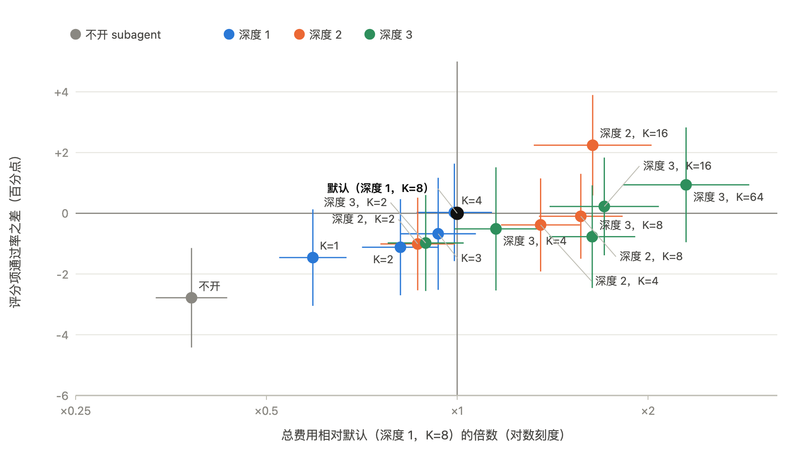
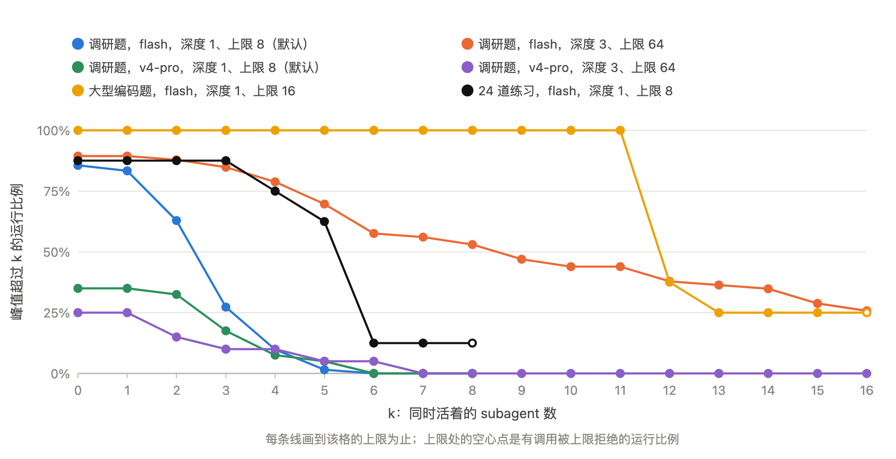
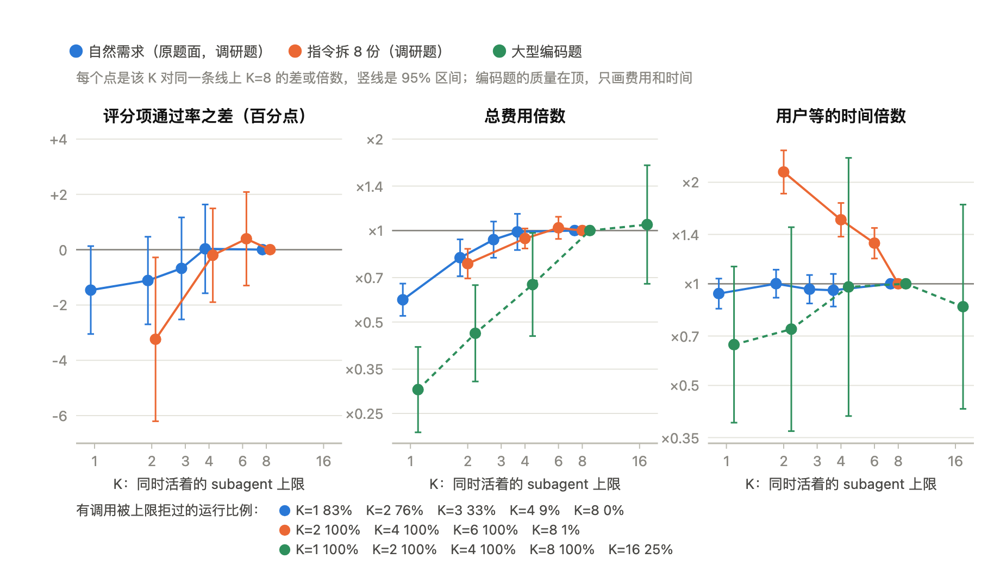
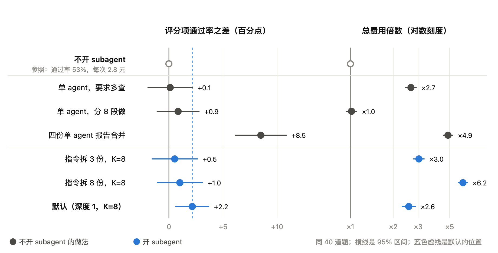
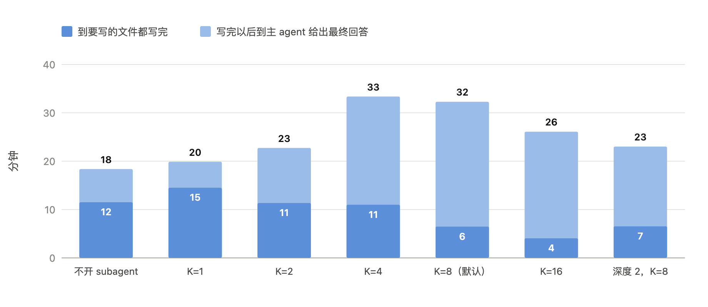
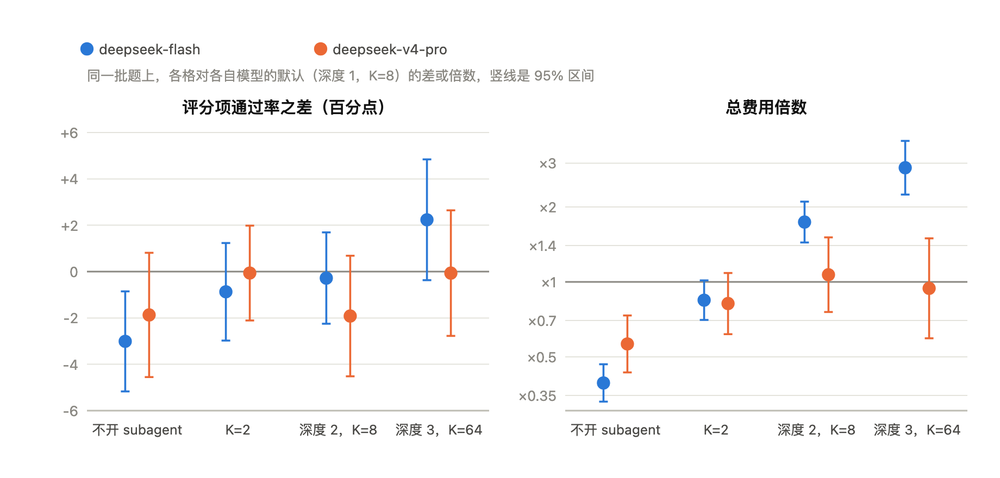
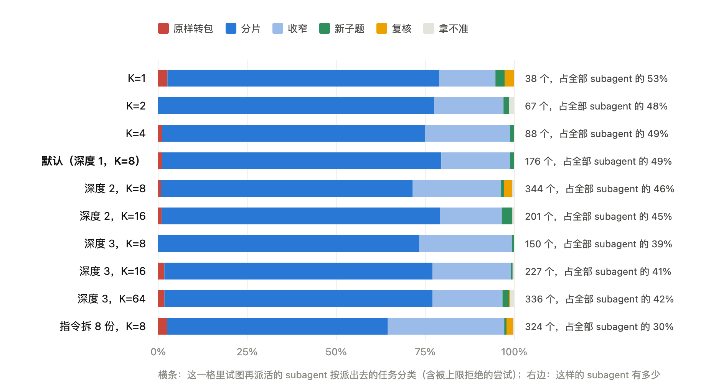
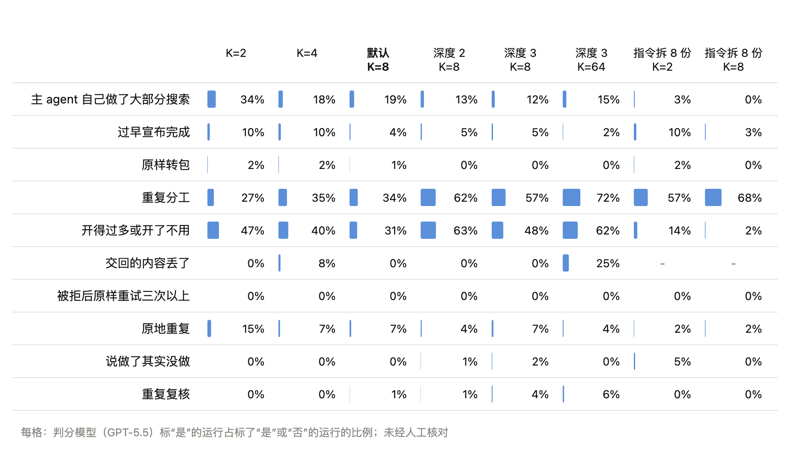

## 摘要

DSH 通过递归深度上限 D 和同时存活上限 K 限制 subagent，默认 K=8、D=1。

共 5,073 次运行，模型 v41flash（max），命令行一次性运行：调研报告题 66 道（DeepResearch Bench II 中文全集）、办公报告题 2 道、表格检索题 65 道、代码题 8 道。逐格改 K 和 D，与默认比质量、费用和时间：

- 开 subagent：调研题分数 +2.8（95% CI [1.1, 4.4]，显著），费用 ×2.6（每次 7.7 元，不开 2.7 元），时间不变；办公报告题多写对 9 个百分点（8.1 元对 2.0 元）；大型编码题隐藏测试全过 8/8，不开只有 1/8，费用 ×4.7（19.4 元对 4.1 元）。
- K：调研类任务上模型同时只开 3～4 个 subagent，K≥4 之后没有区别（K=4 对 K=8：+0.0，[−1.6, +1.6]）。只有题面要求拆成 8 份时 K 才起作用，K 每翻一倍分数 +1.7（显著）；大型编码题全过数 K=1/2/4/8 依次是 3/4/5/8。
- D：主要影响费用。D=2 费用 ×1.57（每次 13.6 元），分数 −0.1（[−1.5, +1.3]）；D=3 对 D=2 −0.6（[−2.5, +1.2]）。
- agent行为相关：
- 四个单 agent 各写一份再合并：比默认 +6.4（[4.2, 8.5]），费用 ×1.9（每次 12.6 元，默认 8.0 元），时间 ×2.3，是所有设置里分数最高的。单 agent 加大搜索量、题面指定拆 3 份或 8 份，都没有显著提升。
- 题面要求主 agent 只做规划、不自己搜索：−5.4（[−9.2, −1.7]）。
- 模型不知道 K 和 D 的上限，默认设置下 57% 的开 subagent 调用被深度上限拒绝默认设置下开 ，被拒后 59% 换个说法再开。
- 各 agent 之间重复不多，被两个以上 agent 打开过的网页占 4%–6%。
- 主 agent 自己做了约三分之一的搜索。
- headless 下主 agent 回答完就退出，此时 subagent 可能还没做完，D≥2 时会崩溃
- 换 v4-pro：开 subagent +1.9（[−0.8, +4.6]），不显著；只有约 35% 的运行开了 subagent。

建议：保留默认值 K=8、D=1。按事先定的推荐规则，调研题上 K=1 也够格（费用 ×0.59，每次 4.4 元，分数 −1.5，[−3.1, +0.1]），可以考虑作为办公用户的省钱模式。但大型编码题全过只有 3/8，办公报告题少写对约 5 个百分点，所以不适合对所有用户直接更改。

## 背景

在小红书上收到大量用户反馈 DSH 喜欢开很多 subagent，Token 消耗很快。以其中三个外部用户的 session log 为例：

| 日志 | 任务 | subagent | 递归数量（第 1/2/3 层） | 主 agent 开的 subagent 数量 | 第四层递归尝试被拒数量 | 最大同时存活数 | Subagent token（不含缓存 / 缓存命中 / 输出） |
|---|---|---|---|---|---|---|---|
| A | 新加坡、韩国旅游攻略（办公，联网） | 24 | 2 / 4 / 18 | 2 | 21 | 22 | 249 万 / 8207 万 / 59 万 |
| B | 调研 DSH 记忆插件（读代码） | 18 | 5 / 10 / 3 | 5 | 0 | 18 | 220 万 / 9224 万 / 64 万 |
| C | 硬件选型报告（办公，联网） | 45 | 7 / 14 / 24 | 7 | 15 | 27 | 282 万 / 3790 万 / 43 万 |

- subagent 倾向于递归，而不是在同一层级内追加。
- 一般会用到允许的最大递归深度，A、C 里第 3 层 subagent 数量最多，还分别有 21、15 次尝试开第 4 层。

问题探讨：DSH 可以设置 subagent 的最大递归深度 D（maxDepth）和最大同时存活数量 K（maxActiveSubagents）。在日常任务（代码任务和办公任务）上，这两个上限各设多少合适？目前的默认是 D=1、K=8。这涉及到每次任务的花费以及 subagent 的收益。

## 竞品的默认值

| | 深度 | 同时存活 |
|---|---|---|
| DSH | 1 | 8 |
| Claude Code subagent | 默认 3 层（环境变量可改，设 1 就是禁止嵌套；历史版本在 5、1、3 之间改过） | 20 |
| Claude Code agent teams | teammate 不能再建 team（等于一层） | 没有硬上限，文档建议 3–5 |
| Claude 平台 Managed Agents | 一层 | 25 |
| Cursor subagent | 最多两层，第二层不能再开 | 文档没写 |
| Cursor 并行 agent | — | 8 |

- 深度上一般1-3之间；同时存活的数量大家都在 8–25。
- 两家的文档都把 subagent 的好处写成上下文隔离，不是更快：
- Cursor 写 5 个并行约 5 倍 token、简单任务主 agent 自己做更快；
- Anthropic 的文档写多 agent 要 3–10 倍 token、整体往往更慢，子任务产出超过约 1,000 token 才值得隔离，并把"简单查询派了 50 个 subagent"列为首要失败。
- Anthropic 研究系统的 lead 一次派 3–5 个，和我们量到的模型自己开 3–4 个是一个量级。
- 没有一家按深度或同时存活的数量分档测过，也没有同等预算下单 agent 的对照。Cursor 的 GPU kernel 那篇（+38%）基线是单 agent 优化过的代码，SQLite 那篇的单 agent 只做了非正式评分；Anthropic 的"比单 agent 高 90.2%"是内部研究题，题量没公布。

## 实验设置

- 模型：DeepSeek V4.1 Flash（推理强度 max）；另用 v4-pro 跑 40 道调研题做对照
- 设置：不开 subagent（D0），D=1/2/3 × K=1/2/3/4/8/16/64；对照组：单 agent 多搜索、单 agent 分 8 段做、四个单 agent 各写一份再合并、题面要求拆 3 份或 8 份、题面要求主 agent 只做规划
- 运行：每次一个容器；同一道题的各设置一起提交，顺序随机；10/1 到 10/10 分批跑完
- 分析：调研题上的 9 个确认性对比开跑前注册，用分层模型（题为随机效应）加 Holm 校正；文中"显著"指 95% CI 不含 0 且校正后 p<0.05。其余任务、其余设置只报描述，不做显著性判断

| 任务 | 题数 | 运行数 | 判分 |
|---|---|---|---|
| 调研报告（DeepResearch Bench II 中文全集，联网） | 66 | 2,294 | 评测集官方的 GPT-5.5（effort high）；Opus 复判 20% 的报告，人工核对 120 条判定 |
| 办公报告（自己写的 2 道，联网，重复多次） | 2 | 1,200 | 事先写定的事实清单 |
| 表格检索（WideSearch 子集，联网） | 65 | 233 | 评测集官方脚本 |
| 代码（61 个文件的大型包、24 道练习不限时和限时两档、16 步串行、4 道练习、读 DSH 源码 2 道） | 8 | 1,346 | 隐藏测试、评分要点 |

## 结果

### （K，D） 对结果的影响

调研题 62 道（剔除泄漏后），每个设置和默认（D=1、K=8）比。横轴是费用倍数（对数刻度），纵轴是分数差，线是 95% CI。元是每次运行的平均花费（模型费加搜索费）；倍数按同题配对算，所以和两列相除会差一点。

| 设置 | 运行数 | 分数差 | 费用（元/次） | 费用倍数 | 时间 |
|---|---|---|---|---|---|
| 不开 subagent | 186 | −2.8 [−4.4, −1.1] | 2.7 | ×0.38 | ×0.94 |
| K=1 | 66 | −1.5 [−3.1, +0.1] | 4.4 | ×0.59 | ×0.94 |
| K=2 | 66 | −1.1 [−2.7, +0.5] | 6.1 | ×0.81 | ×1.00 |
| K=4 | 66 | +0.0 [−1.6, +1.6] | 7.7 | ×0.99 | ×0.96 |
| 默认（D=1、K=8） | 132 | — | 7.7 | — | — |
| D=2，K=8 | 132 | −0.1 [−1.5, +1.3] | 13.6 | ×1.57 | ×1.13 |
| D=2，K=16 | 66 | +2.2 [+0.6, +3.9] | 15.7 | ×1.64 | ×1.21 |
| D=3，K=8 | 66 | −0.8 [−2.5, +0.9] | 12.9 | ×1.63 | ×1.12 |

- 结果：比默认便宜的设置分数都低一点，比默认贵的设置分数没有跟着涨。
- D=2、K=16 是唯一高于默认的（+2.2），但费用 ×1.64；它对 D=2、K=8 的确认性对比校正后不显著（+1.8，p=0.23）。
- 开 subagent 多出的分在信息召回（+3.3）和分析（+3.7）上，呈现没有变化。

### K

每个设置下，同时存活的 subagent 峰值超过 k 的运行比例。
默认设置下中位数 3 个，90% 的运行不超过 4 个，最多 6 个，K=8 一次都没被碰到上限；
K=4 时只有 9% 的运行有调用被拒

质量、费用、时间随 K 的变化。蓝：原题面；橙：题面要求拆 8 份；绿：大型编码题

- 原题面：K 从 1 到 8，分数从 −1.5 升到 0，费用从每次 4.4 元升到 7.7 元（×0.59 到 ×1），时间不变。
- 题面要求拆成 8 份来做：模型想同时开 8 个，K<8 时都有调用被拒。K 每翻一倍分数 +1.7（[+0.6, +2.8]，显著）；K=2 对 K=8 −3.2，时间 ×2.1。
- 大型编码题：每次运行主agent都想同时开 10 个以上，全过数 K=1/2/4/8 依次是 3/4/5/8，模型费 5.9/9.0/13.3/19.4 元。
- v4-pro 开得更少，只有约 35% 的运行开了 subagent。
- 结论：如果规则是"某项指标有收益、其余指标不显著变差、上限确实被触发"就可以替代默认。调研题上 K=1 满足（费用 ×0.59，每次 4.4 元对 7.7 元，分数 −1.5，[−3.1, +0.1]），但结论只适用于调研题；同一个 K=1 在大型编码题上全过 3/8，办公报告题少写对约 5 个百分点。所以如果DSH 只有一个默认值，所以保留 K=8。如果允许分类路由设置，可以考虑减少办公任务开subagent的倾向。

### D

| 对比 | 分数差 | 前一格的费用（元/次） | 费用倍数 | 时间 |
|---|---|---|---|---|
| D=2 对 D=1（K=8） | −0.1 [−1.5, +1.3] | 13.6（D=1 是 7.7） | ×1.57 | ×1.13 |
| D=3 对 D=2（K=8） | −0.6 [−2.5, +1.2] | 12.9 | ×1.05 | ×0.99 |
| D=2 下 K=16 对 K=8 | +1.8 [+0.2, +3.5]，校正后 p=0.23 | 15.7 | ×1.03 | ×1.06 |

- D=2相对D=1，费用增加50% 质量没有显著提升，不建议默认允许递归
- D 只要放开，模型一定会试图继续往下开递归：D=3、K=64 时同时存活中位数 9 个，最多 44 个，费用 ×2.3（每次 24.6 元，最贵的一格），分数 +0.9（费用显著增加，对质量影响不显著）。
- 退出时崩溃（issue #5063）：调研题 24 次，全在 D=2、3；办公报告题 D=2、3（K=8）的 120 次里有 41 次。让主进程等 subagent 做完再退出后基本消失。

### 鼓励agent多搜索、拆分做、做完再合并对结果的影响

同一批 40 道题（剔除泄漏后 38 道），都和不开 subagent 比。

| 做法 | 分数差 | 费用（元/次） | 费用倍数 | 时间 |
|---|---|---|---|---|
| 不开 subagent | — | 2.7 | — | — |
| 默认（D=1、K=8） | +2.2 [+0.6, +3.7] | 8.0 | ×2.6 | ×1.0 |
| 单 agent，至少搜 150 次、打开 250 个网页 | +0.1 [−2.0, +2.2] | 7.0 | ×2.7 | ×1.7 |
| 单 agent，拆成 8 段自己依次做 | +0.9 [−1.1, +2.8] | 2.8 | ×1.0 | ×1.0 |
| 题面要求拆成 3 份交给 subagent | +0.5 [−1.6, +2.7] | 8.3 | ×3.0 | ×1.2 |
| 题面要求拆成 8 份交给 subagent | +1.0 [−1.1, +3.2] | 17.0 | ×6.2 | ×1.3 |
| 四个单 agent 各写一份，再合并 | +8.5 [+6.1, +10.9] | 12.6 | ×4.9 | ×2.3 |

- 四个单 agent 各写一份，再合并相对默认：分数+6.4（[+4.2, +8.5]），费用 ×1.9（12.6 元对 8.0 元），时间 ×2.3；多出的分在信息召回（+6.9）和分析（+8.5）。
- 鼓励agent多搜索相对默认：搜索请求数 ×4.2，分数没变，时间多七成。
- 题面指定拆分：都不比模型自己决定好，拆 8 份时呈现分比不开还低 4.9（[−8.7, −1.1]）。
- 原因（推测）：几次独立的完整尝试找到的资料不同，合并时互相补上；把一道题切成几块做不到这一点。

### 花费

调研题主批，每次运行的 token 中位数（万）和花费。合计 = 模型费 + 搜索费：模型费是日志里的 token 数乘公开价目表，算得准；搜索费是搜索请求数乘抽样实测的单价（日志里没有搜索用量），是估算。

| 设置 | 运行数 | 没进缓存的输入 | 读缓存的输入 | 输出 | 缓存命中率 | 模型费 | 搜索费 | 合计（元/次） |
|---|---|---|---|---|---|---|---|---|
| 不开 subagent | 186 | 14.6 | 712 | 7.9 | 98.0% | 1.3 | 1.5 | 2.7 |
| K=1 | 66 | 23.0 | 973 | 12.0 | 97.7% | 1.9 | 2.4 | 4.3 |
| K=2 | 66 | 37.2 | 1,493 | 18.2 | 97.6% | 2.9 | 3.3 | 6.2 |
| K=4 | 66 | 43.1 | 1,836 | 20.5 | 97.7% | 3.4 | 4.4 | 7.8 |
| 默认（D=1、K=8） | 132 | 42.2 | 1,570 | 21.4 | 97.4% | 3.4 | 4.3 | 7.7 |
| D=2，K=8 | 132 | 80.4 | 3,030 | 39.3 | 97.4% | 5.9 | 7.5 | 13.5 |
| D=2，K=16 | 66 | 93.8 | 3,454 | 40.1 | 97.4% | 7.4 | 9.0 | 16.4 |
| D=3，K=8 | 66 | 78.3 | 2,890 | 39.5 | 97.4% | 6.2 | 7.2 | 13.3 |
| D=3，K=64 | 66 | 109.0 | 4,926 | 63.8 | 97.8% | 12.2 | 15.5 | 27.7 |
| 题面要求拆 8 份，K=8 | 132 | 89.9 | 3,767 | 49.3 | 97.7% | 7.3 | 8.8 | 16.2 |

- 缓存命中率各设置都在 97.4%–98.0%，开 subagent、放开深度都没把它压下去。每个 subagent 自己那条会话的前缀在它自己的多轮里照样复用。
- 多出来的钱是量：开 subagent 以后没进缓存的输入 ×2.9、读缓存 ×2.2、输出 ×2.7；D=3、K=64 是不开的七倍上下。
- 一半的钱花在搜索上：默认每次 7.7 元里模型 3.4 元、搜索 4.3 元。搜索那一半是估算的，模型那一半是实数。
- 全部运行加起来：调研题和代码题这批 2,200 次共 2.27 万元（模型 1.14 万、搜索 1.13 万），办公报告题和其余任务那批 2,873 次共 1.70 万元，两批合计约 4.0 万元。
- token 是中位数，元是平均，所以两列不成比例：几次极贵的运行把平均抬上去了。

### 编码题

大型编码题，深色是文件全部写完的时间，浅色是写完以后到主 agent 给出最终回答的时间。

- 三道编码题各设置的测试通过率都在 97%–100%，差别在大型编码题（61 个文件、3,737 个隐藏测试）的全过数：不开 1/8，默认 8/8，费用 ×4.7（模型费每次 19.4 元对 4.1 元；不联网，没有搜索费）。
- 开 subagent 后文件写得更早（6 分钟，不开 12 分钟），但最终回答更晚（32 分钟，不开 18 分钟），写完以后还用了 26 分钟。
- 24 道独立练习：开不开分数一样，开了费用 ×2.2（4.3 元对 1.8 元）。
- 16 步串行题：模型不开 subagent，每次 0.09 元。

### v4-pro

同一批题上，flash 和 v4-pro 各自和自己的默认比。

- 开 subagent：+1.9（[−0.8, +4.6]），不显著。
- D 放开后 v4-pro 不像 flash 那样多花钱：D=3、K=64 费用 ×0.94，flash 是 ×2.9。
- 绝对价钱反过来：v4-pro 默认每次平均 12.7 元（中位 5.5，少数运行极贵），不开 5.0 元；同一批题 flash 默认 8.0 元。v4-pro 的单价是 flash 的四倍多，但它开的 subagent 少。

### 编排约束

- 设置：题面要求主 agent 只拆任务、汇总结果，不自己搜索和打开网页。
- 结果：分数 −5.4（[−9.2, −1.7]），分析分 −8.6，费用 ×1.28（11.3 元对 9.4 元）。

## 行为

数据：调研题主批 1,784 次运行的会话日志。前面几条是脚本从日志直接数的；最后两条（再派活分类、行为清单）是 GPT-5.5 标注的，人工核对没做，改由 Opus 5.5 在看不到标注的情况下抽样盲核。

| 设置 | 运行数 | 每次运行的 agent 数（含主 agent） | 开 subagent 的调用 | 开成 | 被深度拒 | 被 K 拒 | 主 agent 自己做的搜索占比 | 回答时还有 subagent 在跑 |
|---|---|---|---|---|---|---|---|---|
| K=1 | 66 | 2.1 | 4.3 | 1.1 | 1.5 | 1.8 | 60% | 2% |
| K=2 | 66 | 3.1 | 6.3 | 2.1 | 2.8 | 1.3 | 45% | 11% |
| 默认（D=1、K=8） | 132 | 3.7 | 6.4 | 2.7 | 3.6 | 0.0 | 36% | 5% |
| D=2，K=8 | 132 | 6.6 | 9.7 | 5.6 | 2.5 | 1.5 | 28% | 7% |
| D=3，K=64 | 66 | 13.2 | 16.2 | 12.2 | 4.0 | 0.0 | 23% | 11% |
| 题面要求拆 8 份，K=8 | 132 | 9.1 | 13.7 | 8.1 | 5.6 | 0.0 | 6% | 4% |

- 被拒：默认设置下平均每次运行发起 6.4 次开 subagent 的调用，3.6 次被深度上限拒绝（全部运行合起来 839 次里 479 次，57%），都是第一层 subagent 想再往下开；K=8 一次没拒过。其余任务上合起来也是一半被拒（25,010 次调用里 12,788 次）。
- 被拒以后的下一步（全部设置合起来）：被深度拒的 4,397 次调用里，59% 换个说法再开（深度不变，再开也开不成），27% 改成自己搜索或打开网页，11% 跑命令。被 K 拒的 3,096 次里，57% 再开，7% 先查 agent 列表。
- 主 agent 自己动手：默认设置下主 agent 自己的搜索和打开网页占整棵树的 36%；K=1 时 60%；题面要求拆 8 份时只有 6%，而这一格分数没有更高。
- 重复：重复出现的搜索词（不论是不是同一个 agent 搜的）占全部搜索词的 0.1%–0.5%；被两个以上 agent 打开过的网页，默认 3.9%，D=2 5.1%，D=3、K=64 6.0%。办公报告题上，subagent 交回的写对的事实 87%–92% 只在一个 subagent 的消息里出现。
- 交回：办公报告题上，subagent 交回的写对的事实只有 3%–5% 没进最终报告。
- 回答时还有 subagent 在跑：默认 5%，D≥2 和 K=2 时 7%–11%。headless 下这些 subagent 会被中止，D≥2 时还会让进程崩溃。
- K 放大之后：D=3、K=64 每次运行 13.2 个 agent、16.2 次开 subagent 调用，同时存活中位 9、最多 44，分数 +0.9（不显著），费用 ×2.3。被 K 拒以后只有 7% 的下一步是去查 agent 列表，模型基本不看自己手下有几个在跑。
- 口径：上表、重复、主 agent 占比都是脚本从会话日志直接数的；下面两张图的分类是 GPT-5.5 标的，Opus 5.5 盲核过一部分。日志里没有的量不估：消息从发出到送达的延迟、同时在推理的 agent 数都没有可信的起止时间，没算。

再派活分类：每一格里试图再往下派活的 subagent，按它派出去的任务分类（GPT-5.5 标注，Opus 5.5 抽 30 条盲核）。

- 原题面下 39%–53% 的 subagent 会试图再往下派活，默认设置下这些尝试全被深度上限拒绝；题面要求拆 8 份时是 30%。
- 派出去的任务 96% 是把自己的任务继续拆开（分片 71%、收窄 25%），原样转包 2%，新子题 1%，复核 1%。
- 核对：Opus 5.5 在看不到标注的情况下，对每类 6 条、共 30 条重新分类，和 GPT-5.5 一致 67%（kappa 0.58）。分片 6/6、复核 6/6、原样转包 4/6 一致；GPT-5.5 判为收窄的 6 条里 Opus 只同意 1 条，另外 5 条判为分片，判为新子题的 6 条里 3 条判为分片。所以分片和收窄只合起来报，“原样转包很少”这一条站得住。

行为清单：十项行为在每一格里被标"是"的运行比例（GPT-5.5 标注，Opus 5.5 抽 58 条盲核）。

- 重复分工：默认 34%，D=2 62%，D=3、K=64 72%，题面要求拆 8 份 68%。
- 开得过多或开了不用：默认 31%，D=2 63%，D=3、K=64 62%。
- 原样转包、被拒后原样重试三次以上、说做了其实没做：都在 0%–5%。
- 模型标的"重复分工"比脚本数的重复高得多：模型看的是任务范围有没有重叠，脚本只认完全相同的搜索词和网址。
- 核对：每项抽 GPT-5.5 判"是"和判"否"的各 3 条（"被拒后原样重试三次以上"全批只有 1 条"是"），共 58 条，只给 Opus 5.5 看行为定义和证据句前后几行。能判断的 27 条里 26 条和 GPT-5.5 一致，唯一不一致的是"原样转包"仅有的那条"是"。另外 31 条只看这几行判断不了，其中"开得过多或开了不用"标"是"的 3 条全判不了，这一项的比例不作数；"重复分工""主 agent 自己做了大部分搜索""过早宣布完成"被核到的"是"都对，但每项只核了 2–3 条。

## 模型侧问题

- 上限不可见，只能撞：默认设置下每次运行发起 6.4 次开 subagent 的调用，3.6 次被深度上限拒绝（839 次里 479 次）；其余任务上也是一半。把 K=2 写进工具说明以后，被拒的调用基本没有了，分数没变——说明这部分能在提示里补上。
- 被拒以后不改做法：被深度拒的 4,397 次调用里 59% 换个说法再开（深度没变，再开也开不成），27% 改成自己搜索或打开网页，11% 跑命令；被 K 拒的 3,096 次里 57% 直接再开，7% 先查 agent 列表。
- 派活时假定对方看得见对话：78 个 fork 里 69 个实际从零开始（父 agent 还在第一轮，没有可复制的轮次），模型写的任务说明却按"你已经看过前面的讨论"来写。
- 只编排不动手会掉分：题面要求主 agent 只拆任务、不自己搜索，分数 −5.4（[−9.2, −1.7]），分析分 −8.6。默认设置下主 agent 自己做掉三分之一的搜索，这部分是现在分数的一部分。
- 拆活本身不差：subagent 再往下派的任务 96% 是把自己那份继续拆（分片加收窄），原样转包 2%。问题不在转包，在拆完没地方放——默认设置下这些尝试全被拒。

## 判分验证

| 检查 | 结果 |
|---|---|
| GPT-5.5 自己判两遍（10% 的报告，14,345 条评分项） | kappa 0.95；报告总分相关 0.99，平均差 1.9 分 |
| Opus 复判（20% 的报告，29,288 条） | kappa 0.85；报告总分相关 0.97；Opus 平均高 4.5 分 |
| 换判分模型后的对比 | 两个模型都判过的 31 道题上，默认对不开：GPT-5.5 +1.9，Opus +1.5，差 −0.5（[−2.6, +1.7]） |
| 报告加三成无关但正确的文字（20 份） | 总分 −0.5（[−1.5, +0.5]），不偏向长报告 |
| 插入看起来合理的错误事实（60 条） | 3 条被判为满足（5%） |
| 人工核对（120 条，能判断的 81 条） | 与 GPT-5.5 一致 68%（kappa 0.37），与 Opus 一致 72%；按总体比例加权，GPT-5.5 准确率约 77% |
| 泄漏 | 日志里出现评测集名字、或读过禁用来源的运行全部剔除；人工看了得分最高的 20 份和文字重合最多的 10 份，没有判为照抄的 |

同一道题、同一个设置跑两次的分差（343 对）：中位 6.1，平均 7.9，单次运行的标准差约 7 分。

| 设置 | 配对数 | 标准差估计 |
|---|---|---|
| 不开 subagent | 41 | 10.9 |
| 默认（D=1、K=8） | 64 | 7.4 |
| D=2，K=8 | 62 | 7.6 |
| K=2 | 40 | 5.4 |
| 题面要求拆 8 份，K=8 | 60 | 5.0 |

- 不开 subagent 的运行之间波动最大，标准差是默认的 1.47 倍（[1.12, 1.93]）；开了以后各格之间没有规律。
- 单次运行的噪声（7 分）比我们要报的效应（2.8 分）大，所以所有对比都是同题配对加分层模型，不看单次运行。
- 泄漏按格看：主批不开 subagent 5.9%、默认 3.8%、D=3、K=64 12.1%，开和不开合起来差不多（4.5% 对 4.1%）。只有最宽那一格明显偏高，它本来也只作描述。
- 判分模型和人的一致率不高，主要是判分模型判"满足"、人看节选判"不满足"。设置之间的比较换判分模型后不变，绝对分数要打折扣。
- 人工核对两边都能判断的只有 33 对，默认对不开 −6.1 个百分点（[−23.7, +11.5]），区间太宽，没有结论。

## 工程问题

| 问题 | 现象 | 建议 |
|---|---|---|
| 上限对模型不可见 | 默认设置下 839 次开 subagent 的调用，57% 被拒，全是第一层 subagent 想再往下开 | 把上限写进工具说明，或者到了上限不给第一层这个工具。把 K=2 的上限写进说明后，被拒的调用基本没有了，分数没变 |
| headless 下退出时崩溃 | D=2、3 有 24 次运行在退出时崩溃 | 命令行一次性运行时，主进程等 subagent 做完再退出 |
| fork 出来的 agent 多数没有上下文 | 78 个 fork 里 69 个从零开始（父 agent 还在第一轮，没有可复制的历史），但模型写任务时假定对方看得到对话 | 没有可复制的轮次时报错，或者把当前轮也带上 |
| agent 编号太长 | 每 250 条消息有 1 条把编号抄错一两个字符 | 找不到编号时列出可以发给谁，或者改用短名字 |
| 搜索费用没记录 | 调研题和代码题这批 2.27 万元里搜索占 1.13 万元，会话日志里没有搜索的用量 | 把搜索请求的用量写进日志 |

## Next

- 多份合并做成可选模式：测合并 2 份、3 份够不够；几份并行跑，看能不能不多等。
- 把深度上限告诉模型，看被拒的调用能省多少。
- 大型编码题写完文件后的 26 分钟在做什么，能不能省。
- 行为清单和再派活分类做人工核对（两张表已建好，58 条和 30 条），核对完再报这两项的比例。
- 按角色拆开销：主 agent 和 subagent 各花多少。别家报过 worker 占七成以上 token、贵模型规划便宜模型执行能省八倍钱；DSH 现在不能给 subagent 单独指定模型。
- 不看分数读轨迹：现在的核对都是对着判分结果做的，没做过蒙住分数直接读轨迹找问题。

## 附录

- 实验方案（预注册版，含全部变更记录）、数据和分析脚本：github.com/ZiyaZhang/subagent-limits-eval（私有）
- 在两批运行里都跑过的对比，随机效应合并：默认对不开 +3.1（[1.8, 4.4]）；K=4 对默认 +0.0（[−1.4, +1.5]）；K=1 对默认 −1.2（[−2.6, +0.2]）；D=2 对默认 +0.0（[−1.2, +1.3]）
- 运行中发现的 DSH 异常行为记录：8 条，附源码位置

### 办公报告题、表格检索题和代码题

正文里的调研题之外，这些任务的结果。

办公报告题（自己写的 2 道，按事先定的事实清单判分，主批每组 39–40 份报告；差和倍数对默认，按配对算）：

| 指标 | 不开 subagent | K=1 | K=2 | K=4 | 默认（K=8） | D=2，K=8 |
|---|---|---|---|---|---|---|
| 写对的事实（%） | 56.1 | 64.7 | 67.9 | 73.4 | 71.5 | 75.2 |
| 和默认的差（个百分点） | −15.5 [−19.1, −11.8] | −7.3 [−12.3, −2.3] | −3.7 [−8.6, +1.3] | +1.9 [−2.5, +6.2] | — | +3.6 [−1.1, +8.3] |
| 只算事先定的 63 条 | −9.0 [−13.4, −4.7] | −4.7 [−10.1, +0.6] | −3.5 [−8.2, +1.3] | +0.1 [−3.5, +3.6] | — | +2.8 [−0.9, +6.5] |
| 费用（元/次） | 2.04 | 4.65 | 6.25 | 8.01 | 8.12 | 14.63 |
| 时间（分钟） | 9.4 | 11.9 | 12.0 | 11.4 | 11.2 | 11.2 |
| subagent 数 | 0.0 | 1.9 | 2.6 | 3.5 | 3.6 | 7.9 |

- 其余设置（都对同批的默认）：K=64 −4.7 个百分点（校正后不显著），D=3 +3.6，D=2、K=64 +3.7，D=3、K=64 +1.4，都没测出差别；四个单 agent 各写一份再合并 +7.4（[+3.4, +11.4]，显著），两份合并 −0.3。
- 不开 subagent 改成多查：要求至少搜 150 次、开 250 个网页 −6.4，250/500 −11.4，都显著更差；打开的网页数从 58 涨到 400 和 825，多数是脚本成批存盘。
- 交回：判了 90 份，subagent 消息里写对的事实有 2.7%–5.4% 没进最终报告。
- 把 K=2 的上限写进工具说明：被拒的调用基本没有了，写对的事实 +4.8 个百分点（只算交出完整报告的运行），费用 ×1.22。

表格检索题和一批调研报告题（每题每组 1 次，两组都有效的题：填表 19 道、报告 29 道）：

| 任务 | 组 | 得分 | 和不开的差 | 召回 | 费用（元/次） |
|---|---|---|---|---|---|
| 表格检索 | 不开 subagent | 72.2 | — | 69.9 | 2.24 |
| 表格检索 | 默认 | 74.8 | +2.7 [−0.5, +5.8] | 75.4 | 8.22 |
| 调研报告 | 不开 subagent | 53.5 | — | 48.3 | 2.41 |
| 调研报告 | 默认 | 57.0 | +3.5 [+1.2, +5.9] | 52.5 | 7.56 |

补测 K=4：表格检索 +1.1（[−3.5, +5.7]），调研报告 +0.7（[−3.1, +4.5]），都没测出差别。

代码题（不联网，费用只有模型费）：

| 任务 | 不开 subagent | 默认 | 另外的设置 |
|---|---|---|---|
| 读 DSH 源码 2 道（各 20 次） | 74.8 分 | 76.2 分 | 题面加并行提示 82.9 分；默认对不开 +1.4，没有差别 |
| 24 道练习，限时（各 10 次） | 86.0 分，全过 14.5 道 | 93.0 分，16.7 道 | 并行提示 95.7 分，18.0 道 |
| 24 道练习，不限时（各 20 次） | 96.9 分 | 96.7 分 | K 加到 16 也只有 97.5 分，模型费从 1.69 元涨到 9.86 元 |
| 16 步串行（各 10 次） | 100 分 | 100 分 | 默认下模型不开 subagent |
| 61 个文件的大型包（各 10 次） | 1.9 个隐藏测试没过 | 0.0 个 | 见下 |

- 大型编码题（3,737 个隐藏测试）：默认开 20 个 subagent、一半是复核，模型费 19.85 元，到最终回答 28.4 分钟；不开只要 4.25 元、21.6 分钟，但有 1.9 个测试没过。
- 同一道题要求不复核时，K=1/2/4/8 到最终回答 23.9/15.1/11.9/9.6 分钟，模型费 5.39/6.24/6.52/7.86 元，没过的测试 1.9/1.6/1.3/1.2 个——K 在这里换的是时间。

