# Subagent问题

## 摘要

DSH目前支持通过调整递归深度上限D、同时存活上限K配置subagent,默认K=8，D=1

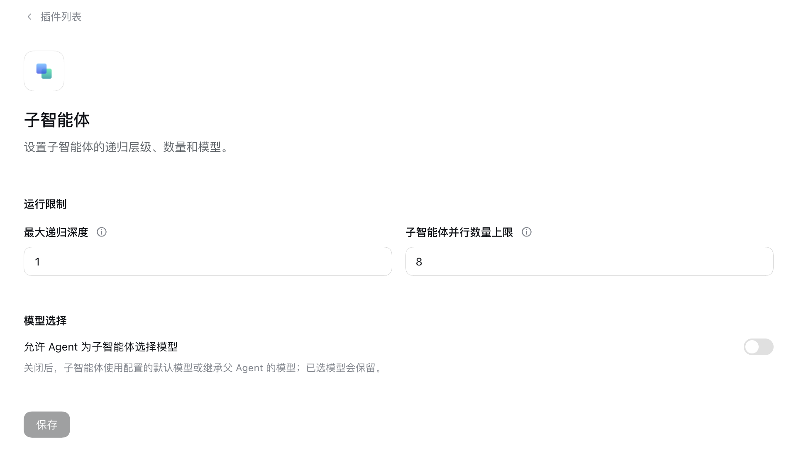

实验通过九种不同类型任务（约 2,700 次运行，v41flash、命令行一次性运行），通过更改K和D，与默认（D=1、K=8）对比质量、费用和时间：

- **K **：调研类任务上模型倾向于只开3～4个subagent，所以调研类任务K大于等于4之后基本没有区别；当K=1、2 时，可以节约20%-60%的费用，但在大型编码题上速度慢1.6–2.3 倍，办公报告题 K=1 少写对约 5 个百分点。

- **D**：**深度主要对费用产生影响，没有带来显著的质量提升。**D从1变为2时，办公报告题的单次任务费用从一次约 8 元变成约 15 元，但报告质量（写对的事实只多 2–4 个百分点，63条+2.2）并没有显著增加。

- **允许开 subagent 会同时导致费用增加和质量增加**：办公报告题开subagent后多写对 9 个百分点，费用是不开的 3.9 倍。代码类任务得分几乎不变，费用 1.6–4.7 倍。

建议：保留默认值K=8、D=1（不允许递归），此外有两个工程问题

1. headless状态下主agent回答完后会退出，此时可能subagent还没做完

1. 模型目前不知道K和D的上限，所以会不断试图继续递归直到报错

## 背景

在小红书上收到大量用户反馈 DSH 喜欢开很多 subagent，Token 消耗很快。以其中三个外部用户的 session log 为例：

| 日志 | 任务 | subagent | 递归数量（第 1/2/3 层） | 主 agent 开的 subagent 数量 | 第四层递归尝试被拒数量 | 最大同时存活数 | Subagent token（不含缓存 / 缓存命中 / 输出） |
|---|---|---|---|---|---|---|---|
| A | 新加坡、韩国旅游攻略（办公，联网） | 24 | 2 / 4 / 18 | 2 | 21 | 22 | 249 万 / 8207 万 / 59 万 |
| B | 调研 DSH 记忆插件（读代码） | 18 | 5 / 10 / 3 | 5 | 0 | 18 | 220 万 / 9224 万 / 64 万 |
| C | 硬件选型报告（办公，联网） | 45 | 7 / 14 / 24 | 7 | 15 | 27 | 282 万 / 3790 万 / 43 万 |

- subagent 倾向于递归而不是同一层级内追加。

- 一般会用到允许的最大递归深度，A、C 里第 3 层 subagent 数量最多，还分别有 21、15 次尝试开第 4 层。

**问题探讨：DSH 可以设置 subagent 的最大递归深度 D（maxDepth）和最大同时存活数量 K（maxActiveSubagents）。在日常任务（代码任务和办公任务）上，这两个上限各设多少合适？目前的默认是 D=1、K=8。这涉及到每次任务的花费以及subagent的收益。**

## 结论

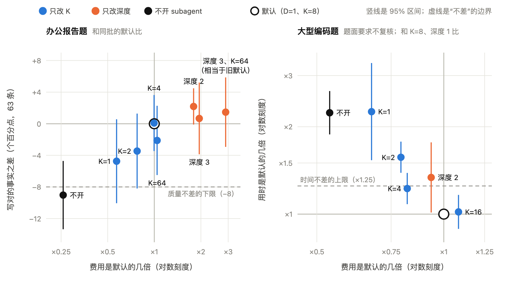

> 调研类任务：联网查资料的三种（办公报告题、评测集填表题、评测集报告题）。其余六种不联网，叫代码类任务

**默认值D=1、K=8 不需要调整，可以考虑办公任务让用户选择是否开subagent？**

- 开 subagent 同时升高质量和费用：办公报告题写对的事实从 76.5% 到 85.5%（+9.0 个百分点）；**费用是不开的 3.9 倍（结果 1、2）**。这里是否能让用户自己选择是否开subagent？价格上升的有点多

- K 大于8后没有效果显著提升：K=16、64 在质量、时间、费用上都没测出好处（结果 4）。

- K 变小后会带来效果下降：
  - K=1 让办公报告题的得分下降 4.9 个百分点
  - 大型编码题在题面要求不复核时，K=1、2、4 的用时是 K=8 的 2.25、1.57、1.22 倍
  - 调研类任务上 K=4 的质量和K=8 基本持平〔办公报告题 A，两个评测集 B〕，价格也基本持平（结果 4）。原因是模型倾向于开3-4个subagent不会触及上限。

- 允许递归后（深度 2）会导致费用进一步提高：允许递归一层时，办公报告题的费用是不允许递归时的 1.87 倍，写对的事实新增 2–4 个百分点（63 条 +2.2、区间含 0，全清单 +3.8）（结果 5）

**建议**

1.  实验过程中遇到的DSH的问题：命令行一次性运行时，进程退出前不会等 subagent 做完；模型不知道K和D的上限，会持续试图开subagent。

1. K不用降到4：调研类任务因为无法触发上限，4 和 8 结果是一样的；对于大型编码题，K=4的费用是 K=8 的 0.70–0.82 倍，代价是用时 1.22 倍。

## 假说

| 假说 | 根据假说预测的实验结果 | 结果 | 在哪 |
|---|---|---|---|
| 1. K 只在模型想开得比它多时起作用 | 限时 24 题上得分随 K 升高，到 8 附近到顶 | 说法成立；这条预想大体对上（限时的题只作参考） | 结果 3、4 |
| 2. 放开深度后subagent质量会提升 | 深度 2，K不变：评分有显著提高 | 不成立：那一组费用是 2.8 倍，只放开深度是 1.5–1.9 倍；质量没测出提高 | 结果 5 |
| 3. 开 subagent 让用户少等 | 不限时 24 题上开 subagent 用时不到不开的一半，K 越大越快 | 不成立：文件写完得更早，最终回答没有更早；大型编码题去掉复核以后才更快 | 结果 6 |
| 4. 多写对靠的是查得多，不是靠分给几个 agent 各查一块 | 单 agent 查够同样多，写对的和默认相差 5 个百分点以内 | 只对了一半：一个 agent 自己多查没追上默认；四个单 agent 各查各的再合并，不比默认少 | 结果 7 |

## 方法

表 2 九种任务。前三种是调研类，后六种是代码类。

| 任务 | 做什么 | 质量怎么算 | 每组跑几次 |
|---|---|---|---|
| 办公报告题 | 联网调研后写长报告，2 道（新加坡旅行攻略、三款服务器 CPU 选型），取自背景里的用户日志 | 写对的事实占比（63 条的清单） | 每题 20 次 |
| 评测集填表题 | 联网收集信息填表：公开评测集 WideSearch 的 65 道中文题里，去掉单 agent 已经做到 90 分的 35 道和搜索时认出评测集的 6 道，剩下的 24 道；对比用的不开组是和默认同一批重新跑的 | 和标准答案逐格比对 | 每题 1 次 |
| 评测集报告题 | 联网调研写报告，公开评测集 DeepResearch Bench II 的 30 道 | 评测集自带的评分项 | 每题 1 次 |
| 读代码题 | 读 DSH 源码，回答问题、写方案，2 道 | 判分模型按要点和评分表打分 | 每题 10 次 |
| 小编程题 | 4 道 Python 练习 | 隐藏测试 | 10 次 |
| 限时 24 题（只作参考） | 24 道 Python 小题，限时 3 分钟。实际使用没有时限，所以方案里写明只作参考 | 隐藏测试 | 10 次 |
| 16 步串行题 | 16 步数据处理，后一步要用前一步的答案，没法分头做 | 对标准答案 | 10 次 |
| 不限时 24 题 | 同样 24 道小题，不限时 | 隐藏测试 | 10–20 次 |
| 大型编码题 | 按规格写一个 61 个文件的 Python 包 | 3,737 个隐藏测试 | 10 次 |

## 结果

### 结果 1： subagent 行为观测

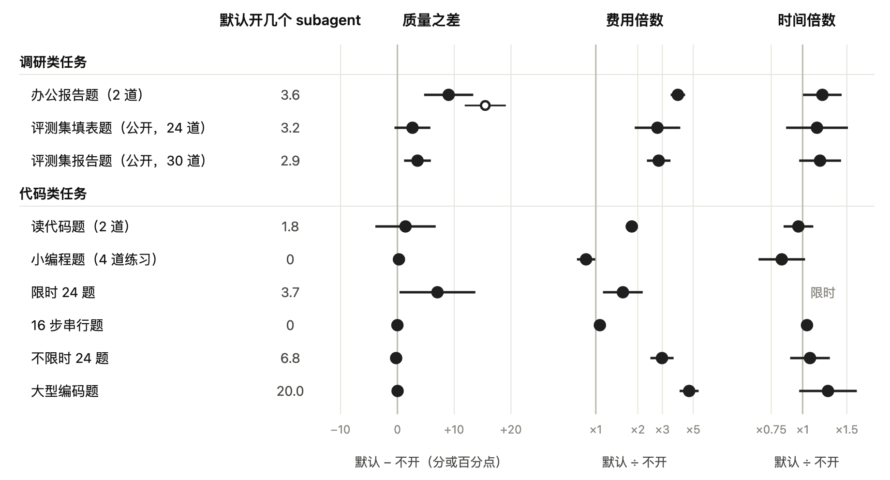

图 1 默认对不开 subagent（都是原题面）：默认下模型开几个、质量高多少、费用和时间是不开的几倍。点是估计值，横线是 95% 区间；办公报告题的空心点是全清单。

- 调研类任务：办公报告题写对的事实从 76.5% 到 85.5%（+9.0 [+4.7, +13.4]，40 对），评测集报告题高 3.5 分，评测集填表题没测出（+2.7 [−0.5, +5.8]）。费用是不开的 2.8–3.9 倍。

- 写错的事实各组每份报告都是 1.0–1.8 条，开不开、放不放开深度都没测出差别（默认对不开 −0.38 [−1.12, +0.37]）。

- 代码类任务：小编程题、16 步串行题、不限时 24 题和大型编码题两组的平均分都在 96 分以上，相差不到 0.3 分；读代码题 75 分上下，没测出差别（+1.4 [−3.9, +6.7]）；限时 24 题（只作参考）高 7.1 分。模型会开 subagent 的四种任务，费用是不开的 1.6–4.7 倍。

- 用户等的时间，没有一种任务测出缩短（结果 6）。小编程题和 16 步串行题上默认时模型一个 subagent 也不开，两组做的是同一件事。

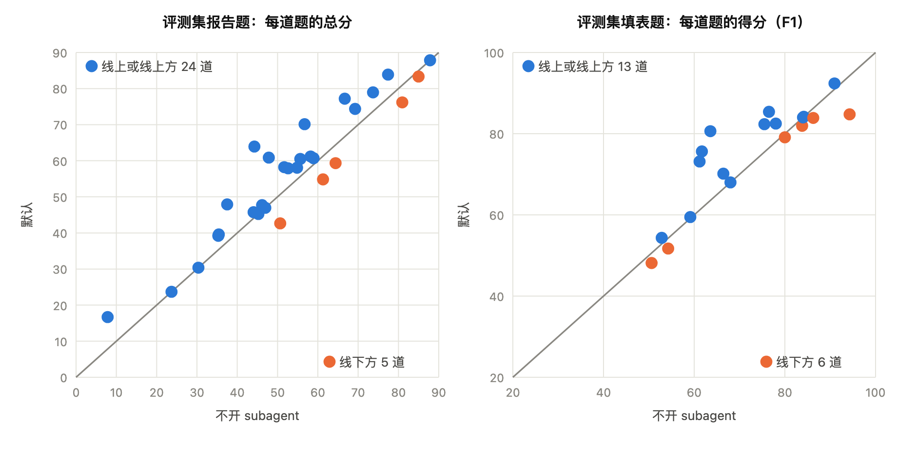

图 2 两个公开评测集，每道题一个点：横轴是不开 subagent 的得分，纵轴是默认的得分，斜线上方是默认更高。

- 按题看：评测集报告题 29 道里默认更高的 19 道、更低的 5 道，其余相同；评测集填表题 19 道里更高 10 道、更低 6 道。

- 每道题涨多少，和这道题默认开了几个 subagent 没看出关系（相关系数 −0.06 和 +0.07；事后分析）。

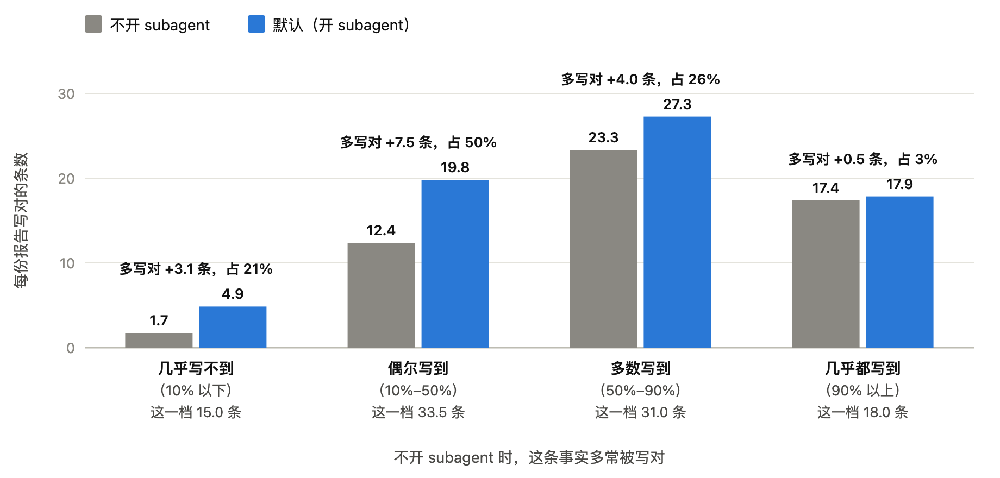

图 3 办公报告题：默认比不开多写对的事实落在哪一档。全清单的 195 条按不开 subagent 时被写对的频率分成四档；柱子是每份报告在这一档里写对的条数（事后分析）。

- 默认每份报告多写对约 15 条（全清单每题平均 97.5 条）。其中四分之三以上落在单 agent 有时写到、有时写不到的两档；单 agent 几乎都写到的一档只多 0.5 条。

- 两道题分开看（按 63 条）：旅行攻略题四批都显著，多 15–22 个百分点；CPU 选型题多 3–10 个，只有一批显著。

- 这把尺子量的是查得全不全，不是报告好不好用：默认的报告也更长（3.9 万字对 2.3 万字）；判分由模型做，还没有人工核对。

### 结果 2：一次任务花多少钱

表 3 各任务一次运行的平均费用（元；联网的三种任务含搜索费）、每多开一个 subagent 多花的钱（费用对开的个数做直线拟合的斜率）和默认一次运行的 token 数（各 agent 合计，和同一行的费用是同一些运行）。

| 任务 | 不开 subagent | 默认 | 默认开几个 | 每多开一个 subagent 多花（元） | 默认一次的 token（万）：输入 / 输出 |
|---|---|---|---|---|---|
| 办公报告题 | 2.04 | 8.12 | 3.6 | 1.4（旅行攻略题 1.2，CPU 选型题 1.9） | 2,678（98% 读缓存） / 20.8 |
| 评测集填表题 | 2.24 | 8.22 | 3.2 | 2.1 | 2,086（97% 读缓存） / 17.3 |
| 评测集报告题 | 2.41 | 7.56 | 2.9 | 1.9 | 2,451（98% 读缓存） / 24.6 |
| 读代码题 | 0.58 | 1.43 | 1.8 | 0.6 | 930（97% 读缓存） / 6.9 |
| 小编程题 | 0.65 | 0.56 | 0 | 0.2（题面加并行提示时才开） | 141（98% 读缓存） / 5.7 |
| 限时 24 题 | 0.39 | 0.68 | 3.7 | 0.1 | 96（95% 读缓存） / 6.9 |
| 16 步串行题 | 0.09 | 0.10 | 0 | 0.2（题面加并行提示时才开） | 34（96% 读缓存） / 0.8 |
| 不限时 24 题 | 1.69 | 5.44 | 6.8 | 文件写完之前开的 0.2，之后开的 0.8 | 1,808（99% 读缓存） / 53.2 |
| 大型编码题 | 4.25 | 19.85 | 20.0 | 写代码的 0.4，复核的 1.1 | 9,576（99% 读缓存） / 171.9 |

- 调研类任务默认一次 7.6–8.2 元，不开 2.0–2.4 元；大型编码题默认约 20 元，不开约 4 元。

- 每多开一个 subagent，调研类任务多花 1.4–2.1 元（约一半是搜索费），读代码题、小编程题、限时 24 题和 16 步串行题 0.1–0.6 元。大型编码题上写完以后派去复核的 subagent 一个 1.1 元，写代码的 0.4 元。

- 按 token 看：办公报告题默认一次约 2,678 万输入（98% 读缓存）和 21 万输出，输入是不开的 3.8 倍，输出 4.1 倍。

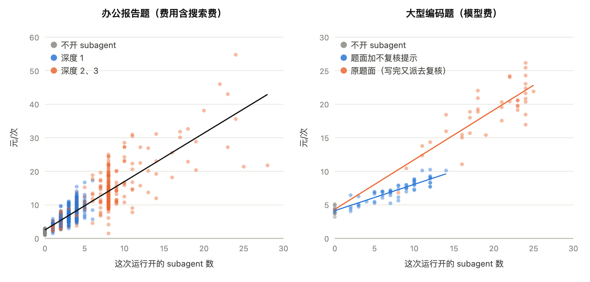

图 4 每个点是一次运行：横轴是这次运行开的 subagent 数，纵轴是费用。左边是办公报告题（含搜索费），右边是大型编码题（模型费）；直线是拟合线。

- 费用随开的个数直线上涨：办公报告题约 2.5 元加 1.4 元乘开的个数。K 和深度是通过改变开的个数来改变费用的（结果 4、5）。

- 同一种设置里各次运行差得远：默认设置跑过的 140 次，最便宜 2 元，最贵 17 元。

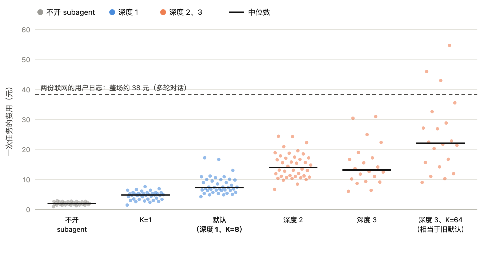

图 5 办公报告题：每个点是一次运行的费用（含搜索费），横线是中位数。虚线是背景里两份联网的用户日志按同样算法得到的整场费用。

- 一次任务的中位数：不开 2 元，默认 7 元，深度 2 是 14 元，深度 3、K=64（相当于旧默认）22 元，最贵的一次 55 元。

- 背景里两份联网的用户日志是多轮对话，按同样的算法每份整场约 38 元；相当于旧默认的 20 次单任务运行里有 3 次超过这个数。

- 联网任务的费用约一半是搜索费（办公报告题默认组 51%）。

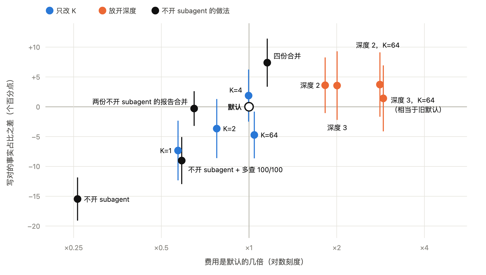

图 6 办公报告题：每种设置和同批的默认比，横轴是费用的倍数，纵轴是写对的事实之差（全清单，个百分点）。竖线是 95% 区间；往右更贵，往上写对的更多。

- 放开深度的四个点都在右边：费用是默认的 1.8–2.9 倍，写对的事实高 1–4 个百分点，区间都跨过 0。

- 只改 K 的点在左边或正中：K=1、2 便宜，写对的也少；K=4、64 的费用和默认一样。

### 结果 3：模型自己想开多少

表 4 默认设置下模型自己怎么开 subagent。“同时活着”指同一时刻没结束的 subagent 数；“同时活着最多”是各次运行里到过的最大值，其余各列是运行次数。

| 任务 | 开了 subagent | 同时活着超过 4 个 | 同时活着最多 | 有调用被 K=8 拒绝 | 有调用被深度上限拒绝 |
|---|---|---|---|---|---|
| 办公报告题 | 40/40 | 7/40 | 6 | 0/40 | 39/40 |
| 评测集填表题 | 20/24 | 9/24 | 8 | 0/24 | 15/24 |
| 评测集报告题 | 25/30 | 2/30 | 5 | 0/30 | 22/30 |
| 读代码题：问答 | 0/10 | 0/10 | 0 | 0/10 | 0/10 |
| 读代码题：写方案 | 10/10 | 0/10 | 4 | 0/10 | 9/10 |
| 小编程题 | 0/10 | 0/10 | 0 | 0/10 | 0/10 |
| 限时 24 题 | 5/10 | 5/10 | 8 | 1/10 | 0/10 |
| 16 步串行题 | 0/10 | 0/10 | 0 | 0/10 | 0/10 |
| 不限时 24 题 | 19/20 | 17/20 | 8 | 1/20 | 1/20 |
| 大型编码题 | 10/10 | 10/10 | 8 | 10/10 | 9/10 |

- 调研类任务：一次运行平均开 2.8–4.0 个，94 次默认运行没有一次调用被 K=8 拒绝；其中 76 次有调用被深度上限拒绝，是 subagent 自己想再往下开。

- 大型编码题一次开 20 个，每次运行都有调用被 K 拒绝。读代码题里的问答题、小编程题和 16 步串行题上，模型自己不开。

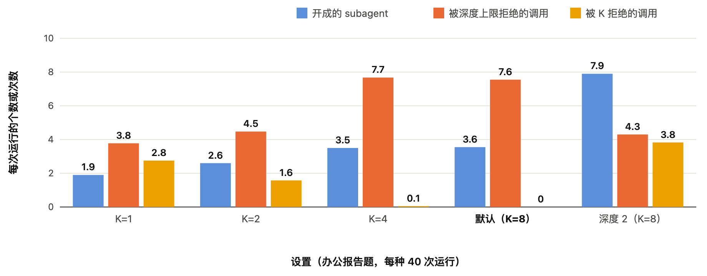

图 7 办公报告题：各种设置下一次运行开出几个 subagent，有几次开 subagent 的调用被深度上限拒绝、几次被 K 拒绝（每种设置 40 次运行的平均）。

- 默认下每次运行开出 3.6 个，另有 7.6 次调用被深度上限拒绝。放开到深度 2，开出 7.9 个，K=8 开始不够用（每次运行 3.8 次调用被 K 拒绝）。

- 全部运行合起来，开 subagent 的调用有一半被上限拒绝（25,010 次里 12,788 次，含把 K 调小的各组）：工具说明里不写上限，模型被拒绝了才知道。这些调用本身花的钱很少，不到全部模型费的 2%。

- 被深度上限拒绝的调用不是重复劳动：办公报告题默认组 39 次运行里的 302 次这样的调用，任务说明平均约 1,900 字，是 subagent 把自己那一块再拆小（比如负责行前准备的 subagent 想再开三个，分别查支付方式、法规和保险、实用信息）；和它自己接到的任务大体相同的不到 10 次。

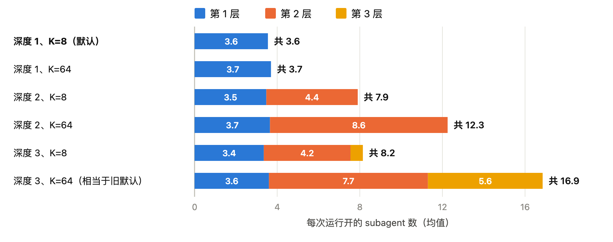

图 8 办公报告题：放开深度和 K 以后，每一层开了多少 subagent（每次运行的平均数）。K 是各层合起来数的。

- 只放开 K 不放开深度，开的个数不变。深度 2 时 K=8 经常用满（31/40 次同时活着的到了 8 个）；第 3 层要把 K 放到 64 才开得多，这就是旧默认下的三层递归。

### 结果 4：K（说法 1）

表 5 K 的每个取值和 K=8 比（深度都是 1）：哪些任务上测出了更好，哪些测出了更差；没列出的都是没测出差别。

| 取值 | 退出时崩溃 | 测出更好的 | 测出更差的 |
|---|---|---|---|
| K=1 | 没有 | 费用：6 个对比都更省（0.38–0.67 倍） | 办公报告题质量 −4.9；不限时 24 题质量 −1.0；大型编码题（不复核题面）用时 ×2.25 |
| K=2 | 没有 | 费用：4 个对比都更省（0.52–0.83 倍） | 大型编码题（不复核题面）用时 ×1.57 |
| K=4 | 没有 | 大型编码题（原题面）费用 ×0.70；大型编码题（不复核题面）费用 ×0.82 | 大型编码题（不复核题面）用时 ×1.22 |
| K=16 | 没有 | 没有 | 没有 |
| K=64 | 没有 | 没有 | 没有 |

说明（表 5）：办公报告题的 K=1、2、4 做过两批，用两批合起来的数；读代码题按事前写定的算法，和小编程题三道题一起算。各任务的数和区间在表 6。

- 没有一个取值只有好处。K=1、2、4 都更省钱，也都让大型编码题在题面要求不复核时更慢；K=1 还让办公报告题少写对。K=16、64 没有测出任何好处。所以 K 保持 8。

- K=4 是比 8 小的取值里代价最小的：只在大型编码题不复核时更慢，原题面下没测出（×1.13 [0.67, 1.90]）。它是费用和等待时间的取舍，下面单独画出来。

- 这些对比多数只有 10–40 对。K=16、64 的时间估计值在 0.91–1.06 倍之间，区间宽到 0.74–1.42 倍：快慢差三成以内，这次测不出。

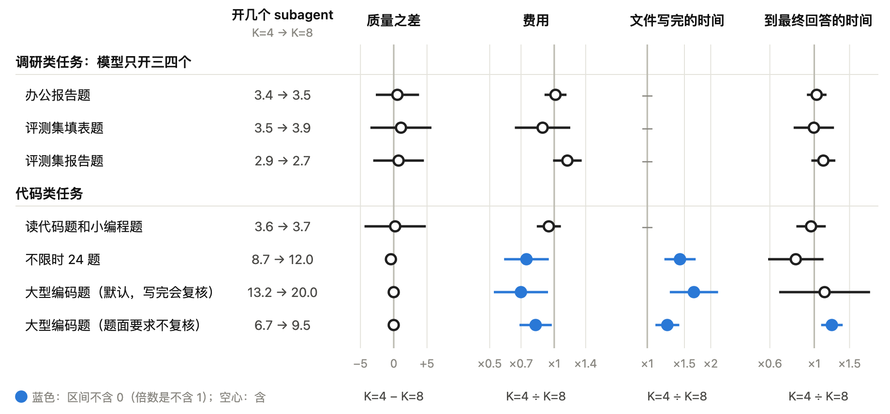

图：K=4 和 K=8 比，一行一种任务。从左到右：两种设置各开几个 subagent、质量之差、费用倍数、文件写完的时间倍数（只有写代码的任务有）、到最终回答的时间倍数；横线是 95% 区间。

- 调研类任务和读代码题：K=4 开的个数和 K=8 差不多（三四个），质量、费用、时间都没测出差别。K=4 时有调用被 K 拒绝的运行，办公报告题 2/40，评测集报告题 3/30，评测集填表题 9/24。调研类任务的费用，降到 4 省不了；降到 1、2 能省（0.52–0.83 倍和更低），K=1 在办公报告题上少写对。

- 能拆成很多块的编码任务（不限时 24 题、大型编码题）：K=4 开得少，钱省 18%–30%；写代码那一段更慢，文件写完的时间是 K=8 的 1.24–1.66 倍。

- 最后要多等多少，看写完以后还做不做别的。题面要求不复核时多等 22%。默认（写完会复核）时没测出差别（×1.13 [0.67, 1.90]）：复核自己要二十多分钟、各次差得远，这时省下的钱主要来自少派了一半复核的 subagent（5 个对 10 个）。

表 6 K 的每个取值对同一批的 K=8（深度都是 1）：质量之差、费用倍数、时间倍数和 95% 区间。

| 任务（题面） | 取值 | 对数 | 质量之差 | 费用倍数 | 时间倍数 |
|---|---|---|---|---|---|
| 办公报告题 | K=1（两批合起来） | 59 | **−4.9 [−9.4, −0.4]**（全清单 −7.1 [−11.2, −3.1]） | **×0.57 [0.50, 0.64]** | ×1.05 [0.91, 1.21] |
|  | K=2（两批合起来） | 60 | −2.4 [−6.1, +1.2]（全清单 −3.3 [−7.5, +0.8]） | **×0.83 [0.73, 0.93]** | ×1.08 [0.94, 1.23] |
|  | K=4（两批合起来） | 60 | +0.6 [−2.7, +3.8]（全清单 +2.0 [−1.8, +5.7]） | ×1.01 [0.90, 1.14] | ×1.03 [0.92, 1.15] |
|  | K=64 | 20 | −2.1 [−6.5, +2.3]（全清单 −4.7 [−8.7, −0.8]） | ×1.04 [0.88, 1.24] | ×0.91 [0.74, 1.11] |
| 评测集填表题 | K=1 | 20 | −1.3 [−4.6, +2.1] | **×0.58 [0.46, 0.73]** | ×1.21 [0.90, 1.62] |
|  | K=4 | 18 | +1.1 [−3.5, +5.7] | ×0.88 [0.66, 1.19] | ×0.99 [0.79, 1.25] |
| 评测集报告题 | K=1 | 29 | −0.6 [−4.4, +3.2] | **×0.52 [0.44, 0.62]** | ×0.94 [0.80, 1.10] |
|  | K=4 | 30 | +0.7 [−3.1, +4.5] | ×1.15 [0.99, 1.34] | ×1.11 [0.97, 1.27] |
| 读代码题和小编程题（三题合起来，题面加并行提示） | K=1 | 30 | −0.5 [−4.7, +3.7] | **×0.64 [0.56, 0.73]** | ×1.24 [1.02, 1.51] |
|  | K=2 | 30 | −1.4 [−6.0, +3.2] | **×0.74 [0.63, 0.87]** | ×0.98 [0.82, 1.16] |
|  | K=4 | 30 | +0.2 [−4.4, +4.8] | ×0.94 [0.83, 1.07] | ×0.96 [0.81, 1.14] |
| 限时 24 题（加并行提示） | K=1 | 10 | −5.8 [−9.2, −2.5] | **×0.45 [0.34, 0.61]** | 限时 |
|  | K=2 | 10 | −4.1 [−8.1, −0.05] | **×0.58 [0.44, 0.76]** | 限时 |
|  | K=4 | 10 | −6.6 [−18.7, +5.5] | ×0.74 [0.54, 1.01] | 限时 |
|  | K=16 | 10 | +0.3 [−1.4, +2.0] | ×0.83 [0.56, 1.21] | 限时 |
| 不限时 24 题（加并行提示） | K=1 | 20 | **−1.0 [−1.6, −0.4]** | **×0.38 [0.29, 0.48]** | ×0.74 [0.55, 1.003] |
|  | K=2 | 20 | −0.5 [−1.1, +0.1] | **×0.52 [0.43, 0.64]** | ×0.80 [0.60, 1.07] |
|  | K=4 | 20 | −0.4 [−0.9, +0.1] | ×0.74 [0.58, 0.94] | ×0.81 [0.59, 1.11] |
|  | K=16 | 20 | +0.1 [−0.5, +0.6] | ×1.24 [0.98, 1.56] | ×1.03 [0.77, 1.39] |
|  | K=64 | 10（时间 8） | 0 [−0.9, +0.9] | ×1.16 [0.85, 1.59] | ×0.98 [0.74, 1.29] |
| 大型编码题（原题面） | K=4 | 10 | −0.01 [−0.01, −0.0004] | **×0.70 [0.52, 0.94]** | ×1.13 [0.67, 1.90] |
|  | K=16 | 10 | 0（都是满分） | ×1.11 [0.997, 1.23] | ×1.06 [0.80, 1.42] |
| 大型编码题（加不复核提示） | K=1 | 10 | −0.02 [−0.04, +0.004] | **×0.67 [0.58, 0.78]** | **×2.25 [1.53, 3.31]** |
|  | K=2 | 10 | −0.01 [−0.03, +0.01] | **×0.79 [0.71, 0.88]** | **×1.57 [1.39, 1.78]** |
|  | K=4 | 10 | 0 [−0.02, +0.02] | **×0.82 [0.69, 0.97]** | **×1.22 [1.08, 1.39]** |
|  | K=16 | 10 | +0.01 [−0.01, +0.02] | ×1.08 [0.98, 1.20] | ×1.02 [0.89, 1.16] |

说明（表 6）：粗体是测出的差别（区间不含 0 或 1，校正以后仍然成立）。办公报告题按 63 条，括号里是全清单，K=1、2、4 是第一批和主要一批合起来的数；读代码题按事前写定的算法，和小编程题三道题一起算；限时 24 题只作参考。题面加了提示的各行，对照的 K=8 组也加了同样的提示。

- 调研类任务上 K=4 对 8：三种任务的质量、费用、时间都没测出差别，估计值都贴着 0 和 1。默认下这三种任务同时活着超过 4 个的运行是少数（表 4）。

- K=2：费用是 K=8 的 0.52–0.83 倍。质量的估计值在办公报告题和读代码题上偏低（−2.4、−1.4），都没测出；大型编码题不复核时用时 1.57 倍。

- 不限时 24 题 K=64 的 10 次里有 2 次没有最终回答（其中 1 次进程非正常退出），没有算进时间。

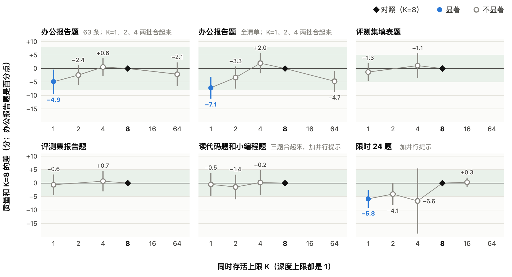

图 9 K 取不同值时的质量：比同一批里的 K=8 高或低多少。实心点显著，空心点不显著；浅绿带是 ±5 分（办公报告题 ±8 个百分点），只作参照。

- 办公报告题的 K=1 是实心点：两批合起来按 63 条 −4.9，全清单 −7.1，区间都不含 0。限时 24 题的 K=1（−5.8）也是实心点，带时限，只作参考。

- 全清单的 K=64 和限时 24 题的 K=2 两个空心点，区间不含 0，和同批的几个对比一起校正以后不显著。

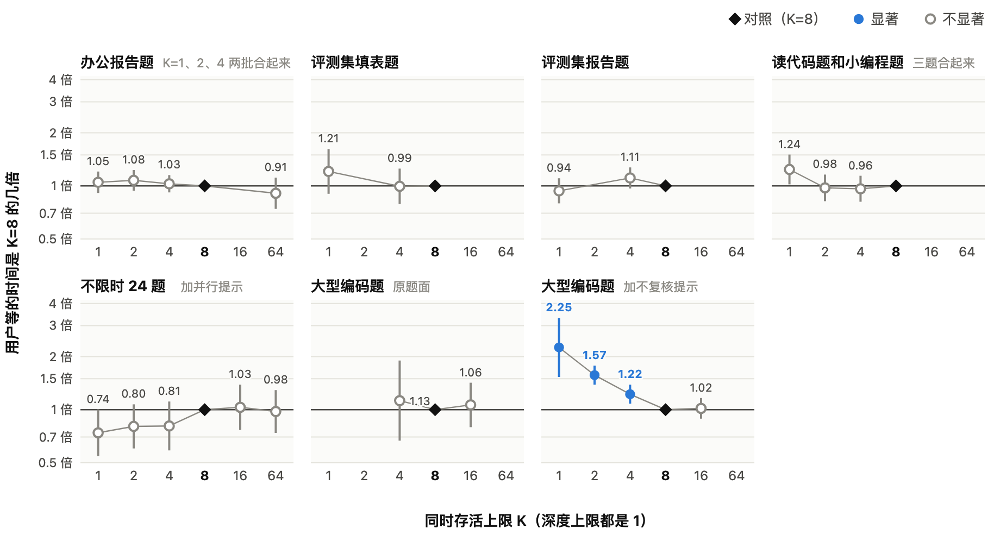

图 10 K 取不同值时用户等的时间：是同一批里 K=8 的几倍。

- 用时随 K 变小而变长的是大型编码题不复核时（K=1、2、4 是 2.25、1.57、1.22 倍）；K=16 没有更快，这时模型同时最多只开十一二个。读代码题和小编程题上 K=1 是 ×1.24 [1.02, 1.51]，区间不含 1，和同批的几个对比一起校正以后不显著。

- 不限时 24 题上 K=1、2、4 的估计值是 0.74–0.81 倍，区间含 1，没有测出 K 小了更慢。

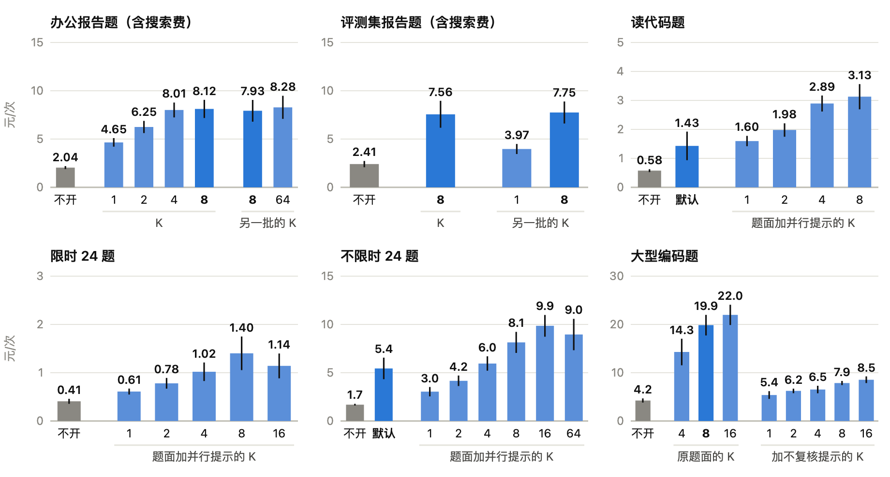

图 11 各任务一次运行的平均费用（元）随 K 怎么变，深度都是 1。深蓝色是默认，灰色是不开；加了提示的几组要和同一条短线上的 K=8 比。

- 费用跟着开的个数走：办公报告题 K=1、2 是 4.7、6.3 元，到 4 以后停在 8 元上下；不限时 24 题和大型编码题上 K 从 1 到 16 一路在涨。

### 结果 5：深度（说法 2）

表 7 深度的每个取值和深度 1 比（K 都是 8）：测出更好的、测出更差的；没列出的都是没测出差别。退出时崩溃是 DSH 的缺陷（结果 8）。各任务的数和区间在表 8。

| 取值 | 退出时崩溃 | 测出更好的 | 测出更差的 |
|---|---|---|---|
| 不开 | 没有 | 办公报告题用时 ×0.83；费用：7 个对比都更省（0.21–0.55 倍） | 办公报告题质量 −9.0；评测集报告题质量 −3.5；大型编码题（原题面）质量 −0.04；大型编码题（不复核题面）用时 ×2.23 |
| 深度 2 | 办公报告题 K=8：28/80；让进程等 subagent 以后 2/60 | 不限时 24 题质量 +0.4；不限时 24 题费用 ×0.91 | 读代码题用时 ×1.15；大型编码题（不复核题面）用时 ×1.34；办公报告题费用 ×1.87；评测集报告题费用 ×1.49；读代码题费用 ×1.48 |
| 深度 3 | 办公报告题 K=8：13/40；让进程等 subagent 以后 3/40 | 没有 | 办公报告题用时 ×1.18；小编程题用时 ×1.88；办公报告题费用 ×1.87；读代码题费用 ×1.42；小编程题费用 ×1.71 |

- 放开到深度 2 是小提升、贵一倍：办公报告题一次约 8 元变成约 15 元（四批合起来 1.87 倍，各批 1.71–2.13 倍），写对的事实多 2–4 个百分点（63 条 +2.2 [−0.1, +4.5]，全清单 +3.8 [+1.0, +6.7]）。每多写对一条事实，开 subagent 本身是 0.40 元，再放开一层是 1.85 元。

- 63 条这把尺子在上面快到头了：默认已经写对 85.5%，三批里最好的组是 87%–91%，所以深度 2 在 63 条上涨得少、在全清单上显著。两套数说的是同一件事。

- 退出时崩溃不算深度本身的代价，修掉以后账还是一样：进程等 subagent 的两批里，深度 2 的费用是 1.91、1.71 倍，写对的事实 +1.3、+0.2 个百分点。深度 3 和深度 2 花的一样多，没测出比深度 2 多写对（−1.4 [−5.4, +2.5]）。

表 8 深度的每个取值对同一批的深度 1（K 都是 8），读法同表 6：粗体是测出的差别。“不开”各行是把默认对不开的对比反过来写；办公报告题的深度 2、3 是几批合起来的数，最后两行同时把 K 放到 64。

| 任务（题面） | 取值 | 对数 | 质量之差 | 费用倍数 | 时间倍数 |
|---|---|---|---|---|---|
| 办公报告题 | 不开 subagent | 40 | **−9.0 [−13.4, −4.7]**（全清单 −15.5 [−19.1, −11.8]） | **×0.26 [0.23, 0.29]** | **×0.83 [0.70, 0.996]** |
|  | 深度 2（四批合起来算） | 99 | +2.2 [−0.1, +4.5]（全清单 +3.8 [+1.0, +6.7]） | **×1.87 [1.72, 2.03]** | ×1.09 [0.98, 1.20] |
|  | 深度 3（两批合起来算） | 39 | +0.7 [−3.9, +5.2]（全清单 +4.1 [−0.3, +8.6]） | **×1.87 [1.64, 2.14]** | **×1.18 [1.04, 1.34]** |
|  | 深度 2、K=64（对同批的默认） | 20 | +3.0 [−1.7, +7.7]（全清单 +3.7 [−1.7, +9.1]） | **×2.81 [2.27, 3.49]** | ×1.21 [0.98, 1.49] |
|  | 深度 3、K=64（对同批的默认） | 20 | +1.5 [−2.9, +5.9]（全清单 +1.4 [−4.1, +6.9]） | **×2.89 [2.18, 3.83]** | ×1.20 [0.98, 1.48] |
| 评测集填表题 | 不开 subagent | 19 | −2.7 [−5.8, +0.5] | **×0.36 [0.25, 0.53]** | ×0.88 [0.66, 1.16] |
|  | 深度 2 | 19 | +2.3 [−2.7, +7.2] | ×1.18 [0.92, 1.52] | ×1.22 [0.99, 1.50] |
| 评测集报告题 | 不开 subagent | 29 | **−3.5 [−5.9, −1.2]** | **×0.35 [0.29, 0.43]** | ×0.85 [0.70, 1.03] |
|  | 深度 2 | 27 | +0.6 [−3.4, +4.6] | **×1.49 [1.21, 1.82]** | ×1.12 [0.93, 1.35] |
| 读代码题 | 不开 subagent | 20 | −1.4 [−6.7, +3.9] | **×0.55 [0.50, 0.61]** | ×1.04 [0.91, 1.19] |
|  | 深度 2 | 20 | +0.7 [−3.8, +5.3] | **×1.48 [1.15, 1.90]** | **×1.15 [1.01, 1.32]** |
|  | 深度 3 | 20 | +2.8 [−3.5, +9.0] | **×1.42 [1.07, 1.88]** | ×1.07 [0.92, 1.23] |
| 小编程题 | 不开 subagent | 10 | −0.3 [−0.9, +0.4] | ×1.18 [1.01, 1.37] | ×1.21 [0.98, 1.50] |
|  | 深度 2 | 10 | 0（都是满分） | ×1.26 [0.86, 1.85] | ×1.46 [0.99, 2.16] |
|  | 深度 3 | 10 | 0（都是满分） | **×1.71 [1.25, 2.33]** | **×1.88 [1.24, 2.85]** |
| 限时 24 题 | 不开 subagent | 10 | −7.1 [−13.7, −0.4] | **×0.64 [0.46, 0.89]** | 限时 |
|  | 深度 2（五个 K 合起来，题面加并行提示） | 10 | −2.8 [−7.2, +1.7] | ×1.03 [0.89, 1.19] | 限时 |
| 16 步串行题 | 不开 subagent | 10 | 0（都是满分） | ×0.94 [0.86, 1.01] | ×0.96 [0.91, 1.01] |
| 不限时 24 题 | 不开 subagent | 20 | +0.2 [−0.6, +1.0] | **×0.34 [0.28, 0.41]** | ×0.93 [0.78, 1.12] |
|  | 深度 2（K=4、8、16 合起来，题面加并行提示） | 20 | **+0.4 [+0.2, +0.6]** | **×0.91 [0.85, 0.97]** | ×0.93 [0.83, 1.05] |
| 大型编码题（原题面） | 不开 subagent | 10 | **−0.04 [−0.05, −0.02]** | **×0.21 [0.18, 0.25]** | ×0.79 [0.61, 1.03] |
|  | 深度 2 | 10 | 0 [−0.01, +0.002] | ×0.95 [0.80, 1.12] | ×0.85 [0.66, 1.10] |
| 大型编码题（加不复核提示） | 不开 subagent | 10 | −0.01 [−0.04, +0.01] | **×0.54 [0.48, 0.60]** | **×2.23 [1.88, 2.65]** |
|  | 深度 2 | 10 | −0.01 [−0.03, +0.02] | ×0.93 [0.75, 1.15] | **×1.34 [1.01, 1.77]** |

- 变贵的是办公报告题、评测集报告题（×1.49）和读代码题（×1.48）。评测集填表题和大型编码题没测出变贵，不限时 24 题略便宜（×0.91）。

- 相当于旧默认的设置（深度 3、K=64）：费用是现在默认的 2.9 倍，写对的事实 +1.5 [−2.9, +5.9]，没测出增加。

- 深度 2 测出更慢的两处（读代码题、大型编码题不复核），区间下限都只到 1.01，换一种算法就不成立（表 10）；办公报告题四批合起来是 ×1.09 [0.98, 1.20]，没测出。不开 subagent 时办公报告题更快、质量更差，大型编码题不复核时更慢。

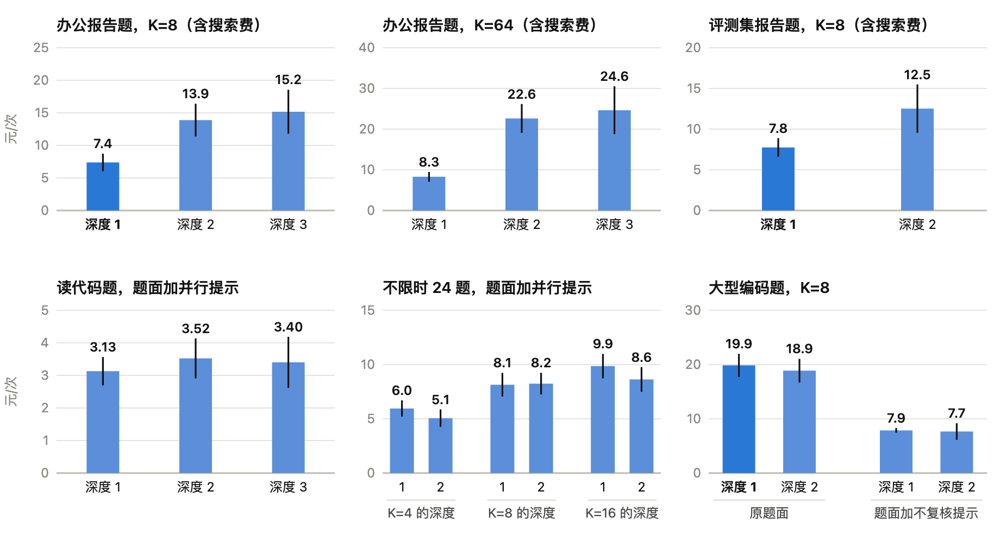

图 12 各任务一次运行的平均费用（元）随深度怎么变。每一格只画同一批跑的几组；深蓝色是默认。

- 办公报告题放开到深度 2 或 3，一次多花 6.5–7.8 元；K 也放到 64，多花 15–17 元。大型编码题和不限时 24 题的费用不随深度涨。

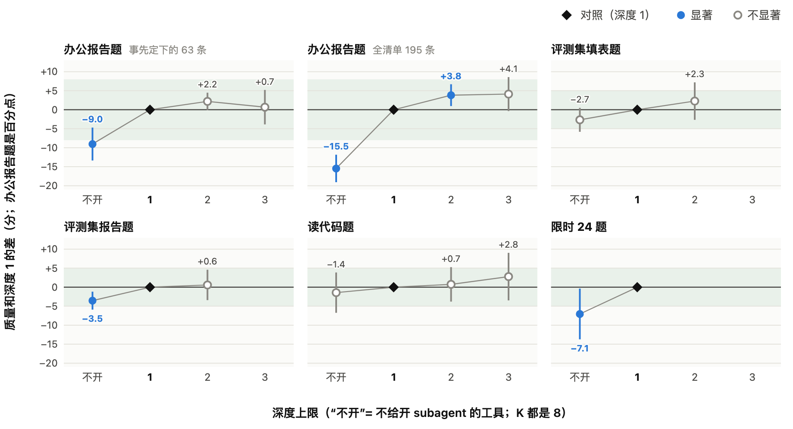

图 13 深度取不同值时的质量：比同一批里的深度 1 高或低多少。读法同图 9。

- 放开深度以后，没有一种任务的质量测出变差。图里全清单的深度 2（+3.8）是实心点，按 63 条是 +2.2、区间含 0。

- 不在图里的不限时 24 题多 0.4 分（各组都接近满分），是唯一测出提高的。

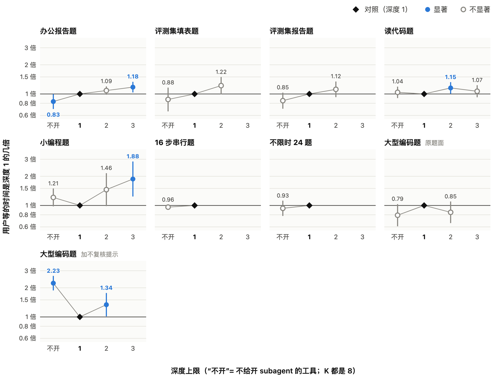

图 14 深度取不同值时用户等的时间：是同一批里深度 1 的几倍。限时 24 题不比时间。

- 深度 2 没有让任何一种任务显著更快。

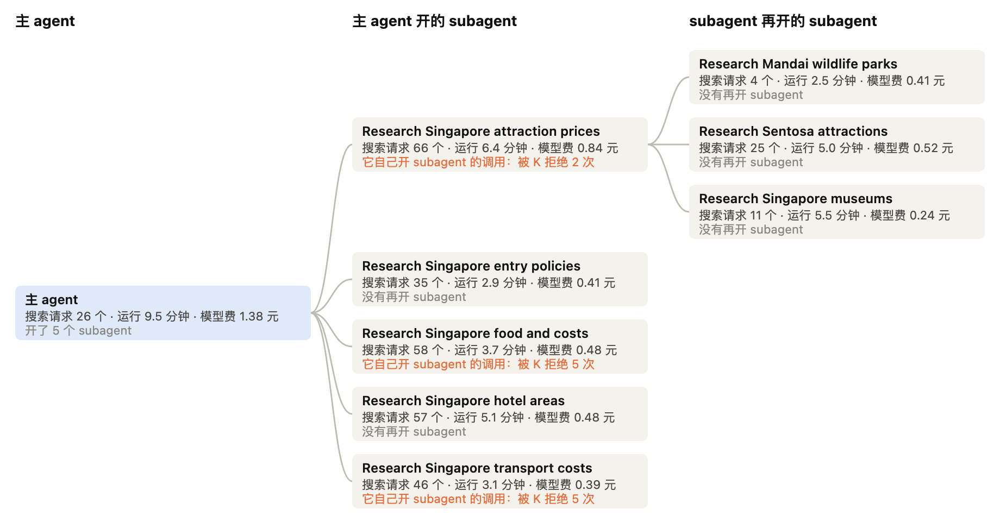

图 15 深度 2 下的一次运行（旅行攻略题，开的 subagent 数是这一组的中位数）：主 agent 开了 5 个 subagent，其中一个又开了 3 个，同时活着的到了 8 个。

- 钱花在多出来的一层上：第 1 层的 subagent 有的又往下开，搜索请求是默认的 1.9 倍。

### 结果 6：时间（说法 3）

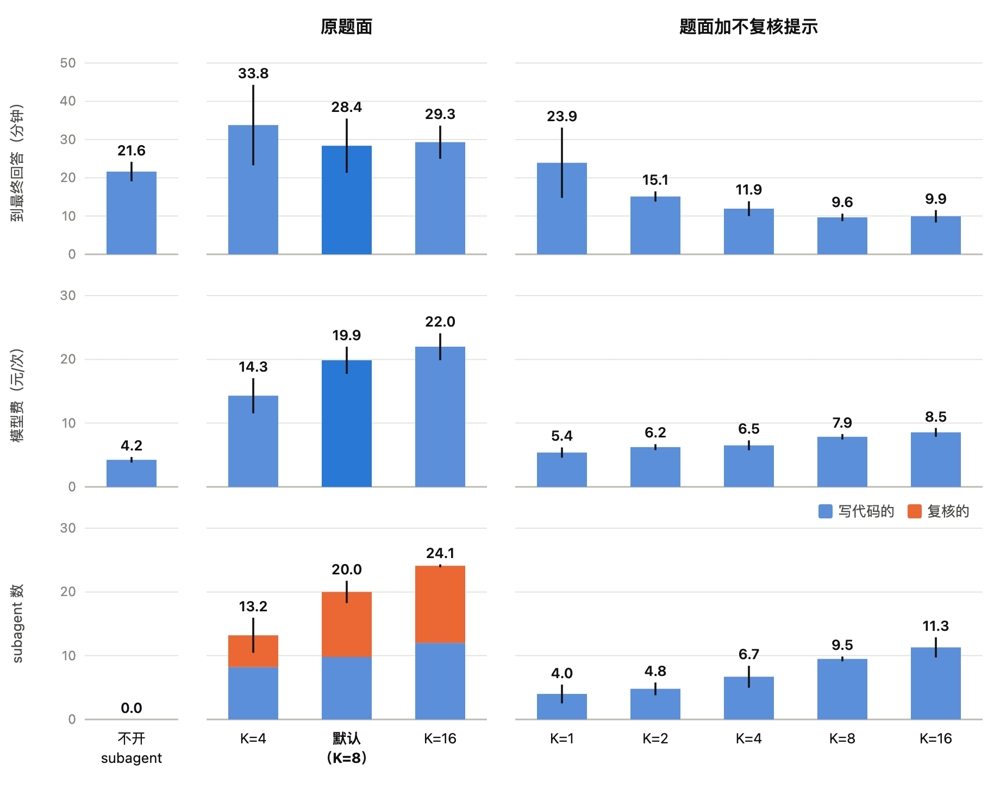

图 16 大型编码题各组：到最终回答的时间、模型费、开的 subagent 数（橙色是写完以后派去复核的）。先看第一行：默认 28 分钟，不开 22 分钟，加不复核提示的 K=8 是 10 分钟。

- 调研类任务没有更快：办公报告题默认比不开慢（×1.20 [1.004, 1.43]；三批是 1.19–1.38 倍），两个评测集没测出差别。并行省下的时间，模型拿去多查了：搜索请求是不开的 3.9 倍。

- 不限时 24 题和大型编码题：文件写完得更早（是不开的 ×0.80 和 ×0.49），最终回答没有更早（×1.07 和 ×1.26，这两个的区间含 1）。原因是复核：模型写完以后又派一批 subagent 去检查。

- 大型编码题去掉复核（题面加不复核提示），费用少 60%、时间少 65%，代价是 10 次里 9 次留下 1–3 个没通过的测试（3,737 个里；有复核时 10 次全过，不开 subagent 时 9 次留下 1–4 个）。这时不开要等的时间是开 subagent 的 2.23 倍。

### 结果 7：多写对靠什么（说法 4）

表 9 办公报告题：不开 subagent 的几种做法和默认比。搜索请求、费用、时间是默认的几倍；“写对的事实”是和默认的差，单位是百分点，按 63 条。多查的三行各和同一批的默认比，最后一列是同一批里什么提示都不加的单 agent。

| 做法 | 搜索请求 | 写对的事实 | 费用 | 时间 | 同一批里不加提示的单 agent |
|---|---|---|---|---|---|
| 单 agent，题面要求至少搜索 100 次、打开 100 个网页（多查 100/100） | ×0.75 | −8.4 [−12.6, −4.2] | ×0.59 | ×1.08 | −12.9 [−16.9, −8.8] |
| 单 agent，要求 150 次、250 个网页（多查 150/250） | ×1.07 | −3.9 [−8.2, +0.4] | ×0.78 | ×1.63 | −10.3 [−14.7, −6.0] |
| 单 agent，要求 250 次、500 个网页（多查 250/500） | ×1.14 | −8.6 [−13.1, −4.1] | ×0.79 | ×1.62 | −10.3 [−14.7, −6.0] |
| 两份单 agent 报告合并成一份（两批合起来） | ×0.51 | +1.2 [−1.7, +4.1] | ×0.65 | ×1.52 | — |
| 四份单 agent 报告合并成一份（两批合起来） | ×0.99 | +7.1 [+3.1, +11.2] | ×1.15 | ×1.73 | — |

- 题面要求单 agent 多查：后两种提示把搜索请求提到了默认的水平，写对的事实比默认少 3.9 和 8.6 个百分点（前一个区间含 0）。但这两组花在模型上的钱只有默认的 0.45 和 0.43 倍，逐个打开读的网页是默认的一到两成（图 18）：搜索量追平了，读进去的没有追平。所以“一个 agent 自己查够同样多能不能追上”这次没有检验成。

- K=1（一次只许一个 subagent 活着，平均先后开 1.9 个）落在不开和默认中间：比不开多写对 +4.3 [−0.3, +8.9]，默认比它再多 +4.7 [−0.6, +10.1]（63 条，两步的区间都含 0；全清单是 +8.5 [+4.6, +12.4] 和 +7.3 [+2.3, +12.3]，都显著）。费用是不开的 2.25 倍，用时 ×1.26 [1.04, 1.53]。按估计值，好处的一半在一次只开一个时就有了，另一半来自同时开。

- 几个单 agent 各写一份再合并，和默认比：两份没有差别，四份不比默认少。四份合并两批合起来是 +7.1 [+3.1, +11.2]；分批是 +9.3 [+3.0, +15.6]（对照的默认组是前一天跑的，方案里写明只作描述）和 +4.9 [−1.3, +11.1]（同一批，区间含 0）。

- 合并那一步的题面要求“有来源的事实都保留”，默认的主 agent 没有被这样要求。和题面加了同样要求的默认比（全清单）：四份合并是 −0.2 [−3.3, +3.0]（10 对；旅行攻略题 −5.5，CPU 选型题 +5.1），两份合并是 −7.0 [−10.6, −3.3]（19 对），更差。所以说法 4 只对了一半。

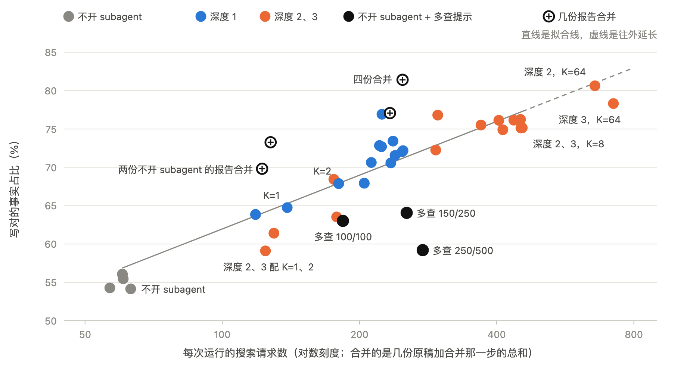

图 17 办公报告题：每个点是一组运行的平均，横轴是每次运行的搜索请求数，纵轴是写对的事实占比（全清单）。直线按主要一批的六组拟合。

- 搜索请求越多，写对的越多。同样的搜索量，单 agent 多查的三组（黑点）落在线下面。几份报告合并的（⊕）画出来在线上面，但合并是不是更省搜索，这批数据定不了。

- 各批的水平不一样（同时测 K=64 的那一批，默认组自己就在 77%），点只能和同一批的默认比；按 63 条下判断的差在表 9 和表 8。

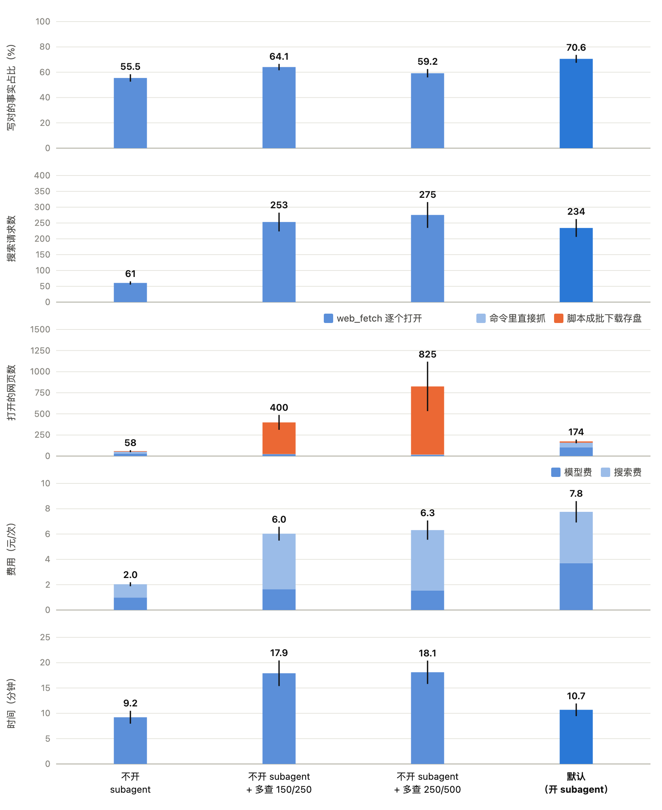

图 18 办公报告题：单 agent 加多查 150/250、多查 250/500 的两组，和同一批的不开、默认比。五栏从上到下是写对的事实占比（全清单）、搜索请求数、打开的网页数、费用、时间。

- 多出来的是搜索请求和下载量，逐个打开来读的网页并没有多：两组用 web_fetch 打开的只有 22 和 14 个（默认 104 个），模型改成写脚本成批下载、存到磁盘再检索（376 和 807 个）。

- 搜索量到了默认的水平时，单 agent 的费用是默认的 0.78 倍（搜索费差不多，模型费不到一半），时间是 1.6 倍。

- 少写对的主要在旅行攻略题上（全清单少 9.7 和 18.0 个百分点）；CPU 选型题上的差区间含 0。

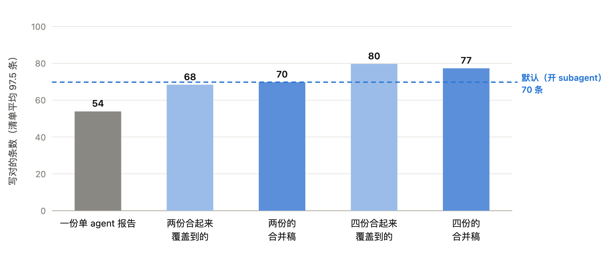

图 19 办公报告题：一份单 agent 报告写对多少条（全清单），两份、四份里至少有一份写对的有多少条，合并稿写对多少条。虚线是默认。

- 一份单 agent 报告平均写对 54 条；两份里至少有一份写对的是 68 条，四份是 80 条。合并稿写对 70 和 77 条，默认 70 条。

- 合并这一步自己查得很少（一次平均 8 个搜索请求）：多出来的事实是几个 agent 各自查到的不一样。

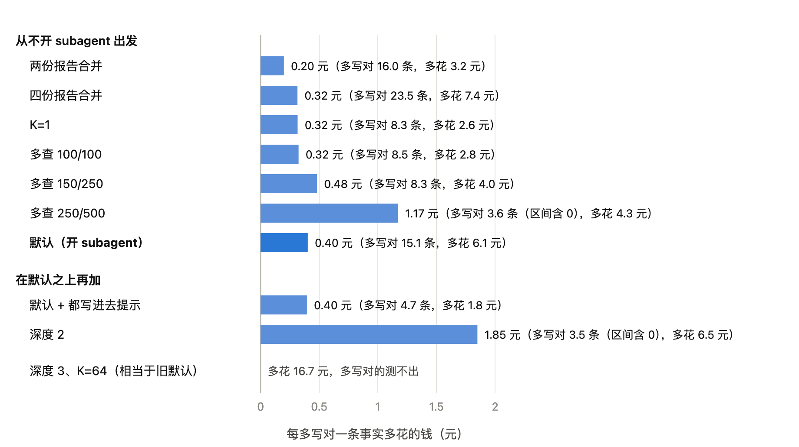

图 20 办公报告题：每多写对一条事实多花的钱（全清单，条）。上面七种做法和一次不开 subagent 的运行比，下面的在默认之上再加。

- 从不开出发，每多写对一条：两份合并 0.20 元，四份合并、K=1 和多查 100/100 约 0.32 元，默认 0.40 元。

- 在默认之上再加：题面要求把 subagent 查到的都写进报告是 0.40 元一条，放开到深度 2 是 1.85 元一条（多写对的区间含 0）。

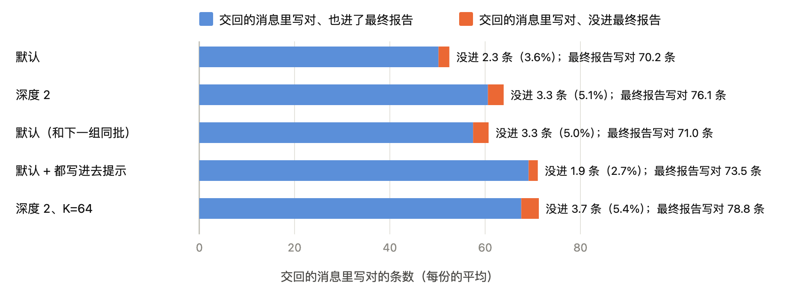

图 21 办公报告题：subagent 交回给主 agent 的消息里写对的事实，进了最终报告和没进的各有多少。

- 主 agent 汇总时丢得不多：交回的消息里写对的事实，只有 3%–5% 没进最终报告。深度 2 多查了没有多写对多少，不是主 agent 汇总这一步丢的（第 2 层交给第 1 层的那一步没有量）。

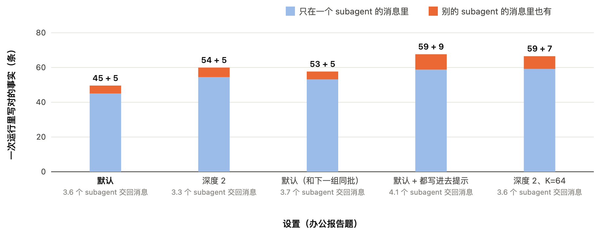

图 22 办公报告题：subagent 交回的消息里写对的事实，只在一个 subagent 的消息里出现的和别的 subagent 也有的各多少条。

- 分头查到的东西很少重复：交回的写对的事实，87%–92% 只在一个 subagent 的消息里出现；默认下各 agent 打开的网页只有 8% 被两个以上的 agent 打开过。

### 结果 8：交付

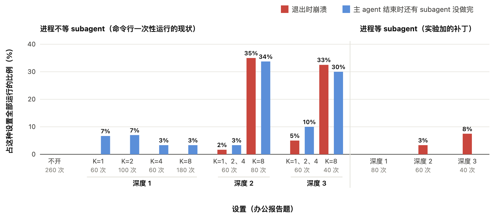

图 23 办公报告题各种设置下运行是怎么结束的：红柱是退出时崩溃的运行占的比例，蓝柱是主 agent 结束时还有 subagent 没做完的运行占的比例。右边三组的进程等 subagent 做完再退出。

- 深度不超过 1 的 1,764 次运行没有一次退出时崩溃。办公报告题深度 2、3 在 K=8 下是 28/80 和 13/40，K=1、2、4 下，深度 2 是 1/60、深度 3 是 3/60；读代码题深度 2、3 的 260 次里 5 次，小编程题 100 次里没有。崩溃的运行绝大多数已经交出报告、照常计分：办公报告题 K=8 的这 120 次里报告不完整的只有 2 次。

- 让进程等 subagent 做完再退出，深度 2、3 的崩溃降到 5/100。

- 全部 2,873 次运行按同一条规则分：正常结束 2,618 次，到时限被停 181 次（限时题和 3 次填表题），退出时崩溃 58 次，主 agent 最后一轮没有正常结束 15 次，其余 1 次。没有正常结束的 15 次里 12 次交了东西、照常判了分；办公报告题主要一批里没有这样的运行，小编程题有 4 次（去掉以后的数在表 10）。

- 蓝柱是另一回事：主 agent 没等 subagent 做完就给出回答，那些 subagent 的活白做了。默认下 6/180 次，报告都是完整的；题面要求把 subagent 查到的都写进报告时 8/40 次，其中 6 次没交出完整报告。

### 结果 9：把上限告诉模型

表：办公报告题：K=2 和 K=8（默认）各配工具说明里写明上限与否，每组 40 次（两道题各 20 次）。前四行是各组的均值；后三行是按题和第几次配对的差或倍数，括号里是 95% 区间，粗体是区间不含 0（倍数不含 1）的差别。写对的事实按 63 条；开的 subagent 和被拒绝的调用按全部运行，其余按交出完整报告并判了分的运行。

| 组或对比 | 写对的事实（%） | 费用（元/次） | 到最终回答（分钟） | 被 K 拒绝（次/运行） | 开的 subagent |
|---|---|---|---|---|---|
| K=2 | 83.4 | 5.59 | 12.3 | 1.4 | 2.4 |
| K=2，告知 | 80.2 | 5.26 | 11.7 | 0.1 | 2.1 |
| K=8（默认） | 84.6 | 7.74 | 12.3 | 0.0 | 3.6 |
| K=8，告知 | 85.8 | 7.74 | 12.6 | 0.0 | 3.6 |
| K=2：告知对不告知 | −3.2 [−7.5, +1.0] | ×0.94 [0.84, 1.05] | ×0.96 [0.80, 1.15] | **−1.3 [−1.6, −1.0]** | −0.3 [−0.6, −0.0] |
| K=8：告知对不告知 | +1.2 [−2.5, +4.9] | ×0.98 [0.85, 1.13] | ×1.02 [0.86, 1.21] | 0 | 0 [−0.4, +0.4] |
| 告知的 K=2 对 K=8 | **−4.5 [−8.6, −0.4]** | **×0.67 [0.60, 0.75]** | ×0.92 [0.80, 1.06] | +0.1 [−0.0, +0.2] | **−1.5 [−1.8, −1.2]** |

- 告知以后 K=2 上被 K 拒绝的调用从每次 1.4 次变成 0.1 次（基本不再超出上限）；写对的事实没测出差别（−3.2 [−7.5, +1.0]，区间在 ±8 个百分点以内），费用没测出差别（×0.94 [0.84, 1.05]），时间没测出差别（×0.96 [0.80, 1.15]）。

- 默认值（K=8）下写进去：开的 subagent 没测出差别（0 [−0.4, +0.4] 个），写对的事实没测出差别（+1.2 [−2.5, +4.9]，区间在 ±8 个百分点以内），费用没测出差别（×0.98 [0.85, 1.13]）；被深度上限拒绝的调用从每次 7.3 次变成 9.0 次（+1.7 [+0.1, +3.2]）。

- 告知以后的 K=2 比默认少写对 4.5 个百分点（−4.5 [−8.6, −0.4]，次要对比，没校正），费用 ×0.67 [0.60, 0.75]；K=2 告知前后是 −3.2 [−7.5, +1.0]，区间含 0，告知的作用在两个 K 上的差 −4.4 [−10.4, +1.6]。这一批说明不了告知让 K=2 变好或变坏，能确定的是被 K 拒绝的调用没有了；K 的结论不用改。读法是开跑前写定的，各组的全部数在附录的细节四。

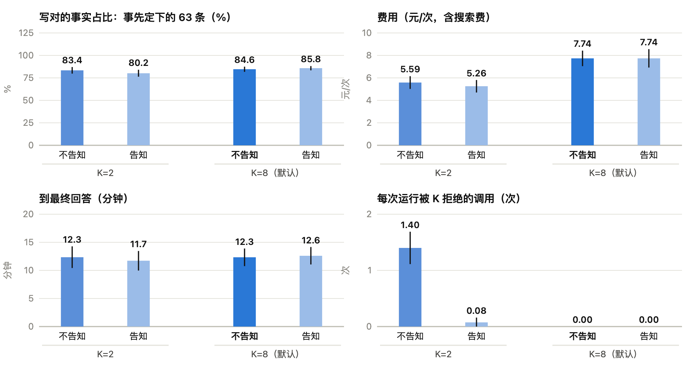

图：办公报告题：K=2 和 K=8 各配工具说明里写明上限与否，四样量的组均值和 95% 区间（写对的占比、费用、时间按交出完整报告并判了分的运行，被拒绝的调用按全部运行）。

### 结果 10：结论稳不稳

表 10 换一种算法，结论变不变。每行先写正文用的算法和数，再写换成什么、换了以后是多少。

| 结论（正文的算法） | 正文的数 | 换成 | 换了以后 | 变不变 |
|---|---|---|---|---|
| 开 subagent 让办公报告题多写对（主要一批，63 条） | +9.0 [+4.7, +13.4] | 全清单 | +15.5 [+11.8, +19.1] | 不变 |
|  |  | 四批合起来（63 条） | +11.2 [+9.0, +13.4] | 不变 |
|  |  | 评分表总分（第一批；同一批按 63 条是 +13.9） | +2.9 [−0.8, +6.6] | 变：评分表测不出 |
| 深度 2 没测出让办公报告题多写对（四批合起来，63 条） | +2.2 [−0.1, +4.5] | 全清单 | +3.8 [+1.0, +6.7] | 变：全清单下显著 |
|  |  | 全清单，把批当成随机因素（区间按只有四批放宽） | +3.7 [−0.7, +8.2] | 变回区间含 0 |
| K=1 让办公报告题少写对（两批合起来，63 条，59 对） | −4.9 [−9.4, −0.4] | 只看主要一批（40 对） | −4.7 [−10.1, +0.6] | 变：单批没测出 |
|  |  | 全清单（两批合起来） | −7.1 [−11.2, −3.1] | 不变 |
|  |  | 两批各算各的，再等权平均 | −5.0 [−10.1, +0.0] | 区间的上端刚好到 0 |
| K=2、K=4 在办公报告题上没测出差别（两批合起来，63 条） | −2.4 [−6.1, +1.2]；+0.6 [−2.7, +3.8] | 只看主要一批 | −3.5 [−8.2, +1.3]；+0.1 [−3.5, +3.6] | 不变 |
| K=64 在办公报告题上没测出差别（63 条） | −2.1 [−6.5, +2.3] | 全清单 | −4.7 [−8.7, −0.8] | 区间不含 0，校正后不显著；这两组等于同一种设置跑了两遍，见表下 |
| K=1 在读代码题和小编程题上没测出差别（三道题一起算，事前写定的算法） | −0.5 [−4.7, +3.7] | 只看两道读代码题；再把三个深度下的 K=1 都算上 | −2.9 [−7.4, +1.5]；−4.0 [−6.6, −1.3] | 前一种不变；后一种变：更差（事后合并） |
| K=2、K=4 在读代码题和小编程题上没测出差别（三道题一起算） | −1.4 [−6.0, +3.2]；+0.2 [−4.4, +4.8] | 只看两道读代码题 | −3.4 [−8.1, +1.3]；−1.9 [−7.2, +3.4] | 不变 |
| K=1、2、4 在读代码题和小编程题上没测出差别（三道题一起算） | 见上两行 | 去掉主 agent 最后一轮没有正常结束的运行所在的 1–2 对 | −2.0 [−5.0, +1.1]；−3.0 [−6.4, +0.5]；−1.3 [−5.0, +2.5] | 不变：估计值更低，区间仍含 0 |
| K=4 让大型编码题变慢（不复核题面） | ×1.22 [1.08, 1.39] | 原题面 | ×1.13 [0.67, 1.90] | 变：没测出 |
| 深度 2 让大型编码题变慢（不复核题面） | ×1.34 [1.01, 1.77] | 原题面；K=16、64 下的深度 2（不复核题面） | ×0.85 [0.66, 1.10]；×0.99 [0.79, 1.25]、×1.01 [0.74, 1.38] | 变：都没测出 |
| 深度 2 让读代码题变慢 | ×1.15 [1.01, 1.32] | 把每个请求按同一个模型速度重算时间 | ×1.14 [0.99, 1.32] | 变：没测出 |
| 大型编码题原题面 K=4 的得分没测出差别 | −0.01 分（10 次里 4 次各留 1 个没过的测试） | t 区间不含 0；按精确检验 | p = 0.13 | 正文按精确检验 |

表 11 办公报告题上同一个对比在几批里各做了一遍的结果，和合起来的数。写对的事实按 63 条，单位是百分点。各批用的是同两道题，一致说明能重复，不说明换题也成立。

| 对比 | 各批的结果 | 合起来 | 几批一致吗 |
|---|---|---|---|
| 默认对不开：写对的事实 | +13.9、+9.0、+12.9、+10.3（都显著） | +11.2 [+9.0, +13.4] | 四批一致 |
| K=4 对 8：写对的事实 | +1.5 [−5.7, +8.7]、+0.1 [−3.5, +3.6] | +0.6 [−2.7, +3.8] | 两批都没测出差别 |
| K=2 对 8：写对的事实 | −0.4 [−6.2, +5.4]、−3.5 [−8.2, +1.3] | −2.4 [−6.1, +1.2] | 两批都没测出差别 |
| K=1 对 8：写对的事实 | −5.3 [−14.3, +3.7]、−4.7 [−10.1, +0.6] | −4.9 [−9.4, −0.4] | 方向一致；单批都含 0，合起来不含 |
| 深度 2 对 1：费用 | ×2.13、×1.83、×1.91、×1.71（都显著） | ×1.87 [1.72, 2.03] | 四批一致 |
| 深度 2 对 1：写对的事实 | +3.9、+2.8、+1.3、+0.2（都含 0） | +2.2 [−0.1, +4.5] | 方向一致；合起来仍含 0 |
| 深度 2 对 1：时间 | ×1.29、×1.02、×1.00、×1.14（一批显著） | ×1.09 [0.98, 1.20] | 两批偏慢、两批持平；合起来区间含 1 |
| 深度 2 退出时崩溃（K=8） | 7/20、14/40、7/20 | 28/80 | 三批一致 |

- 跨批合起来的数，批与批之间的方差估出来都是 0（各批的估计值相差在抽样误差以内），所以把批当成随机因素和现在的算法给出同样的估计值。但只有两到四批，批间方差本身估不准：“合起来才显著”的两处，K=1 的 −4.9 和深度 2 全清单的 +3.8，换成更保守的算法区间都碰到或含 0。默认对不开的 +11.2 怎么算都显著（+11.2 [+7.7, +14.8]）。

- 换算法以后，“两个默认值都不改”没有一处被推翻。会变的三处：K=1 在办公报告题上的损失单批测不出；大型编码题换回原题面，K=4 和深度 2 更慢都测不出；深度 2 的好处在全清单下显著，仍然是多写对 2–4 个百分点、费用近两倍。

- 全清单里后补的 132 条是看过第一批报告以后整理的，参考的样本多数来自开 subagent 的组，所以以 63 条为准。

- 两个公开评测集和写代码的各题都只做过一批。重复跑本身的波动：办公报告题上 K=64 和 K=8 两组里 K 都没有拒绝过一次调用，等于同一种设置跑了两遍，20 对的写对的事实仍差 2.1 个百分点。

## 讨论

- **为什么 K 调大没用。** K 限的是同时活着的个数，调研类任务上模型自己只开三四个。调用会被 K 拒绝的是能拆成十几块的编码任务：K 小了文件写得慢，要等多久还看写完以后复核不复核。

- **为什么放开深度主要是多花钱。** 多出来的一层把搜索量提到 1.9 倍，写对的事实只多 2–4 个百分点。多查了为什么没有多写对多少，这次没有测；只知道不是主 agent 汇总这一步丢的（结果 7）。

- **上限不告诉模型。** 工具说明里不写上限，到了深度上限的 subagent，工具列表里仍然有开 subagent 的工具，所以开 subagent 的调用有一半被拒绝（结果 3）。这些调用本身花的钱很少；把上限写进工具说明以后，K=2 上被拒的调用从每次 1.4 次变成 0.1 次，写对的事实没有差别、费用和时间没测出变化；默认值下开的数量、写对的事实、费用都没测出变化，被深度上限拒绝的调用从每次 7.3 次变成 9.0 次（结果 9）。

- **和预想不一样的两处。** 不限时的题上开 subagent 没有更快（复核把省下的时间用掉了）；两份单 agent 报告合并就和默认没有差别（默认没有被要求把查到的都写进去；和加了这个要求的默认比，两份合并少 7 个百分点）。

- **和别人的结果。** 上限调大没测出好处，和 ArcticSwarm（arXiv 2609.01870；同时运行的 subagent 上限从 8 调到 48，准确率在波动以内）一致。放开深度：SAIGE（arXiv 2609.19759 提出的一种多 agent 协作办法）把最大深度从 1 调到 3，得分是降的；这里是没测出值得这个价钱的好处。单 agent 重复多次再合并：ArcticSwarm 的题一题只有一个答案，只能投票，结果不如多 agent；这里合并的是报告，写对的不比默认少。产品的默认值两种都有：Codex CLI 和 Gemini CLI 的 subagent 不能再往下开，Claude Code 现在默认允许三层（2026 年改过两次，没有公布测量）；这里的结果支持前一种。各项的数在附录的表 31。

- **数据提出的问题比“默认值取几”大。** 同一个 K，在调研类任务上从不起作用（94 次默认运行没有一次碰到 8，却有 76 次被深度上限拒绝），在能拆成很多块的编码任务上每次都起作用。按任务类型设上限，或者把上限告诉模型让它自己安排，比改这两个数更对症；告知上限的一批（结果 9）只是第一步。

- **局限。** 一个模型、一个推理强度、一个 DSH 版本、命令行一次性运行：“K 调大没用”靠的是这个模型在调研类任务上一次只开三四个，换模型可能不一样。重复跑的办公报告题只有两道，区间只反映同一道题重复跑的波动。质量量的是事实写对了多少，由模型判分，还没有人工核对。代码类任务上 K 和深度的结论是在题面加了并行提示或不复核提示时得到的，用户不会这样写题面。K 的结论只对现在的实现成立（工具说明里不写上限，超出上限的调用被拒绝）。别人的结果里深度有用的两种情形（执行的模型弱、任务本身一层套一层；输入远超一个上下文、工作量比输入涨得快），这次的任务都不属于：“深度保持 1”只对一个上下文装得下的日常任务成立。

- **下一步。** 到了上限排队等空位（不拒绝）的做法；告知上限只在办公报告题的 K=2、8 上测过，K=1 和代码类任务没有测；在第一遍错得多的任务上比有没有复核；读代码题上补测 K=4。运行中发现的 DSH 缺陷和每条结论会被什么结果推翻，在附录的“运行中发现的 DSH 缺陷”和“适用范围、会推翻结论的结果和下一步”两节。

## 附录

### 实验列表

| 实验批次 | 任务 | 设置 | 进程等不等 subagent | 质量判断 | 运行次数 |
|---|---|---|---|---|---|
| 第一批 | 办公报告题；读代码题和小编程题 | 办公报告题：不开，深度 1、2、3 各配 K=1、2、4、8（每题 10 次）。读代码题和小编程题：原题面的不开和深度 1、2、3（K=8；另按事前的规则补了几格小 K），加并行提示的深度 1、2、3 各配 K=1、2、4、8（每题 10 次） | 不等 | 办公报告题先按评分表打总分，后来改按事实清单判；读代码题按要点和评分表；小编程题用隐藏测试 | 820 |
| 对照题批 | 限时 24 题、16 步串行题 | 不开、默认、默认加并行提示（各 10 次） | 等 | 隐藏测试、对答案 | 60 |
| 等 subagent 批 | 办公报告题 | 进程等 subagent 的默认、深度 2、深度 3，和不等的深度 2、深度 3（每题 10 次） | 两种都有 | 先按评分表打总分，后来改按事实清单判 | 100 |
| 限时 24 题批 | 限时 24 题（限时 3 分钟和 2 分钟两版） | 不开；加并行提示的深度 1、2 各配 K=1、2、4、8、16（每版 10 次） | 等 | 隐藏测试 | 220 |
| 不限时 24 题批 | 不限时 24 题 | 不开、默认；加并行提示的深度 1、2 各配 K=1、2、4、8、16、64（10 或 20 次） | 等 | 隐藏测试 | 240 |
| 大型编码题批 | 大型编码题 | 不开；原题面的 K=4、8、16 和深度 2；加不复核提示的 K=1、2、4、8、16 和深度 2（各 10 次） | 等 | 隐藏测试 | 110 |
| 大型编码题深度批 | 大型编码题 | 加不复核提示的深度 1、2 各配 K=16、64（各 10 次） | 等 | 隐藏测试 | 40 |
| 办公报告题主要的一批 | 办公报告题 | 不开、K=1、K=2、K=4、默认、深度 2（每题 20 次）。重做一遍来确认第一批的结果，正文办公报告题的数多数出自这一批 | 不等 | 事实清单 | 240 |
| K=64 批 | 办公报告题 | 四种：默认；K=64；深度 2、K=64；深度 3、K=64（每题 10 次） | 等 | 先按评分表打总分，后来改按事实清单判 | 80 |
| 多查 100/100 那一批 | 办公报告题 | 不开、不开加多查 100/100、默认、默认加都写进去提示（每题 20 次） | 不等 | 事实清单 | 160 |
| 都写进去提示的深度批 | 办公报告题 | 加都写进去提示的默认和深度 2（每题 10 次） | 等 | 事实清单 | 40 |
| 评测集填表题选题 | WideSearch 的 65 道中文题 | 不开（每题 1 次） | — | 逐项 F1 | 65 |
| 评测集填表题批 | 评测集填表题 | 不开、默认、默认加并行提示（每题 1 次） | 等 | 逐项 F1 | 72 |
| 评测集报告题第一批 | 评测集报告题 | 不开、默认（每题 1 次） | 等 | 评测集的评分项 | 60 |
| 评测集报告题第二批 | 评测集报告题 | K=1、默认、深度 2（每题 1 次） | 等 | 评测集的评分项 | 90 |
| 多查 150/250、250/500 那一批 | 办公报告题 | 不开、不开加多查 150/250、不开加多查 250/500、默认（每题 20 次） | 不等 | 事实清单 | 160 |
| 评测集填表题补测批 | 评测集填表题 | K=1、K=4、默认、深度 2（每题 1 次） | 等 | 逐项 F1 | 96 |
| 评测集报告题补测批 | 评测集报告题 | K=4、默认（每题 1 次） | 等 | 评测集的评分项 | 60 |

### 

### 任务、提示和判断用词

- DSH（DeepSeek Harness）里，主 agent 可以把一部分活交给 subagent；subagent 在后台运行，做完把结果作为一条消息送回上级。

- 两个上限：深度上限 D：subagent 还能不能再往下开 subagent；D=0 是连主 agent 也不给开 subagent 的工具，下文叫“不开 subagent”，也叫单 agent。同时存活上限 K：同一时刻最多有几个 subagent 没结束，各层合在一起数。模型事先看不到这两个数，超出上限的那次调用会被拒绝。

- 比较方法：九种任务上一共跑了约 2,700 次；每个设置和默认（D=1、K=8）比三样：质量、一次任务的费用（元；联网任务含搜索费）、用户等的时间（从开始到主 agent 给出最终回答）。主要的对比每次只改一个上限。

- 配对方法：实验分批做，一个设置只和同一批里的对照组比（多数是默认设置；题面加了并行提示或不复核提示的各组，对照的是同样加提示的深度 1、K=8）。同一道题的同一次重复，两个设置各有一次运行，配成一对算差；下文的“20 对”“40 对”指这个。

- 进程等不等 subagent：命令行一次性运行时，主 agent 给出最终回答，进程就退出，不管 subagent 是不是还在运行。一部分批次给进程打了补丁，让它等 subagent 做完再退出，下文叫“进程等 subagent”。

| 题目类型 |  | 题面 | 质量怎么算 | 每种设置跑几次 |
|---|---|---|---|---|
| 调研类 | 办公报告题 | 联网调研后写一份长报告，2 道，取自背景里的用户日志 A、C：新加坡 4 天自由行攻略（下文叫旅行攻略题）；鲲鹏 920、海光 7000、飞腾 S5000C 三款服务器 CPU 的选型对比（下文叫 CPU 选型题） | 对照事实清单逐条核对，报告写对了其中百分之几（写对的事实占比）。清单两题共 195 条（下文叫全清单）：63 条是任何运行之前定下的，132 条是看过第一批报告以后补的。结论以事先定下的 63 条为准，全清单的数并排给 | 每题 10 或 20 次；正文的数多数出自每题 20 次的主要一批（40 对） |
|  | 评测集填表题 | 联网收集信息，填一张指定列的表；公开评测集 WideSearch 的 24 道中文题 | 和标准答案逐格比对的得分（逐项 F1） | 每题 1 次 |
|  | 评测集报告题 | 联网调研，按题面要求写报告；公开评测集 DeepResearch Bench II 的 30 道中文题 | 评测集自带的评分项满足了百分之几 | 每题 1 次 |
| 代码类 | 读代码题 | 不联网，读 DSH 源码，2 道：回答“subagent 的两个上限在哪里实现”（问答题）；写一个记忆溯源插件的实现方案（写方案题，取自用户日志 B） | 问答题按要点、写方案题按评分表，由判分模型打分 | 每题 10 次 |
|  | 小编程题 | 4 道 Python 练习，一次运行做完 4 道 | 各题隐藏测试通过比例的平均 | 10 次 |
|  | 限时 24 题 | 24 道互不相关的 Python 小题，限时 3 分钟；特意设计成适合分给几个 subagent 同时做 | 到时间为止，各题隐藏测试通过比例的平均 | 10 次 |
|  | 16 步串行题 | 16 步数据处理，后一步的题目要靠前一步的答案才找得到；特意设计成没法同时做 | 和标准答案对 | 10 次 |
|  | 不限时 24 题 | 同样 24 道小题，不限时 | 各题隐藏测试通过比例的平均 | 10–20 次 |
|  | 大型编码题 | 按规格写一个 Python 包：48 个模块、61 个文件 | 3,737 个隐藏测试，各测试文件通过比例的平均（少过 1 个测试约少 0.02 分，所以这道题同时给没通过的测试个数） | 10 次 |

有些组在题面末尾另加了一句提示，下文用这四个名字；不加提示的叫“原题面”：

- 并行提示：“独立的子任务尽量交给 subagent 并行做。”用来让模型多开一些 subagent，上限才有机会起作用。

- 不复核提示：要求文件都写完以后不要再另开 subagent 去复核（检查、验证、补测试），需要检查就自己检查。只用在大型编码题；原题面下模型写完会再派一批 subagent 复核。

- 多查提示：“写报告之前，请至少做 100 次网页搜索，并打开至少 100 个网页核对内容。”加在不开 subagent 的组上，让一个 agent 自己多查。一共三种，按要求的搜索次数和网页数叫多查 100/100、多查 150/250、多查 250/500。只用在办公报告题。

- 都写进去提示：“subagent 交回来的有来源的事实都写进最后的文件，重复的只写一次。”只用在办公报告题。

另外，小编程题、两道 24 题和大型编码题的原题面里本来就有一句“给的只是部分测试，判分会用更完整的测试，所以要按规格写对”。

**图表里的判断用词。** 每个差或倍数都带 95% 区间，判断分四种：

- 显著（正文也说“测得出”）：区间不含 0（倍数是不含 1）；事前写定要一起看的几个对比，按 Holm 方法一起校正以后仍然成立。

- 校正后不显著：单看区间不含 0，一起校正以后不成立。

- 没有差别：区间含 0，并且整个落在 ±5 分（办公报告题是 ±8 个百分点）以内。只有质量分这一类。

- 没测出差别：区间含 0，但比上面的范围宽。可能有差别，这些次数分不出来。

- 图例和表里的“不显著”是后三种的合称。

附录里还用到两个合称：两个公开评测集指评测集填表题和评测集报告题；对照题指限时 24 题和 16 步串行题，一道特意适合分给几个 subagent 同时做，一道特意没法同时做。

### 运行环境和 subagent 的机制

- **环境。** 模型是内部端点的 v41flash，推理强度 max（最高一档）；DSH 版本 0.2.0-rc.2。每次运行在一个独立容器里（4 核 16 GB），用命令行一次性运行：一条指令做到底，中间没有人回复。单次运行有时间上限（多数批是 60 分钟，最长的几批 90 分钟）。

- **subagent 怎么运行。** 主 agent 调用开 subagent 的工具，subagent 在后台做，做完把结果作为一条消息送回上级；上级这时可以接着干别的，也可以再开。开 subagent 的工具有两个：名叫 subagent 的那个新开一个空的上下文，任务说明要写全；名叫 subagent_fork 的那个让 subagent 带着主 agent 到这时为止的对话。这里不区分，都算 subagent。全部运行里这两个工具一共被调用 23,508 次，其中 subagent_fork 只有 70 次。subagent 用的模型、推理强度、系统提示和工具都和主 agent 一样：联网的任务里是 23 个工具（不联网的任务少两个联网工具，21 个），其中 5 个是管 subagent 的（开的两个，加上给它发消息、查看、打断各一个）。不开 subagent 的组是把这 5 个都拿掉。这几个数是从本机试跑的日志里读的：同一版 DSH，配置文件和正式实验的相同（逐个比过哈希）；联网的 60 次走内部端点，不联网的只有 6 次、走官网接口。DSH 另有一个编排多个 agent 的 workflow 工具，它开的 agent 不受 K 限制，各组都关掉了。

- **两个上限怎么起作用。** K 数的是整棵树上同一时刻没结束的后台 subagent，各层共用。模型还可以开一种做完才返回、不占 K 的前台 subagent，这次几乎没用到（全部 2,713 次运行开成的一万一千多个 subagent 里，这样开成的只有 7 个；这样发出的调用是 12 次）。工具说明里不写这两个上限；到了深度上限的 subagent，工具列表里仍然有开 subagent 的工具。超出上限的那次调用返回一条错误，错误消息里写了上限是几（K=2 时被 K 拒绝的那条是“subagent limit reached (active child limit: 2); wait for an existing child to finish or complete this work with the current agents”），模型到这时才知道上限。

- **进程等不等 subagent。** 命令行一次性运行时，主 agent 给出最终回答，进程就退出，不管 subagent 是不是还在运行（DSH 缺陷第 4 条）。第一批、办公报告题主要的一批和多查的两批照这个原样跑。其余各批给进程打了补丁：主 agent 这一轮结束时如果还有 subagent 没结束，就等它们结束、主 agent 把送回来的结果处理完再退出（最多空等 20 分钟）。每一批是哪种跑法见附录的表 12，两种跑法的组不配在一起比。

- **搜索。** DSH 的搜索工具背后没有专门的搜索接口。模型调一次搜索工具可以带几个查询词，每个查询词由搜索插件向模型接口另发一个带联网搜索的请求（下文的“搜索请求”），取回搜索结果。办公报告题默认设置下一次运行平均调 75 次搜索工具、发 239 个搜索请求。多查提示里说的“网页搜索”模型是按工具调用还是按查询词来数，没有查；下文的搜索量都按搜索请求数。

- **几份报告合并。** 同一道题先让几个单 agent 各自独立写一份报告（互不通信），再起一次不开 subagent 的运行，题面加一段话，让它把这几份合并成一份：有来源的事实都保留，重复的只写一次，说法不一致的重新核实。费用算全部这几次运行的总和；时间按几份同时写、写完再合并算。

- **判分。** 事实清单、评分表和两个公开评测集由 Opus 5.5 判分，判分时看不到是哪一组；小编程题、两道 24 题和大型编码题用隐藏测试，16 步串行题对标准答案。各题的题面原文、两份事实清单和评分标准原文在本页最后三节（打分机制、题目、评分标准）。

### 测了哪些取值

- 深度上限 D：0（不开 subagent）、1、2、3。

- 同时存活上限 K：1、2、4、8；办公报告题另测了 64，限时 24 题另测了 16，不限时 24 题和大型编码题另测了 16、64。

- 读代码题、限时 24 题和不限时 24 题上，换 K 和深度的各组题面都加了并行提示（让模型多开一些，上限才有机会起作用），和同样加了并行提示的深度 1、K=8 的组比。读代码题和小编程题另有原题面的深度 2、3 两组（K=8）。大型编码题的各组分原题面和加不复核提示两套，各自和同一套里的 K=8 比。

- 评测集填表题的选法：WideSearch 的 65 道中文题先不开 subagent 各做一次，35 道做到 90 分以上（已经到顶，比不出差别），6 道模型在搜索时认出了评测集，用的是剩下的 24 道。

- 限时 24 题带时限，对照题批和限时 24 题批里都是。方案 10 月 3 日 17:20Z 写明（这时对照题批的结果已经看过，限时 24 题批的统计还没有出）：实际使用没有时限，带时限的结果只作参考，开 subagent 快不快、K 和深度的作用以不限时 24 题为准。这份报告仍然给出限时 3 分钟一版的结果；正文的任务表里标了“只作参考”，各处的限时 24 题都按这一条读。另有限时 2 分钟的一版，波动很大，只在后面的分任务结果里给。

- 16 步串行题的题面也写着限时 10 分钟；30 次运行都在 34–139 秒做完，没有一次到时限，下文把它算作不限时的任务。

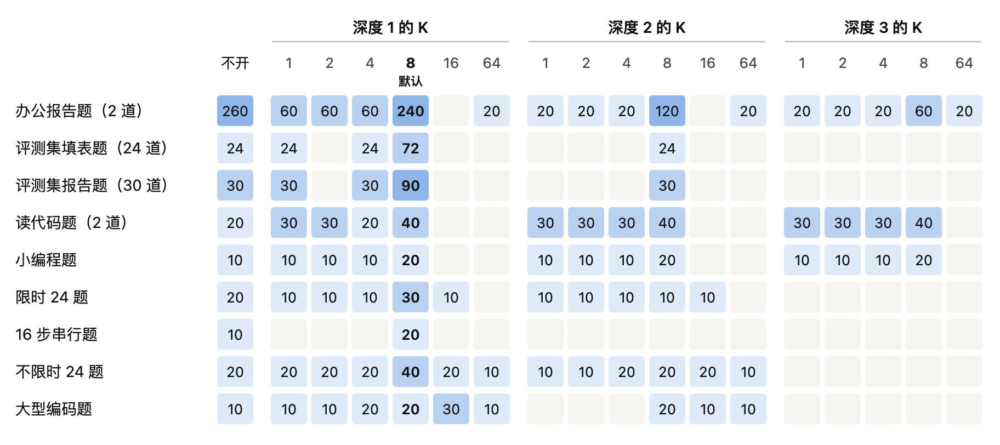

图 24 每种设置在每个任务上一共跑了多少次：各批、原题面的组和题面加了提示的组都加在一起，所以比表 15 里“每种设置跑几次”多；灰格是没测。

说明（图 24）：另有评测集填表题选题用的 65 次和限时 24 题限时 2 分钟的那一版 110 次没有画进去；把几份报告合成一份的 60 次合并运行不在这 2,713 次里。

K 和深度在办公报告题上扫得最全。两个公开评测集上测了不开 subagent、K=1、K=4 和深度 2；深度 3 只在办公报告题、读代码题和小编程题上测过。

### 指标和读法

- **质量**：办公报告题用“写对的事实占比”，即报告里写对的条目数除以清单条目数。结论以事先定下的 63 条为准：后补的 132 条是看过第一批报告以后整理的，参考的样本多数来自开 subagent 的组，可能偏向这些组，也更难写到（细节八）。事前写定的主要对比和校正是按全清单做的，所以办公报告题的各表两套数都给，各带自己的判断；两套读法不一样的地方，正文按 63 条下结论并写明。其余任务用各自的得分（满分 100）。

- **费用**（元/次）：模型费按这个模型在 DeepSeek 官网的公开高峰价算（每百万 token：没命中缓存的输入 2 元，命中缓存的输入 0.04 元，输出 8 元；空闲时段是一半），命中多少按接口返回的实际用量。各组输入里命中缓存的都在 97% 左右（办公报告题主要的一批各组 96.9%–97.5%），缓存不造成组间的差别；同一道题同时跑几十次对命中率有没有影响，没有单独量过。联网任务再加搜索费，每个搜索请求按抽样实测的 0.0173 元算（搜索请求的用量没有记进会话日志，只能这样估）。不联网的任务只有模型费。

- **时间**：从开始到主 agent 给出最终回答的时间，也就是用户等的时间。

- **对比**：每种设置都和同一批里的默认组比（各批有哪些设置见附录的表 12）。同一道题的同一次重复，两组各有一次运行，配成一对算差，给 95% 区间。倍数按每一对分别算、再取几何平均。加了并行提示或不复核提示的各组，对照的是同一批里题面相同的深度 1、K=8 的组。

- **判断**：四种判断用词的定义见前面的“任务、提示和判断用词”。一起做 Holm 校正的，是同一批里事前写定的那一组主要对比（表里带 ★ 的行）：质量、费用、时间各自在这一组里一起校正，把这一组按题拆开重算时也照样校正。接近满分、配对差多数为 0 的对比（大型编码题的得分），t 区间不可靠，按精确的符号翻转检验判断。不在这一组里的次要对比和事后的对比不校正；例外是读代码题把另一个因素合起来算的五个对比（K=1、2、4 对 K=8 是三个深度合起来，深度 2、3 对深度 1 是四个 K 合起来），它们是事后合并的，在这五个里一起校正。★ 只表示这一行在事前的清单里；清单写明的主要指标多数是质量，不限时 24 题和大型编码题是时间。表里的“判断”一列只说质量之差。

- **“没有差别”的范围**：±5 分是第一批开跑之前写进方案的。办公报告题的 ±8 个百分点，是在第一批看到开 subagent 的效果（+16.5 个百分点；正文用的 +15.5 是后来重做的那一批）以后、后面各次对比判分之前定的，取的是这个效果的一半左右；所以办公报告题上的“没有差别”只说明差别不超过 8 个百分点。

- **质量上能测出多大的差别**（按 80% 的把握算）：办公报告题 40 对的对比是 5–7 个百分点，只有 20 对的是 6–12 个；评测集填表题 4–6 分，评测集报告题 3–6 分，读代码题 6–8 分。

- **费用和时间上能测出多大的倍数**：办公报告题 40 对的对比、读代码题和评测集报告题，要差到 1.1–1.3 倍才测得出；评测集填表题、不限时 24 题、大型编码题和办公报告题 20 对的对比，多数要差到 1.3–1.7 倍，最大的一个要 2.1 倍。比这小的差别，“没测出差别”不等于没有；不限时 24 题和大型编码题上的“没测出更快”只说明没有快出三分之一以上。

- **哪些是事前写定的**：每一批的主要对比和读法，都是在读到结果之前写进实验方案的；附录的表 46 列出全部主要对比和结果，表前写明了哪几处不是在开跑之前写的。“次要对比”是方案里列明、但不进校正的对比；标“事后”的是看到结果以后加的分析，只作描述。

### 细节一：一次任务花多少钱

**费用随开的 subagent 数涨；K 和深度改变了开的数量，费用跟着变。开 subagent 既多了搜索费、也多了模型费：单 agent 靠多查提示把搜索请求做到默认的水平时，费用是默认的 0.78 倍（搜索费差不多，模型费不到一半；细节六）。开多少个由模型自己和两个上限决定，见细节二。**

- 一次任务的费用随开的 subagent 数直线上涨（图 4）。联网的调研类任务上一个 subagent 最贵，其中一半是搜索费。小编程题上默认时模型不开 subagent，默认和不开两组做的是同一件事，两组的费用差校正后不显著。

- 办公报告题上每多开一个 subagent，平均多 43 个搜索请求。单 agent 只在题面加多查提示，费用也是原来的两倍多（表 21：对默认从 ×0.24 到 ×0.59）。

- 办公报告题上 subagent 开在第几层，价钱差不多（三层分别约 1.6、1.4、1.5 元）。

- 不限时 24 题和大型编码题上，用途不同价钱不同：文件写完以后再派去复核的 subagent，一个的钱够开三个左右写代码的。

表 16 办公报告题各种设置下一次运行的费用（元，含估算的搜索费）。这些设置来自三批，最后一列是同一批里默认组的均值（所以有三个不同的数）。K=1 有一次运行没交出完整报告，没有算。

| 设置 | 运行次数 | 开的 subagent 数 | 均值 | 中位 | 九成不超过 | 最高 | 同批的默认 |
|---|---|---|---|---|---|---|---|
| 不开 subagent | 40 | 0.0 | 2.04 | 2.05 | 2.72 | 2.95 | 8.12 |
| K=1 | 39 | 1.9 | 4.65 | 4.85 | 6.47 | 7.65 | 8.12 |
| K=2 | 40 | 2.6 | 6.25 | 6.07 | 9.08 | 10.29 | 8.12 |
| K=4 | 40 | 3.5 | 8.01 | 7.63 | 11.50 | 12.52 | 8.12 |
| 默认（深度 1、K=8） | 40 | 3.6 | 8.12 | 7.33 | 10.95 | 17.25 | — |
| K=64 | 20 | 3.7 | 8.28 | 8.26 | 10.69 | 13.37 | 7.93 |
| 深度 2 | 40 | 7.9 | 14.63 | 14.00 | 19.60 | 24.44 | 8.12 |
| 深度 3 | 20 | 8.2 | 15.16 | 13.19 | 24.99 | 30.98 | 7.38 |
| 深度 2、K=64 | 20 | 12.3 | 22.62 | 23.11 | 31.16 | 38.11 | 7.93 |
| 深度 3、K=64（相当于旧默认） | 20 | 16.9 | 24.65 | 22.13 | 43.02 | 54.76 | 7.93 |

- K 和深度改变了开的数量，费用跟着变（表 16 的第三、四列一起变）：K 到 4 以后开的数量不再变，费用也不变；放开深度以后数量翻倍，费用跟着翻倍。表里开了 subagent 的九种设置，平均费用和按图 4 那条直线算出来的相差不超过 13%。

- 同一种设置里各次运行差得远：默认设置在五批里一共跑过 140 次（多查 150/250、250/500 那一批的 40 次没有算进来），最便宜的一次 2 元，最贵的一次 17 元；同是默认设置，开的数量只能解释这些运行之间费用差别的 28%（上面说的直线上涨是跨设置看的）。

- 背景里两份联网的用户日志（A、C）是多轮对话，按同样的算法每份整场约 38 元；相当于旧默认的 20 次单任务运行里有 3 次超过这个数（图 5）。

### 细节二：模型自己想开多少

**调研类任务上模型一次运行一共只开三四个 subagent，K=8 没有拒绝过它的调用（评测集填表题 24 次里有 9 次同时活着超过 4 个，最多到过 8 个）；深度上限在多数运行里都拒绝过调用。大型编码题上模型想开的比 8 多。**

- 调研类任务上 K=8 没有拒绝过任何调用，多数运行同时活着的不超过 4 个；大型编码题每次运行都有调用被 K 拒绝。问答题、小编程题和 16 步串行题，模型自己不开。

- 调研类任务上大多数运行都有调用被深度上限拒绝。办公报告题放开到深度 2 以后，仍有 32/40 次。

- 全部 2,713 次运行里，开 subagent 的调用一共 23,508 次，开成了 11,753 个，其余几乎都是被上限拒绝的（被深度上限 5,425 次，被 K 6,327 次；这个总数里包括各个把 K 调小了的组）。默认设置下，办公报告题一次运行开成 3.6 个，另有 7.6 次调用被深度上限拒绝（图 7）：是 subagent 想再往下开，图 25 是其中一次运行。放开到深度 2，第 1 层的 subagent 有的又开了几个，K=8 就满了，这时每次运行有 3.8 次调用被 K 拒绝（图 15）。

- 深度和 K 互相影响（图 8）：只放开 K 不放开深度，开的数量不变；深度 2 时 K=8 经常不够用（31/40 次同时活着的到了 8 个）；第 3 层要把 K 放到 64 才开得多。K 是各层合起来数的，K=1、2 时第 1 层就把它用满了：第一批里深度 2、K=1 和深度 2、K=2 的 40 次运行，第 2 层一个都没开出来。

- 不限时 24 题和大型编码题上，K 到 16 为止越大开得越多：不限时 24 题在题面加并行提示时，K=1 平均开 2.2 个，K=16 开 17.3 个，K=64 没有再多。

- 按够不够用看 K（表 4 的“同时活着超过 4 个”和“有调用被 K=8 拒绝”两列）：K=8 满足了调研类任务和读代码题全部默认运行的需要，其中同时活着超过 4 个的是少数。办公报告题实际跑过 K=4：40 次里 2 次有调用被拒绝，开的数量、写对的事实都和 K=8 没有差别（表 16、表 19）。两个公开评测集上 K=4 时，评测集填表题 24 次里 9 次、评测集报告题 30 次里 3 次有调用被拒绝。写代码的两种任务要得更多：K 放到 64 时，大型编码题（加不复核提示）同时活着的最多时中位 12 个，不限时 24 题（加并行提示）中位 9 个。

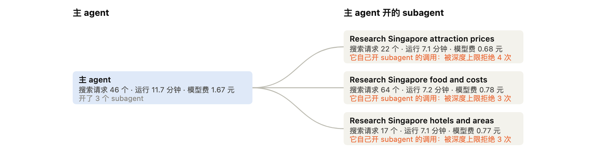

图 25 默认设置下的一次运行（旅行攻略题；开的 subagent 数等于这一组中位数的运行里取重复号最小的一次）：主 agent 一开始就开了 3 个 subagent，各查一块。

说明（图 25）：每个方框是一个 agent，第一行是模型自己给它起的标签（原文是英文），下面是它发出的搜索请求数、运行了多久、花了多少模型费，以及它自己开 subagent 的调用被拒绝了几次。

### 细节三：开不开值不值

**调研类任务上，开 subagent 换来查得更全（评测集填表题上没测出）；代码类任务上，模型会开 subagent 的四种任务费用是不开的 1.6–4.7 倍，得分只有限时 24 题（带时限，按方案只作参考）多了 7.1 分、大型编码题多通过 2 个测试，不限时 24 题没有差别，读代码题没测出差别；两类任务上，原题面下用户等的时间都没有测出缩短。**

表 17 开 subagent（默认）对不开 subagent。

| 任务 | 质量之差 | 判断 | 只算事先定下的 63 条 | 费用倍数 | 时间倍数 |
|---|---|---|---|---|---|
| 办公报告题 | +15.5 [+11.8, +19.1] | 显著变好 | +9.0 [+4.7, +13.4] | ×3.88 [3.44, 4.37] | ×1.20 [1.004, 1.43] |
| 评测集填表题 ★ | +2.7 [−0.5, +5.8] | 没测出差别 | — | ×2.77 [1.90, 4.04] | ×1.14 [0.86, 1.51] |
| 评测集报告题 ★ | +3.5 [+1.2, +5.9] | 显著变好 | — | ×2.82 [2.32, 3.43] | ×1.17 [0.97, 1.42] |
| 读代码题 | +1.4 [−3.9, +6.7] | 没测出差别 | — | ×1.81 [1.64, 2.00] | ×0.96 [0.84, 1.10] |
| 小编程题 | +0.3 [−0.4, +0.9] | 没有差别 | — | ×0.85 [0.73, 0.99]（校正后不显著） | ×0.83 [0.67, 1.02] |
| 限时 24 题 | +7.1 [+0.4, +13.7] | 显著变好 | — | ×1.56 [1.13, 2.17] | 限时 |
| 16 步串行题 | 0（都是满分） | — | — | ×1.07 [0.99, 1.16] | ×1.12 [1.06, 1.18] |
| 不限时 24 题 | −0.2 [−1.0, +0.6] | 没有差别 | — | ×2.98 [2.46, 3.62] | ×1.07 [0.89, 1.28] |
| 大型编码题 | +0.04 [+0.02, +0.05] | 显著变好（约 2 个测试） | — | ×4.67 [3.99, 5.47] | ×1.26 [0.97, 1.64] |

说明（表 17）：质量之差：办公报告题是写对的事实占比（个百分点），其余是得分；费用和时间是倍数；方括号里是 95% 区间。带 ★ 的行是事前写定的主要对比；办公报告题、限时 24 题、16 步串行题、不限时 24 题和大型编码题的行是方案里列明的次要对比（办公报告题的主要对比是第一批的那个，这一行用的是次数更多的主要一批）；读代码题、小编程题两行是把事前写定的三题合起来的对比按题拆开，属事后（三题合起来的结果见附录的表 42）。

- 调研类任务上，开 subagent 换来的是查得更全：办公报告题的事实占比显著更高，评测集报告题的召回（评分项里“该有的信息找到没有”那一类满足了百分之几）+4.2 [+1.4, +7.1]，评测集填表题的召回（标准答案的格子里填对了多少）+5.6 [+0.6, +10.5]、校正后不显著。按全清单，办公报告题两道题都成立（各批里旅行攻略题多 21–23 个百分点，CPU 选型题多 9–13 个）；按事先定下的 63 条，旅行攻略题在四批里都显著（多 15–22 个），CPU 选型题多 3–10 个、只有一批显著。办公报告题的这个对比在四批里重复过（各批的全清单结果是 +15.1、+15.5、+16.5、+17.7；第一批的那个是事前写定的主要对比，正文别处用的是主要一批的数）；写错的条数没有变多。

- 代码类任务上，限时 24 题做完的更多（测试全过的题从 14.5 道到 16.7 道，共 24 道），其余几种任务的得分见表 17。不限时 24 题和大型编码题上，文件写得更快（从开始到要写的文件都写完的时间，是不开的 ×0.80 和 ×0.49），用户等的时间却没有缩短，原因在细节六。

- 题面加并行提示，模型开得更多、费用更高，得分没有显著提高：读代码题对默认 +6.7 [+1.7, +11.7] 分（校正后不显著）、模型费 ×2.9；评测集填表题对不开 subagent +1.6 [−2.4, +5.7] 分；16 步串行题对默认模型费 ×1.9、时间 ×1.7，得分不变。

- 按题看，没看到“模型开得多的题涨得更多”：两个公开评测集上，每道题的涨幅和这道题默认开了几个 subagent 的相关系数是 +0.07 和 −0.06（两组的运行都计分的 19 道和 29 道题；区间约 ±0.4，中等强度的关系排除不了；事后分析）。

表 18 办公报告题：默认比不开 subagent 多写对的是哪些事实（事后分析）。

| 不开 subagent 时 | 这一档有几条 | 其中事先定下的 | 不开时写对 | 默认写对 | 多写对 | 占多写对的 |
|---|---|---|---|---|---|---|
| 几乎写不到（10% 以下） | 15.0 | 1.5 | 1.7 | 4.9 | +3.1 | 21% |
| 偶尔写到（10%–50%） | 33.5 | 7.0 | 12.4 | 19.8 | +7.5 | 50% |
| 多数写到（50%–90%） | 31.0 | 11.0 | 23.3 | 27.3 | +4.0 | 26% |
| 几乎都写到（90% 以上） | 18.0 | 12.0 | 17.4 | 17.9 | +0.5 | 3% |
| 合计 | 97.5 | 31.5 | 54.8 | 69.8 | +15.0 | 100% |

说明（表 18）：195 条事实按“不开 subagent 时多常被写对”分成四档；分档用第一批和多查 100/100 那一批里不开 subagent 的运行，多写对的条数在办公报告题主要的一批里量（分档和量用同一批的话，碰巧没写到的条目会平白显出涨幅）。条数都是每题每份报告的平均（清单每题平均 97.5 条）。

- 多写对的四分之三以上，落在单 agent 有时写到、有时写不到的两档。最低一档只占一到两成，是因为清单里这样的条目少（每题约 15 条）：按每条算，这一档被写对的比例从 12% 涨到 32%，涨幅和“偶尔写到”那一档（37% 到 59%）一样大。

- 最低一档的事实单 agent 也查得到，只是每次查到的少：四份单 agent 报告合并以后，这一档写对 5.8 条，默认是 4.9 条；换一批量，合并稿是 2.0 条、默认是 2.6 条，两批里谁多谁少不一样。

- 这张表有两个限制。清单主要收的是多份样本报告都写到的事实，很少被查到的事实进不了清单，所以它说明不了 subagent 多查到的东西里有多少是单 agent 查不到的。写没写对看的是最终报告，默认的报告也更长（3.9 万字对 2.3 万字），表里分不开“查到的更多”和“写进去的更多”。

- 事先定下的 63 条大多落在单 agent 本来就常写对的两档，可涨的余地小；这是只算 63 条时效果小一截的原因之一（细节八）。

### 细节四：K

**K 调大（16、64）没测出好处。K=1 有显著的损失：大型编码题的时间和限时 24 题的得分（后一个带时限，按方案只作参考）；读代码题三个深度合起来算也显著（事后合并），只看深度 1 没测出差别。K=2 校正后显著的损失只有大型编码题加不复核提示时慢到 1.57 倍；三处质量的估计值偏低，都不显著（读代码题三个深度合起来和限时 24 题两处，单看区间不含 0，校正后不成立）。K=4 和 8 显著的差别只在大型编码题上：4 更便宜，加了不复核提示以后慢两成。三种调研类任务上 K=4 的质量、费用、时间都不显著，其中评测集填表题的区间宽。**

表 19 换 K 对 K=8 的差别（深度都是 1；图 9、图 26、图 10 画的就是这张表）。

| 任务 | K | 质量之差 | 判断 | 办公报告题：事先定下的 63 条 | 费用倍数 | 时间倍数 |
|---|---|---|---|---|---|---|
| 办公报告题 | 1 ★ | −7.3 | 显著变差 | （−4.7），没测出差别 | ×0.57 | （×1.05） |
|  | 2 ★ | （−3.7） | 没测出差别 | （−3.5），没测出差别 | ×0.77 | （×1.05） |
|  | 4 ★ | （+1.9） | 没有差别 | （+0.1），没有差别 | （×1.00） | （×1.04） |
|  | 64 ★ | （−4.7） | 校正后不显著 | （−2.1），没有差别 | （×1.04） | （×0.91） |
| 评测集填表题 | 1 | （−1.3） | 没有差别 | — | ×0.58 | （×1.21） |
|  | 4 ★ | （+1.1） | 没测出差别 | — | （×0.88） | （×0.99） |
| 评测集报告题 | 1 ★ | （−0.6） | 没有差别 | — | ×0.52 | （×0.94） |
|  | 4 ★ | （+0.7） | 没有差别 | — | （×1.15） | （×1.11） |
| 读代码题（加并行提示） | 1 | （−2.9） | 没测出差别 | — | ×0.52 | （×1.11） |
|  | 2 | （−3.4） | 没测出差别 | — | ×0.64 | （×0.86） |
|  | 4 | （−1.9） | 没测出差别 | — | （×0.94） | （×0.97） |
| 限时 24 题（加并行提示） | 1 ★ | −5.8 | 显著变差 | — | ×0.45 | 限时 |
|  | 2 ★ | （−4.1） | 校正后不显著 | — | ×0.58 | 限时 |
|  | 4 ★ | （−6.6） | 没测出差别 | — | （×0.74） | 限时 |
|  | 16 ★ | （+0.3） | 没有差别 | — | （×0.83） | 限时 |
| 不限时 24 题（加并行提示） | 1 ★ | −1.0 | 显著变差 | — | ×0.38 | （×0.74） |
|  | 2 ★ | （−0.5） | 没有差别 | — | ×0.52 | （×0.80） |
|  | 4 ★ | （−0.4） | 没有差别 | — | （×0.74） | （×0.81） |
|  | 16 ★ | （+0.1） | 没有差别 | — | （×1.24） | （×1.03） |
|  | 64 ★ | （0） | 没有差别 | — | （×1.16） | （×0.98） |
| 大型编码题（原题面） | 4 | （−0.01） | 没测出差别（区间不含 0，精确检验 p = 0.13；平均差 0.4 个测试） | — | ×0.70 | （×1.13） |
|  | 16 | （0） | 没有差别 | — | （×1.11） | （×1.06） |
| 大型编码题（加不复核提示） | 1 ★ | （−0.02） | 没有差别 | — | ×0.67 | ×2.25 |
|  | 2 ★ | （−0.01） | 没有差别 | — | ×0.79 | ×1.57 |
|  | 4 ★ | （0） | 没有差别 | — | ×0.82 | ×1.22 |
|  | 16 ★ | （+0.01） | 没有差别 | — | （×1.08） | （×1.02） |

说明（表 19）：质量之差：办公报告题是写对的事实占比（个百分点），其余是得分。办公报告题的“质量之差”和“判断”两列是全清单的，旁边一列是事先定下的 63 条和它自己的判断，结论以 63 条为准。费用（办公报告题和评测集报告题含搜索费，其余是模型费）和时间是倍数。带括号的数：区间含 0（倍数是含 1），或者校正后不显著；区间在附录的表 6。带 ★ 的行是事前写定的主要对比。限时 24 题的费用是限时 3 分钟里花掉的模型费。

- K 只在模型想开得比它多的时候起作用：办公报告题上模型只开三四个，K=4 和 8 没有差别。读代码题上 K=4 和 8 没测出差别；限时 24 题上 K=4 的估计值偏低，但 10 对的区间很宽（附录表 6），也没测出差别。

- 上面都是深度 1 下的对比。读代码题在第一批里还在深度 2、3 下各跑过一套：深度 2 那一套 K=4 比 K=8 高（+3.7 [+0.9, +6.6]，20 对；没有校正，只作描述），深度 3 是 +0.1；三个深度合起来 +0.7，没有差别。

- 两个公开评测集上补测的 K=4（事前写定的主要对比，两个一起校正）：评测集报告题没有差别（+0.7 [−3.1, +4.5]，30 对）；评测集填表题没测出差别（+1.1 [−3.5, +5.7]，18 对，这些对数能测出的最小差别约 6 分）。两处的费用和时间都没测出差别（费用 ×0.88、×1.15，时间 ×0.99、×1.11）。事前写定的读法在附录的表 13。

- K=1 在办公报告题上按事先定下的 63 条少写对 4.7 个百分点、没测出差别（全清单少 7.3，显著），在限时 24 题上少做完，在大型编码题（加不复核提示）上慢得多；评测集报告题和评测集填表题上没有差别（±5 分以内），费用是一半多一点。不限时 24 题上 K=1 的得分低 1 分，大型编码题各组的得分差都不到 1 个测试。

- K=2 的费用是 K=8 的 0.52–0.79 倍。办公报告题和限时 24 题上质量的估计值偏低，一个没测出、一个校正后不显著；大型编码题加了不复核提示以后慢到 1.57 倍。

- 费用跟着开的数量走（图 11）：办公报告题上 K 到 4 就不再涨；不限时 24 题和大型编码题上从 K=1 到 8 费用在涨，K=16 没测出比 8 更贵。

- K=4 和 8 的差别只在大型编码题上测得出，是费用和时间的取舍：原题面下 K=4 更便宜（少派了复核的 subagent），时间没测出差别；加了不复核提示以后，K=4 更便宜也更慢。原题面下 K=4 平均多留 0.4 个没通过的测试（10 次里 4 次各留 1 个，K=8 的 10 次全过），得分差 −0.01 分：t 区间不含 0，但 10 对里只有 4 对不为 0，按精确检验 p = 0.13，没测出差别；也远在方案定的 −1 分门槛以内（表 13）。原题面的这几组还有三到六成的运行把内存用满（细节七），时间的比较带着这个影响。

- K=16、64 没测出更快（大型编码题上 K=64 只和同批的 K=16 比过：×0.87，区间含 1）。大型编码题加不复核提示时，这不是内存不够造成的：模型同时最多只开十一二个，文件写得更快了，到最终回答的时间没有缩短（细节七的表 29）。

- 给出 K 取值的读法先后写过四条，另有两条判断小 K 有没有损失；什么时候写的、写的时候看过哪些结果、各给出什么，列在附录的表 13。10 月 3 日的三条规则写的时候有两条的结果已经在手，不算事前写定，按它得到的是 4；10 月 4 日为大型编码题补的两条，原题面下给出 4，加不复核提示时给出 8。补测 K=4 之前写定的那一条给出的是保持 8，建议按的是它。正文方法里的判断框架是这些规则的概括，交付那一步方案里没有。

- 各组的绝对数在附录的分任务结果表和图里（图 31、图 35、图 16、图 38）。

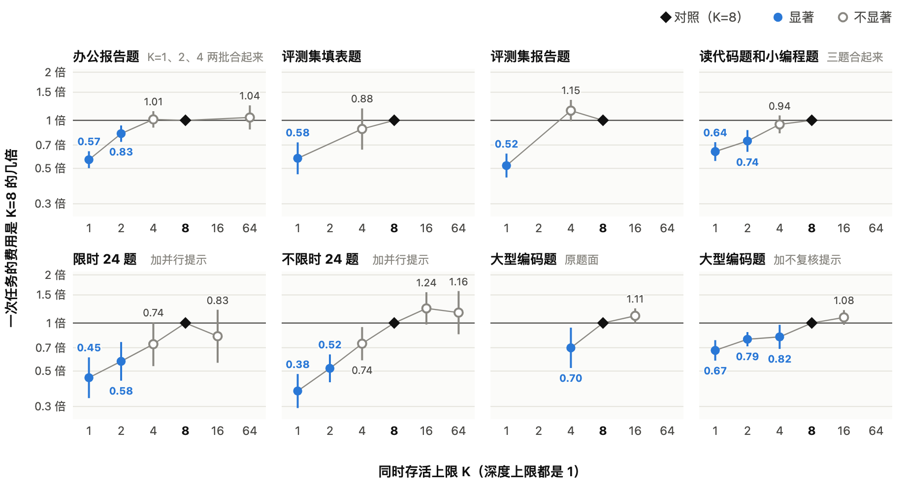

图 26 K 取不同值时一次任务的费用：是同一批里 K=8 的几倍。

### 细节五：深度

**放开到深度 2，办公报告题的费用近两倍，写对的按事先定下的 63 条只多 2.2 个百分点、区间含 0（全清单多 3.8，显著）；评测集报告题和读代码题只是变贵；深度 3 没测出比深度 2 多写对。**

表 20 放开深度以后的差别（图 13、图 27、图 14 画了其中的大部分行；办公报告题深度 3 对 2、读代码题加并行提示的两行和两道 24 题的深度 2 没有画）。

| 任务 | 对比 | 质量之差 | 判断 | 办公报告题：事先定下的 63 条 | 费用倍数 | 时间倍数 |
|---|---|---|---|---|---|---|
| 办公报告题 | 深度 2 对 1（K=8，四批合起来算，99 对，事后） | +3.8 | 显著变好 | （+2.2），没有差别 | ×1.87 | ×1.11 |
|  | 深度 3 对 1（K=8，两批合起来算，事后） | （+4.1） | 没测出差别 | （+0.7），没有差别 | ×1.87 | ×1.20 |
|  | 深度 3 对 2（K=8，两批合起来算，事后） | （+0.9） | 没有差别 | （−1.4），没有差别 | — | — |
|  | 深度 3、K=64 对默认（相当于旧默认）★ | （+1.4） | 没有差别 | （+1.5），没有差别 | ×2.89 | （×1.20） |
| 评测集填表题 | 深度 2 对 1 | （+2.3） | 没测出差别 | — | （×1.18） | （×1.22） |
| 评测集报告题 | 深度 2 对 1 ★ | （+0.6） | 没有差别 | — | ×1.49 | （×1.12） |
| 读代码题（原题面） | 深度 2 对 1 | （+0.7） | 没测出差别 | — | ×1.48 | ×1.15 |
|  | 深度 3 对 1 | （+2.8） | 没测出差别 | — | ×1.42 | （×1.07） |
| 读代码题（加并行提示） | 深度 2 对 1 | （−0.6） | 没有差别 | — | （×1.09） | （×0.96） |
|  | 深度 3 对 1 | （+0.5） | 没有差别 | — | （×1.02） | （×0.90） |
| 小编程题（原题面） | 深度 2 对 1 | （0） | 没有差别 | — | （×1.26） | （×1.46） |
|  | 深度 3 对 1 | （0） | 没有差别 | — | ×1.71 | ×1.88 |
| 限时 24 题（加并行提示，五个 K 合起来） | 深度 2 对 1 ★ | （−2.8） | 没测出差别 | — | （×1.03） | 限时 |
| 不限时 24 题（加并行提示，K=4、8、16 合起来） | 深度 2 对 1 ★ | +0.4 | 显著变好 | — | ×0.91 | （×0.93） |
| 大型编码题（原题面） | 深度 2 对 1 | （0） | 没有差别 | — | （×0.95） | （×0.85） |
| 大型编码题（加不复核提示） | 深度 2 对 1 | （−0.01） | 没有差别 | — | （×0.93） | ×1.34 |

说明（表 20）：质量之差：办公报告题是写对的事实占比（个百分点），其余是得分；费用和时间是倍数。带括号的数：区间含 0（倍数是含 1），或者校正后不显著。办公报告题的“质量之差”和“判断”是全清单的，旁边一列是事先定下的 63 条和它自己的判断，结论以 63 条为准。带 ★ 的行是事前写定的主要对比，其余是事前列明的次要对比（没有校正）或事后合并。办公报告题前两行的时间里，有一批记的是整个进程的时长（含等 subagent 结束的时间）。

- 办公报告题上，放开到深度 2 或 3，一次任务多花 6.5–7.8 元；K 也放到 64，多花 15–17 元（图 12）。换来的写对的事实占比只多几个百分点。按事先定下的 63 条，四批合起来是 +2.2 [−0.1, +4.5]，区间含 0；把 K 也放到 64 的第五批算上是 +2.3 [+0.3, +4.4]。按全清单是 +3.8 [+1.0, +6.7]：四批单看都测不出，合起来算才显著（附录的图 32）。深度 3 没测出比深度 2 多。

- 评测集报告题上深度 2 也更贵；评测集填表题上质量、费用、时间都没测出差别（+2.3 [−2.7, +7.2]，×1.18，×1.22）。读代码题原题面下，深度 2、3 的模型费是 1.48、1.42 倍，得分没测出变化：多花的钱在写方案那道题上，模型在第 2 层又开了 3 个左右，这道题的模型费是深度 1 的 1.80 倍。题面加并行提示时，深度 1 的费用本来就高（图 12 的读代码题一格画的是这一套），深度 2、3 没测出更贵。

- 小编程题上模型在深度 1 时一次都不开 subagent；深度 2 的 10 次里有 1 次、深度 3 有 4 次开了（各 1–2 个），这 5 次的模型费平均 1.78 元，其余没开的 0.63 元，得分都是满分。主 agent 看到的工具和提示在三种深度下完全相同，各只有 10 次，这个差别是不是偶然分不清（只作描述）。

- 各批事前写的、会影响深度放不放开的读法有八条（附录的表 14），没有一条给出放开；其中两条的结果落在读法没有预设说法的地方。

- 时间：深度 2 没有让任何一种任务显著更快。显著更慢的三处（办公报告题四批合起来 ×1.11、读代码题原题面 ×1.15、大型编码题加不复核提示 ×1.34），都只是刚好显著，区间下端都是 1.01；办公报告题主要的一批单看是 ×1.02 [0.87, 1.19]，读代码题加并行提示时是 ×0.96，大型编码题原题面是 ×0.85，区间都含 1。

- 办公报告题以外，测出好处的只有不限时 24 题（得分高不到半分、模型费略低），不值得为它改默认。大型编码题加不复核提示时深度 2 更慢，K 放到 16、64 以后这个差别没有再出现（附录表 46 的“大型编码题：K=16、64 时的深度 2”两行）。

- 相当于旧默认的设置开的 subagent 是现在的近 5 倍（最多一次 28 个），多花的钱没有换来测得出的提高；把对照换成同批的默认和深度 1、K=64 两组的平均，结果相近（表 35 注 2）。

- 别人的实验里放开深度是变差的，见“和别人的结果对照”。

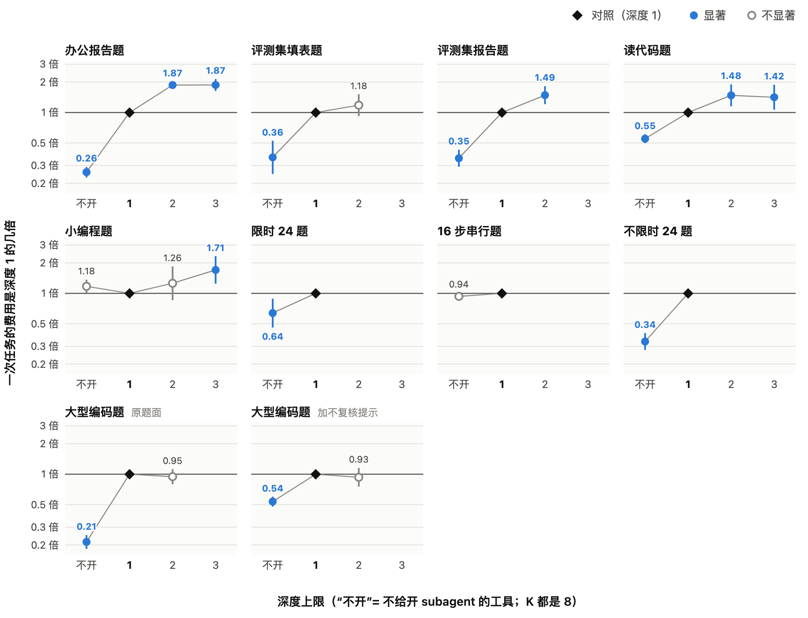

图 27 深度取不同值时一次任务的费用：是同一批里深度 1 的几倍。“不开”是不给开 subagent 的工具。

### 细节六：钱和时间花在哪

**调研类任务的钱一半是搜索费。办公报告题上让单 agent 自己多查（题面加多查提示），搜索量到了默认的水平：按事先定下的 63 条，多查 150/250 比默认少写对 3.9 个百分点、没测出差别，多查 250/500 少 8.6 个、显著（全清单少 6.4 和 11.4 个，都显著）；默认比不开多写对的那些，它补上的不到六成；四份独立的单 agent 报告合并，才不比默认少。大型编码题的钱和时间大半花在复核上（代码写完以后，模型又派一批 subagent 去检查）；不限时 24 题上复核占钱的 23%、时间的 18%。**

表 21 办公报告题：不开 subagent 的几种做法（另加一行默认加都写进去提示）和默认比。

| 批 | 做法 | 配对数 | 搜索请求 | 费用 | 时间 | 写对的事实占比之差（个百分点） | 只算事先定下的 63 条 |
|---|---|---|---|---|---|---|---|
| 多查 100/100 那一批 | 不开 subagent | 40 | ×0.23 | ×0.24 | ×0.72 | −17.7 [−21.6, −13.9] | −12.9 [−16.9, −8.8] |
|  | 不开 subagent + 多查 100/100 | 40 | ×0.75 | ×0.59 | ×1.08（区间含 1） | −9.0 [−13.0, −5.1] | −8.4 [−12.6, −4.2] |
|  | 默认 + 都写进去提示（只算交出完整报告的） | 32 | ×1.17（区间含 1） | ×1.22 | ×1.31 | +4.8 [+0.9, +8.6] | +4.1 [−0.1, +8.2] |
| 多查 150/250、250/500 那一批 | 不开 subagent | 40 | ×0.27 | ×0.27 | ×0.84 | −15.1 [−19.1, −11.1] | −10.3 [−14.7, −6.0] |
|  | 不开 subagent + 多查 150/250 | 39 | ×1.07（区间含 1） | ×0.78 | ×1.63 | −6.4 [−10.6, −2.1] | −3.9 [−8.2, +0.4] |
|  | 不开 subagent + 多查 250/500 | 40 | ×1.14（区间含 1；39 对） | ×0.79 | ×1.62 | −11.4 [−15.0, −7.7] | −8.6 [−13.1, −4.1] |
| 合并稿（两批合起来算） | 两份报告合并 | 40 | ×0.51 | ×0.65 | ×1.52 | −0.3 [−3.2, +2.6] | +1.2 [−1.7, +4.1] |
|  | 四份报告合并 | 20 | ×0.99 | ×1.15 | ×1.73 | +7.4 [+3.4, +11.4] | +7.1 [+3.1, +11.2] |

说明（表 21）：每行只和同一批里的默认比，按批分成三段；搜索请求、费用、时间三列是对默认的倍数。合并指同一道题让几个单 agent 各自独立写一份报告，再由一个单 agent 合并成一份（下文叫合并稿）；费用算这几次运行的总和，时间按几份同时写、写完再合并算。第一段的第三行是默认设置加都写进去提示：40 次里有 8 次主 agent 没等 subagent 回来就结束，没交出完整的报告，这一行只算其余的（40 次全算的数在方法补充）。

表 22 办公报告题：多查 150/250 和多查 250/500 对同批默认，按题分开（每题 19–20 对）。

| 题 | 提示 | 写对的事实占比之差（个百分点） | 搜索请求（对默认的倍数） |
|---|---|---|---|
| 旅行攻略题 | 多查 150/250 | −9.7 [−16.5, −3.0] | ×1.41 [1.12, 1.77] |
|  | 多查 250/500 | −18.0 [−23.3, −12.6] | ×1.30 [0.93, 1.84] |
| CPU 选型题 | 多查 150/250 | −3.0 [−8.7, +2.7] | ×0.81 [0.58, 1.14] |
|  | 多查 250/500 | −4.7 [−10.1, +0.6] | ×0.99 [0.76, 1.29] |

- **让单 agent 多查，能补上一部分；三种提示里两种仍显著少于默认。** 多查 100/100 的搜索请求是默认的 0.75 倍，按事先定下的 63 条比不开多 4.5 个百分点、区间含 0（全清单多 8.7，显著），补上了不开和默认之间差距的 35%（全清单 49%），仍比默认少 8.4 个百分点，显著。多查 150/250 和多查 250/500 的搜索请求和默认没测出差别。按 63 条，同一批里默认比不开多写对 10.3 个百分点，这两种比不开多 6.0 和 1.7 个（后一个区间含 0），比默认少 3.9（没测出差别）和 8.6（显著）。按全清单，比不开多 8.5 和 3.7 个（后一个区间含 0），比默认少 6.4 和 11.4 个（都显著）（表 21、图 18、图 17；各组的数在附录的表 36）。

- **少写对的主要在旅行攻略题上（表 22）。** 这道题上多查 150/250 的搜索请求比默认还多，多查 250/500 的估计值也更高（区间含 1），写对的仍然少；CPU 选型题上写对的差区间含 0。

- **多出来的是搜索请求和下载量，逐个打开来读的网页并没有多。** 多查 150/250 和多查 250/500 用 web_fetch 逐个打开的网页只有 22 和 14 个（同批不开 subagent 是 29 个，默认 104 个），模型费是默认的 0.45 和 0.43 倍。要求打开的网页越多，模型越是写脚本成批下载、存到磁盘再检索，而不是一个一个读：存盘的网页，多查 100/100 平均 83 个（图 29），多查 150/250 和多查 250/500 是 376 和 807 个（图 18）。所以搜索量到了默认的水平时，单 agent 更便宜（搜索费差不多，模型费不到一半），但要多等六成时间。

- **再多查一档会不会更好，没有回答。** 事前想用多查 250/500 对多查 150/250 来看，但前者实际的搜索请求只是后者的 ×1.06，没有拉开；写对的反而少 5.0 个百分点（−5.0 [−8.6, −1.4]；把没交出完整报告的那一次运行也算进去是 −3.2 [−8.3, +1.9]）。这一批只试了“题面加一句要求”这一种让单 agent 多查的办法。

- **上下文窗口没有用满。** 这两种提示下，主 agent 单次请求的输入最多时，中位是 23.6 万和 22.8 万 token（同批默认的主 agent 23.7 万；各组里最大的一次是 67 万和 44 万，窗口是 100 万）；被 DSH 裁剪过上下文的运行各有 1 次和 0 次（DSH 不等窗口用满就会裁剪），没有一次运行超时。但下载的网页是存盘检索的，没有读进上下文；少写对和一个上下文能读多少有没有关系，这份数据说明不了。

- **两份合并和默认没有差别，四份合并不比默认少。** 四份合并的搜索量和默认差不多，两批合起来算，比默认多写对 7.1 个百分点（按事先定下的 63 条；全清单 7.4，都显著）；按全清单分批是 +9.8 [+3.3, +16.2] 和 +5.0 [−0.9, +11.0]，后一批区间含 0（前一批拿来合并的报告和对照的默认组是前一天跑的，后一批是同一批）。合并用的那段话要求“有来源的事实都保留”，默认的主 agent 没有被这样要求；和题面加了都写进去提示、交出完整报告的默认比（只有后一批能比），四份合并是 −0.2 [−3.3, +3.0]（10 对），两份合并是 −7.0 [−10.6, −3.3]。所以能说的是：四份合并写对的不比默认少；默认比不开多写对的那些，不一定要靠 subagent 才补得上。

- **合并稿里的事实从哪来（图 19）。** 一份单 agent 报告平均写对 54 条；两份里至少有一份写对的是 68 条，四份是 80 条；合并稿写对 70 条和 77 条，默认是 70 条。合并这一步自己查得很少（一次平均 8 个搜索请求，最多 22 个），题面要求它只在几份说法不一致、需要核实的时候再去查。

- **主 agent 汇总时丢得不多。** subagent 交回的消息里写对的事实，有 3%–5% 没进最终报告（每份 2–4 条）。这只算了 subagent 发回的文字，它们直接写进文件的不算；深度 2 时第 2 层交给第 1 层的那一步没有量。深度 2 没测出比深度 1 丢得更多（附录的表 37）。

- **同一次运行里，各个 agent 查的东西很少重复（图 28、表 23）。** 办公报告题主要的一批里，默认设置下一次运行用 web_fetch 打开 112 个不同的网页，其中 9 个（8%）有两个以上的 agent 打开过；搜索的查询词 239 个里重复的平均不到 1 个。放开深度以后开的 agent 多了，重复的仍只有一成左右。这是按网址和查询词逐字比的：换个说法的查询词、内容相同的不同网页算不出来。

- **各个 subagent 交回的事实也很少重复（图 22、表 24）。** 判过的 90 次运行（subagent 一共交回 726 条消息）里，写对的事实有 93%–95% 能对上是哪个 subagent 交回的；对得上的里面，87%–92% 只在一个 subagent 的消息里出现。交得最多的那个 subagent 占三成半到六成（一次运行有 3–4 个 subagent 交回消息）。这是按原话和取值逐字找的，换了说法的重复找不出来。算作“别的 subagent 也有”的 544 条里，原话在两个 subagent 的消息里都有的只有 10 条，其余是取值在别处也出现，其中 63% 的取值不到 6 个字（比如 S$14）；只算 6 个字以上的取值，只在一个 subagent 的消息里出现的是 94%–98%。

- **被拒绝的调用本身花的钱很少（表 25）。** 模型为没开成的 subagent 写的任务说明，办公报告题默认设置下每次运行约 0.05 元，占模型费的 1.3%；发出的工具调用全是被拒绝的开 subagent 调用的模型请求，每次运行 1.5 步，整步的费用 0.06 元（1.5%）。两个数有重叠，合起来不到这一组模型费的 3%。全部运行加在一起，这两项是 82 元和 60 元，模型费一共 9,739 元。被拒绝以后模型怎么改做法、对质量有没有影响，这里没有量。

- **都写进去提示**让交出完整报告的运行多写对几个百分点（只算事先定下的条目时区间含 0），其中从汇总这一步少丢的不到 2 条；这些运行开的 subagent 也更多（4.6 个对 3.8 个）。代价是主 agent 更容易没等 subagent 回来就结束（DSH 缺陷第 4 条）。

- **搜索费。** 联网任务的费用有一半左右是搜索费（办公报告题默认组 51%）。每个搜索请求里，模型顺带写的那段回答占这个请求费用的 43%，搜索插件并不用它。

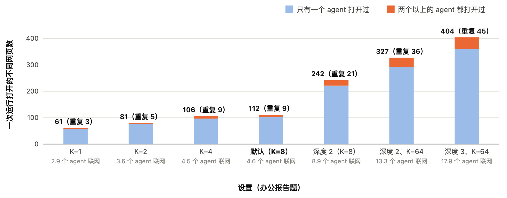

图 28 办公报告题：一次运行里各个 agent（主 agent 和 subagent）用 web_fetch 打开的不同网页数，橙色是两个以上的 agent 都打开过的。

说明（图 28）：柱子上是总数和其中重复的个数；设置下面的灰字是平均每次运行有几个 agent 联过网。前五种设置来自办公报告题主要的一批（各 40 次运行），后两种来自 K=64 批（各 20 次）。

表 23 办公报告题：同一次运行里各个 agent 查的东西重复多少（每次运行的平均；前五行是办公报告题主要的一批，后两行是 K=64 批）。

| 设置 | 联网的 agent 数 | 不同的查询词 | 两个以上的 agent 都查过的 | 用 web_fetch 打开的不同网页 | 两个以上的 agent 都打开过的 | 占打开的网页 |
|---|---|---|---|---|---|---|
| K=1 | 2.9 | 136 | 0.2 | 61 | 3.0 | 5% |
| K=2 | 3.6 | 180 | 0.1 | 81 | 5.0 | 6% |
| K=4 | 4.5 | 237 | 0.3 | 106 | 9.3 | 10% |
| 默认（K=8） | 4.6 | 239 | 0.5 | 112 | 9.4 | 8% |
| 深度 2（K=8） | 8.9 | 455 | 0.8 | 242 | 20.9 | 9% |
| 深度 2、K=64 | 13.3 | 656 | 1.4 | 327 | 36.4 | 11% |
| 深度 3、K=64 | 17.9 | 720 | 1.6 | 404 | 44.6 | 10% |

说明（表 23）：查询词按小写、去掉多余空格以后逐字比；网页按网址比（去掉协议、www. 和末尾的斜杠）。只算搜索工具和 web_fetch，不含在 shell 命令里抓的网页。

表 24 办公报告题：交回的消息里写对的事实是哪个 subagent 交回的（个数和条数是每次运行的平均，两个百分比是各次运行合起来算的比例）。

| 组 | 运行数 | 交回过消息的 subagent（其中有事实对得上的） | 交回的消息里写对 | 对得上是谁交回的 | 只在一个 subagent 的消息里 | 别的 subagent 也有 | 交得最多的一个占 |
|---|---|---|---|---|---|---|---|
| 默认 | 18 | 3.6（3.2） | 52.5 | 94% | 45.1（91%） | 4.6 | 58% |
| 深度 2 | 19 | 3.3（3.3） | 63.9 | 94% | 54.5（91%） | 5.5 | 51% |
| 默认（和下一组同批） | 19 | 3.7（3.6） | 60.7 | 95% | 53.2（92%） | 4.5 | 44% |
| 默认 + 都写进去提示 | 15 | 4.1（4.1） | 71.1 | 95% | 58.8（87%） | 8.9 | 36% |
| 深度 2、K=64 | 19 | 3.6（3.4） | 71.3 | 93% | 59.2（89%） | 7.3 | 47% |

说明（表 24）：一条事实按判分时引的那句原文去找它出自哪个 subagent 的消息；原文在两个 subagent 的消息里都有，或者这条事实的取值在别的 subagent 的消息里也出现，就算“别的 subagent 也有”。

表 25 被拒绝的开 subagent 的调用和它们花的钱（每次运行的平均）。

| 任务 | 设置 | 运行数 | 开成的 subagent | 被深度上限拒绝 | 被 K 拒绝 | 任务说明（元） | 整步都被拒绝的请求（元） |
|---|---|---|---|---|---|---|---|
| 办公报告题 | K=1 | 40 | 1.9 | 3.8 | 2.8 | 0.05（2.1%） | 0.9 步，0.03（1.4%） |
|  | K=2 | 40 | 2.6 | 4.5 | 1.6 | 0.04（1.4%） | 1.1 步，0.03（1.1%） |
|  | K=4 | 40 | 3.5 | 7.7 | 0.1 | 0.05（1.4%） | 1.7 步，0.06（1.6%） |
|  | 默认 | 40 | 3.6 | 7.6 | 0.0 | 0.05（1.3%） | 1.5 步，0.06（1.5%） |
|  | 深度 2 | 40 | 7.9 | 4.3 | 3.8 | 0.06（0.9%） | 1.7 步，0.06（0.9%） |
| 评测集填表题 | 默认 | 24 | 4.0 | 5.3 | 0.0 | 0.04（1.0%） | 0.8 步，0.03（0.7%） |
| 评测集报告题 | 默认 | 30 | 2.8 | 3.6 | 0.0 | 0.04（1.2%） | 1.0 步，0.05（1.3%） |
| 读代码题和小编程题 | 默认 | 30 | 1.2 | 1.2 | 0.0 | 0.01（0.6%） | 0.4 步，0.01（0.7%） |
| 不限时 24 题 | 默认 | 20 | 6.8 | 0.1 | 0.2 | 0.00（0.0%） | 0.1 步，0.00（0.0%） |
|  | 加并行提示，K=1 | 20 | 2.2 | 0.4 | 7.4 | 0.03（1.1%） | 0.1 步，0.00（0.1%） |
| 大型编码题 | 默认 | 10 | 20.0 | 4.1 | 4.9 | 0.10（0.5%） | 2.5 步，0.08（0.4%） |
|  | 加不复核提示，K=1 | 10 | 4.0 | 0.1 | 10.6 | 0.06（1.1%） | 0.1 步，0.00（0.0%） |

说明（表 25）：办公报告题各行出自办公报告题主要的一批（默认组在六批里被深度上限拒绝的调用是每次运行 6.4–8.9 次），其余各行依次出自评测集填表题批、评测集报告题第一批、第一批、不限时 24 题批、大型编码题批。“任务说明”一列是模型为没开成的 subagent 写调用参数用掉的输出 token 折成的钱（把这一步的输出按各个调用的参数长度分摊，含思考，是偏高的估计）；“整步都被拒绝的请求”是一次模型请求发出的工具调用全是被拒绝的开 subagent 调用时，这次请求的全部费用（输入、命中缓存的输入和输出）。括号里是占这一组模型费的比例。两列有重叠，不能相加。

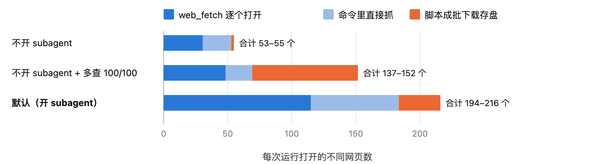

图 29 办公报告题：一次运行打开的不同网页数，按打开的办法分（多查 100/100 那一批）。命令里直接抓的和脚本存盘的会有重叠，合计给的是下限和上限。

表 26 办公报告题：多写对一条事实要多花多少钱（多花的钱 ÷ 多写对的条数）。

| 做法 | 和谁比 | 多写对（条） | 多花（元） | 每条（元） |
|---|---|---|---|---|
| 两份报告合并 | 一次不开 subagent 的运行 | +16.0 | +3.2 | 0.20 |
| 四份报告合并 | 一次不开 subagent 的运行 | +23.5 | +7.4 | 0.32 |
| K=1 | 一次不开 subagent 的运行 | +8.3 | +2.6 | 0.32 |
| 不开 subagent + 多查 100/100 | 一次不开 subagent 的运行 | +8.5 | +2.8 | 0.32 |
| 不开 subagent + 多查 150/250 | 一次不开 subagent 的运行 | +8.3 | +4.0 | 0.48 |
| 不开 subagent + 多查 250/500 | 一次不开 subagent 的运行 | +3.6（区间含 0） | +4.3 | 1.17 |
| 默认（开 subagent） | 一次不开 subagent 的运行 | +15.1 | +6.1 | 0.40 |
| 默认 + 都写进去提示（只算交出完整报告的） | 默认 | +4.7 | +1.8 | 0.40 |
| 深度 2 | 默认 | +3.5（区间含 0） | +6.5 | 1.85 |
| 深度 3、K=64（相当于旧默认） | 默认 | +1.4（区间含 0） | +16.7 | 测不出多写对 |

说明（表 26）：单位是条，不是百分点（一份清单平均 97.5 条）。前七行从不开 subagent 出发，后三行在默认之上再加；每行只用一批的数、和同一批里的参照比，所以深度 2 这一行（一批 40 对）和表 20 里四批合起来的数不一样。条数按全清单算，没有另按事先定下的 63 条算。

- 从不开 subagent 出发，多写对一条事实：两份报告合并最便宜；四份合并、K=1 和多查 100/100 约 0.32 元，默认 0.40 元；多查 150/250 和多查 250/500 是 0.48 和 1.17 元（后者多写对的区间含 0）。在默认之上再加，放开深度比都写进去提示贵得多。

- 按对默认的估计值，四份合并比深度 2 多写对，费用低得多（表 21、表 20），只是要等的时间是默认的 1.7 倍。

表 27 不限时 24 题和大型编码题：代码写完以后有没有再派 subagent 复核。

|  | 到最终回答（分钟） | 模型费（元/次） | 没通过的隐藏测试（共 3,737 个） |
|---|---|---|---|
| 大型编码题，不开 subagent | 21.6 | 4.25 | 1.9 |
| 大型编码题，默认（10/10 次派了复核） | 28.4 | 19.85 | 0.0 |
| 大型编码题，题面加不复核提示 | 9.6 | 7.86 | 1.2 |
| 不限时 24 题，不开 subagent | 10.9 | 1.69 | — |
| 不限时 24 题，默认里文件写完又派了 subagent 的 5 次 | 19.1 | 9.21 | — |
| 不限时 24 题，默认里没再派的 15 次 | 10.3 | 4.19 | — |

- 这两种任务上多等的时间，花在文件写完以后又派去复核的 subagent 上；派了复核的运行，比不开 subagent 多花的钱也大半在复核上。不派复核时，模型费仍是不开 subagent 的 1.9–2.5 倍。不限时 24 题默认的 20 次里只有 5 次派了复核。

- 大型编码题不让复核（加不复核提示），费用少六成、用户等的时间少三分之二，代价是 10 次里有 9 次留下 1–3 个没通过的测试（有复核时 10 次都全部通过）。复核在代码写完第一遍时错得多的任务上值不值，没有测。

- 要写代码的四种任务（小编程题、两道 24 题、大型编码题），原题面都写了“给的只是部分测试，判分会用更完整的测试，所以要按规格写对”。复核有可能是模型对这句话的反应；去掉这句话的对照还没有做。

### 细节七：各设置交付得怎么样

**深度 1 以内（含不开 subagent）的 1,604 次运行没有一次退出时崩溃；办公报告题放开到深度 2、3，进程不等 subagent 时，K=8 的运行有三分之一退出时崩溃。大型编码题原题面下，三到六成的运行里有进程把容器的内存用满被杀，加不复核提示以后很少；K=16、64 没有更快，不是内存不够造成的。**

表 28 办公报告题：各种设置下运行是怎么结束的（各批加在一起）。报告不完整指没交报告或报告不到 5,000 字符。“—”是这一列对这种跑法不适用。

| 设置 | 进程等不等 subagent | 运行次数 | 报告不完整 | 主 agent 结束时还有 subagent 没做完 | 退出时崩溃 | 等了 20 分钟还有 subagent 没结束 |
|---|---|---|---|---|---|---|
| 不开 subagent（含题面加多查提示的各组） | 不等 | 260 | 1 | 0 | 0 | — |
| 深度 1，K=1 | 不等 | 60 | 1 | 4 | 0 | — |
| 深度 1，K=2 | 不等 | 60 | 0 | 6 | 0 | — |
| 深度 1，K=4 | 不等 | 60 | 0 | 2 | 0 | — |
| 深度 1，K=8（默认） | 不等 | 140 | 0 | 5 | 0 | — |
| 深度 1，K=8，题面加都写进去提示 | 不等 | 40 | 6 | 8 | 0 | — |
| 深度 2，K=1、2、4 | 不等 | 60 | 0 | 2 | 1 | — |
| 深度 2，K=8 | 不等 | 80 | 1 | 27 | 28 | — |
| 深度 3，K=1、2、4 | 不等 | 60 | 0 | 6 | 3 | — |
| 深度 3，K=8 | 不等 | 40 | 1 | 12 | 13 | — |
| 深度 1（K=8、64；含加都写进去提示的一组） | 等 | 80 | 0 | — | 0 | 0 |
| 深度 2（K=8、64；含加都写进去提示的一组） | 等 | 60 | 0 | — | 2 | 6 |
| 深度 3（K=8、64） | 等 | 40 | 0 | — | 3 | 4 |

- 深度 1：各个 K 都没有退出时崩溃。主 agent 结束时还有 subagent 没做完的运行占 3%–10%，各个 K 差不多。

- 深度 2、3：崩溃集中在 K=8（28/80、13/40）；K=1、2、4 的 120 次里 4 次。崩溃的运行几乎都交出了完整的报告（K=8 的 120 次里 2 次不完整），但进程以出错结束，没做完的 subagent 的结果丢了。

- 进程等 subagent 做完再退出（实验加的补丁）：深度 2、3 的 100 次里崩溃 5 次，另有 10 次等了 20 分钟还有 subagent 没结束。

- 题面加都写进去提示：进程不等 subagent 的 40 次里，8 次主 agent 没等 subagent 做完就结束，6 次报告不完整；进程等 subagent 的 20 次都交了完整的报告。

- 其它任务（附录的表 33）：两个公开评测集开 subagent 的各组进程都等，324 次里 1 次退出时崩溃（评测集填表题的深度 2）、3 次到了时限。读代码题进程不等，深度 2、3 的 260 次里 5 次崩溃。小编程题没有崩溃，但题面加并行提示的各组 120 次里有 26 次主 agent 提前结束，其中 9 次得分低于 90 分。

表 29 大型编码题各组：开了多少 subagent（括号里是文件写完以后才开的，即复核用的）、同时活着的最多几个、被 K 拒绝的调用数、从开始到文件写完和到最终回答的分钟数、有进程因内存被杀的运行数、内存峰值（容器上限 16 GB）。

| 题面 | 设置 | 开的 subagent（其中复核的） | 同时活着最多 | 被 K 拒绝的调用 | 文件写完（分钟） | 到最终回答（分钟） | 有进程因内存被杀的运行 | 内存峰值（GB） |
|---|---|---|---|---|---|---|---|---|
| 原题面 | 不开 subagent | 0.0（0.0） | 0.0 | 0.0 | 11.8 | 21.6 | 1/10 | 3.5 |
|  | K=4 | 13.2（5.0） | 4.0 | 4.9 | 9.9 | 33.8 | 6/10 | 13.7 |
|  | K=8（默认） | 20.0（10.2） | 8.0 | 4.9 | 5.8 | 28.4 | 3/10 | 9.6 |
|  | K=16 | 24.1（12.1） | 13.0 | 0.8 | 4.1 | 29.3 | 6/10 | 10.5 |
|  | 深度 2（K=8） | 20.5（10.8） | 8.0 | 8.6 | 6.6 | 24.1 | 6/10 | 11.1 |
| 加不复核提示 | K=1 | 4.0（0.0） | 1.0 | 10.6 | 20.2 | 23.9 | 1/10 | 2.6 |
|  | K=2 | 4.8（0.0） | 2.0 | 9.0 | 11.7 | 15.1 | 0/10 | 0.6 |
|  | K=4 | 6.7（0.0） | 3.6 | 6.2 | 8.4 | 11.9 | 0/10 | 3.8 |
|  | K=8 | 9.5（0.0） | 8.0 | 4.2 | 6.6 | 9.6 | 1/10 | 4.7 |
|  | K=16 | 11.3（0.0） | 11.3 | 0.0 | 4.1 | 9.9 | 2/10 | 4.5 |
|  | K=16（另一批） | 12.4（0.0） | 12.4 | 0.0 | 4.6 | 11.3 | 1/10 | 4.6 |
|  | K=64（另一批） | 10.8（0.0） | 10.8 | 0.0 | 4.9 | 9.9 | 0/10 | 4.3 |
|  | 深度 2（K=8） | 8.2（0.3） | 6.4 | 3.2 | 7.8 | 13.6 | 0/10 | 2.5 |
|  | 深度 2、K=16（另一批） | 10.4（0.2） | 10.3 | 0.0 | 4.4 | 11.4 | 0/10 | 3.3 |
|  | 深度 2、K=64（另一批） | 11.9（0.2） | 11.8 | 0.0 | 4.3 | 9.9 | 3/10 | 7.5 |

说明（表 29）：除“有进程因内存被杀的运行”一列以外都是每次运行的平均；每组 10 次。标“另一批”的四行来自大型编码题深度批；其中深度 2、K=16 一组有 1 次运行一开始就结束了、没有写文件，这一行的两个时间只算其余 9 次。

- 加不复核提示时，K 从 8 放到 16、64，模型同时最多开 11–12 个（各次运行的平均）；K=16 的 20 次里只有 1 次开满了 16 个，没有调用被拒绝。

- 文件写完的时间从 K=8 的 6.6 分钟降到 4.1–4.9 分钟，到最终回答的时间没有缩短（9.9–11.3 分钟，K=8 是 9.6）：文件写完以后到最终回答的这一段，从 3.0 分钟变成 5.0–6.7 分钟。多开的 subagent 只缩短了写文件的一段。

- 这几组的内存峰值平均 4–5 GB，10 次里至多 2 次有进程被杀，所以 K=16、64 没有更快不是内存不够造成的。CPU 的占用没有记录，4 核够不够判断不了。

- 原题面下不一样：K=4、8、16 的 10 次里各有 6、3、6 次有进程把 16 GB 内存用满被杀（深度 2 是 6 次），内存峰值平均 10–14 GB。所以原题面各组之间的时间比较带着容器内存的影响，“K=4 的时间没测出差别”要带着这个限制读。

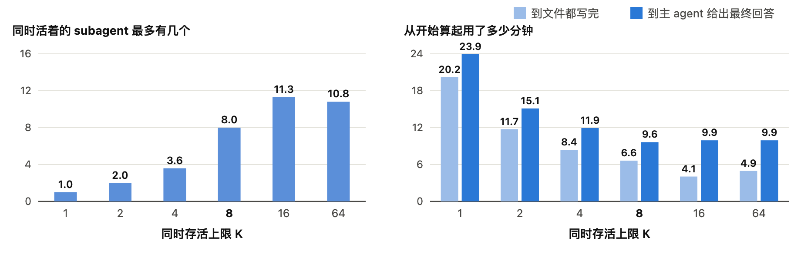

图 30 大型编码题，题面加不复核提示：K 取不同值时，同时活着的 subagent 最多有几个（左），以及从开始到文件都写完、到主 agent 给出最终回答各用了多少分钟（右）。

说明（图 30）：每个 K 是 10 次运行的平均；K=64 来自另一批。

### 细节八：量得准吗

**同一份报告判两遍结果几乎一样；办公报告题上五到七个百分点以内（只有 20 对的对比更宽）、公开评测集上三到六分以内的差别，这些次数测不出来；事实清单的判分没有和人工对照过。**

表 30 对测量本身做过的检查。

| 检查 | 结果 |
|---|---|
| 评分表总分能不能看出差别 | 不能。开不开 subagent 是 +2.9 [−0.8, +6.6] 分，没测出差别；其中“关键事实”一类高 10 个百分点。所以另建了逐条核对的事实清单 |
| 两套条目的结果为什么差一截 | 后补的 132 条参考的样本，每题 12 份里有 10 份来自开 subagent 的组，可能偏向这些组。开 subagent 的效果在后补的条目上是 +18.5 [+14.6, +22.5]，是事先定下的 63 条上（表 17）的两倍。一部分原因是后补的条目本来就更难写到（不开 subagent 时写对 47%，63 条是 76%），可涨的余地大。按难度分档再比（事后分析）：旅行攻略题上差别的大半能用难度解释；CPU 选型题上 63 条只涨 3–4 个百分点、后补的涨 13–16 个，难度至多解释一半。所以后补条目偏向开 subagent 的组这种可能排除不了；结论以事先定下的 63 条为准，全清单的数并排给 |
| 同一种设置重复跑，差多少 | 默认设置在六批里都跑过，各批的写对的事实占比在 70.6% 到 76.9% 之间。深度 1 下 K=64 和 K=8 开的 subagent 一样多，K 都没有起作用，写对的事实占比却差了近 5 个百分点（只算 63 条差 2 个；表 19） |
| 同一份报告判两遍，一致吗 | 事实清单：七批各抽一部分判了第二遍，逐条一致 98.3%–99.5%；评测集报告题逐条一致 98.1%（补测 K=4 那一批 98.4%）；评测集填表题两遍的得分平均差 0.12 分（补测那一批 0.26 分） |
| 判分和别的判法一致吗 | 事实清单的判分只和另一个模型对照过：写清单的 agent 通读样本报告时的逐条归类，一致 97.3%、96.2%。评分表在试跑阶段由人打过 2 份对照，逐条一致 71%，之后改了评分表。报告整体好不好没有人评过 |
| 各组用的模型速度一样吗 | 不限时 24 题的两批里量过每路请求的输出速度：开 subagent 的各组 235–246 token/秒，不开的 247–253。办公报告题把每个请求按同一个速度重算时间，各组对默认的时间倍数变化不超过 0.02 |
| 搜索费估得准吗 | 单价是抽 40 个搜索请求实测的均值，95% 区间是 ±27%，所以办公报告题默认组的搜索费是 4.1 ± 1.1 元。各组的搜索费都占一半左右（49%–54%），单价在这个范围里变，费用倍数的变化不到 1%（合并稿的两行约 2%–3%，它们的搜索费占得少一些）；不开 subagent 加多查提示的三组，搜索费占到三分之二到四分之三，它们对默认的费用倍数会变 4%–6% |
| 公开评测集会不会搜到答案 | 容器里屏蔽了答案所在的网站；日志里出现评测集名字或读到不许用的来源的运行不计分（评测集填表题 8/72 次，评测集报告题 2/60 次；补测 K=4 的两批是 11/96 次和 0/60 次）。把它们算进去：评测集报告题 +3.5 [+1.2, +5.8]，评测集填表题 +2.3 [−0.1, +4.8] |

- 所以办公报告题上只有 20 对运行的对比，6 个百分点以内的差别测不出来，单看一批不能当结论；办公报告题的各张表都给了只算事先定下的 63 条的结果。

- 评测集报告题上 ±5 分的范围偏宽：同一个设置重跑一遍，单道题的总分平均就差 6.2 分，而开 subagent 的全部好处才 3.5 分。那上面 K=1、深度 2 的“没有差别”只能读成没有看到大的差别。

### 和事前预想不一样的地方

有 14 批事前写下过预计的结果（其中后来改按事实清单判分的那一批，预计写在重新判分之前，那时运行已经做完）；预计、实际和对没对上，都列在附录的表 47。改变了结论的是三处没对上的（其余没对上的几处没有改变结论）：

- **不限时 24 题。** 预计开 subagent 能把时间从 6 分钟缩到 2.5 分钟，K 越大越快。实际没有更快，题面加并行提示还更慢；查原因才看到慢在文件写完以后又派 subagent 去复核（细节六）。

- **两份不开 subagent 的报告合并。** 预计写对的比默认低 3–9 个百分点。实际和默认没有差别；“默认多写对的不一定要靠 subagent”是从这里来的。

- **按搜索量直线推算。** 把深度和 K 都放开，按图 17 那条直线（各组的搜索请求数对写对的事实占比），该多写对 10–11 个百分点。实际的估计值只有 1–4 个（把对照换成同批两个深度 1 组的平均是 4–6 个），都低于直线推算。

### 运行中发现的 DSH 缺陷

“代码写完又派 subagent 复核”是模型的行为（题面里的一句话可能有影响），放在细节六。下面六条是 DSH 自己的缺陷：

1. **搜索请求的 token 用量没有记进会话日志**（日志里只有每个请求的记录，所以搜索费只能按抽样实测的单价估）；每个搜索请求里模型顺带写的那段回答，搜索插件没有用（细节六）。

1. **到了深度上限，工具列表里还留着开 subagent 的工具，调用了才被拒绝。** 办公报告题默认设置的 40 次运行共被拒 302 次，写任务说明和发请求的 token 都浪费了。

1. **模型事先不知道同时存活数量的上限，开到超出的那一个才被拒绝。** K=1 的 40 次运行被拒 110 次，K=2 的 40 次被拒 63 次。可以把上限告诉模型，或者改成排队。

1. **命令行一次性运行时，主 agent 这一轮结束进程就退出，不管 subagent 是不是还在运行。** 全部 2,713 次运行里有 58 次退出时崩溃（进程在处理 subagent 送回的消息时报错；这些运行照样算结果，交出了完整报告的照常计分），都出在深度 2、3 的组；其中一次主 agent 说了一句等四组 subagent 的结果回来就汇总，然后就结束了，报告没有写出来。深度 1 的组没有崩溃，但题面加都写进去提示以后，40 次里有 8 次主 agent 没等 subagent 回来就结束，交出的是半成品或者没交。

1. **被上级中断（用 interrupt_agent 工具）的 subagent，如果当时还有没处理的消息在排队，就一直不结束**，DSH 一直当它还活着（各批里见到 31 个，没有一个结束）。

1. **agent 用 shell 跑的进程没有内存上限。** 大型编码题批的 110 次运行里 26 次有进程把容器 16 GB 内存用满被系统杀掉，其中 1 次被杀的是 DSH 进程本身。

### 和别人的结果对照

表 31 别人量过的相近问题。数字都对过原文；模型、任务和判分都和这里不同，只比方向。

| 来源 | 量了什么 | 结果 | 和这里的关系 |
|---|---|---|---|
| Anthropic 工程博客《How we built our multi-agent research system》（2025-06） | 多 agent 调研系统在 BrowseComp 上的成绩差别由什么解释 | token 用量一项解释了 80%；多 agent 系统用的 token 约是普通对话的 15 倍 | 一致：这里单 agent 加多查 150/250、多查 250/500 的两组，搜索请求到了默认的水平，模型费不到默认的一半；写对的按全清单都显著更少，按事先定下的 63 条一组没测出差别、一组显著更少 |
| Google《Towards a Science of Scaling Agent Systems》（arXiv 2512.08296） | 四种多 agent 结构在 6 个评测集上和单 agent 比 | 相对单 agent 的变化从 +80.8%（金融分析）到 −70.0%（要按顺序规划的任务），全部平均 −0.3% | 一致：值不值看任务 |
| ArcticSwarm（arXiv 2609.01870） | 同时运行的 subagent 上限从 8 到 48，BrowseComp-Plus 前 100 题，每档 3 次 | 准确率 76.0%–79.3%，作者认为差别在重复跑的波动以内；上限 8 用的 token 最多，是上限 16 的 1.49 倍 | 上限调大没有好处，一致。费用方向相反：他们上限 8 用的 token 最多（作者的说法是查多少由主 agent 定，不由上限定）；这里上限小了模型就少开、少查 |
| 同上 | 单 agent 重复 20 次再投票，token 和多 agent 系统相同 | 准确率 62.5%，多 agent 系统 82.6% | 方向相反：这里四份单 agent 报告合并，写对的不比默认少。他们一题一个答案，重复只能投票；这里是写报告，各份查到的事实可以并起来 |
| W&D（arXiv 2602.07359） | 单 agent 每轮并行调用 1 到 8 个工具，BrowseComp 前 100 题，各 1 次 | 每轮 3 个对每轮 1 个：准确率 68% 对 66%，钱和时间少约四成；每轮 5、8 个准确率更低 | 相同的只有一点：不开 subagent 也能把一次查的量做上去。他们量到的是轮数、钱和时间变少，查得多并没有更准；这里的三种多查提示让单 agent 写对的事实按全清单多了 4–9 个百分点（按 63 条多 2–6 个），仍少于默认：按全清单三种都显著，按 63 条两种显著 |
| WideSearch（arXiv 2508.07999） | 多 agent 对单 agent，200 道联网收集信息填表的题 | 逐项得分高 3.0–6.8 分，搜索次数是 2–4 倍 | 和这里的评测集填表题同一量级 |
| 《Rethinking Multi-Agent Collaboration: When More Is Less》（arXiv 2609.19759） | 在他们提出的协作办法 SAIGE 上，把最大深度从 1 调到 3；模型 DeepSeek-V4-Pro，框架 Codex CLI | DeepResearch Bench II（和这里的评测集报告题是同一个评测集）55.2 降到 52.2，日常办公任务 71.8 降到 63.2 | 他们放开深度是变差；这里评测集报告题深度 2 没有差别（+0.6 分），办公报告题略有提高；两边都没看到值得这个价钱的好处 |
| Cognition《Multi-Agents: What's Actually Working》（2026-04） | Devin 在生产中的做法 | 只让一个 agent 写，其余 agent 提供信息或做审查；审查 agent 平均每个 PR 找出 2 个 bug | 这里代码写完后的复核也能修掉最后一两个没通过的测试；几份报告交给一个 agent 合并是同一种分工 |

### 适用范围、会推翻结论的结果和下一步

表 32 每条结论对应的反面结果和下一步。

| 结论 | 什么结果会推翻它 | 下一步 |
|---|---|---|
| K 保持 8：调大没测出好处；比 8 小的取值各有一样没过（K=4 是读代码题的质量没测出、大型编码题不复核时慢两成） | 读代码题上加跑以后，K=4 的质量区间下限收进 −5 分以内，并且定下保留复核（原题面下 K=4 的时间没测出差别；这几组内存不够，要在内存更大的容器里重测）：这时可以降到 4。或者把上限告诉模型、超出上限时改成排队以后，K=1、2 的损失没有了；或者在模型想同时开十个以上的任务上，K=16 测得出更快 | 读代码题上加跑 K=4；在内存更大的容器里重测原题面的大型编码题 K=4 和 8；把上限写进工具说明，重测办公报告题的 K=2 和 K=8 |
| 深度保持 1 | 一个上下文装不下的大任务上，深度 2 明显更好 | 找一类深度 1 时单个 subagent 的上下文装不下的任务测深度（这次的任务都装得下） |
| 办公报告题上，让单 agent 自己多查只补上一部分（按 63 条，三种提示里两种仍显著少于默认；按全清单三种都是），四份独立的单 agent 报告合并不比默认少 | 换一种让单 agent 多查的办法以后，同样的搜索量下它和默认没有差别；或者四份合并稿和同样要求都写进去的默认比，写对的明显少（现在是 −0.2 [−3.3, +3.0]；能这样比的只有后一批合并稿，10 对） | 合并稿换题重复；多查提示只试了“题面加一句要求”这一种办法，换分阶段查、先列提纲再逐项查这类办法再测 |
| 代码类任务上开 subagent 得分几乎不变 | 代码写完第一遍时错得多的任务上，复核把通过率明显提了上去 | 在写完第一遍时通过率低的任务上比有没有复核；去掉题面里“判分会用更完整的测试”一句，看模型还派不派复核 |
| 各组的差别不是判分造成的 | 人工逐条核对和判分模型的判定对不上，而且偏向某一类组 | 抽 100 条判定请人核对 |

- 四种不限时、用测试或标准答案判分的任务（小编程题、16 步串行题、不限时 24 题、大型编码题）上，全部 580 次运行里有 10 次得分低于 90 分：9 次是小编程题加并行提示时主 agent 没等 subagent 做完就结束，1 次是大型编码题一开始就结束了、没有写文件。其余的得分都在 94 分以上；去掉这 10 次，同一批里各组的平均分最多差 1.4 分。所以这些任务上只比得出费用、时间和交没交完。

- 一个模型（v41flash，推理强度 max）、一个 DSH 版本（0.2.0-rc.2）、命令行一次性运行，任务都是一次运行做完的，平均用时最长的一组约半小时，个别运行到一小时。换模型、在桌面端多轮对话里用、更长的任务，都没有测。

- 重复跑的办公报告题只有两道，而且取自用户日志里的任务。文中的区间反映的是同一道题重复跑的波动；换题以后幅度会变（开 subagent 的效果在两道题之间就差一倍，公开评测集上更小）。

- 事实清单量的是“查得全不全”，不是报告好不好用。报告更长、事实更多，用户是不是更愿意要，没有测。

- 这些任务都没有大到一个上下文装不下。窗口是 100 万 token；单次请求的输入，办公报告题各组最多用到 48 万，大型编码题最多 58 万（不开 subagent 的一次）。单 agent 加多查提示的几组更高：多查 100/100 最多 68 万，多查 150/250 最多 67 万，各有 1 次被 DSH 裁剪过上下文（输入最多才六十多万，可见 DSH 不等窗口用满就会裁剪）。深度可能有用的场景是更大的任务，这里没有。

- 不让模型复核只在大型编码题上测过，而且不复核提示是加在题面里的，没有放进系统提示。

### 各设置下运行是怎么结束的

表 33 办公报告题以外的任务：各种设置下运行是怎么结束的（各批、各个 K 和加提示的组加在一起；办公报告题见表 28）。

| 任务 | 设置 | 进程等不等 subagent | 运行次数 | 交付不完整 | 提前结束 | 退出时崩溃 | 其它非正常退出 | 到时限 | 等到上限 | 有进程因内存被杀 |
|---|---|---|---|---|---|---|---|---|---|---|
| 评测集填表题 | 不开 subagent | 不等 | 24 | 0 | 0 | 0 | 0 | 0 | — | — |
|  | 深度 1（K=1、4、8；含加并行提示的组） | 等 | 120 | 0 | — | 0 | 0 | 3 | 0 | — |
|  | 深度 2（K=8） | 等 | 24 | 0 | — | 1 | 0 | 0 | 1 | — |
| 评测集报告题 | 不开 subagent | 不等 | 30 | 0 | 0 | 0 | 0 | 0 | — | — |
|  | 深度 1（K=1、4、8） | 等 | 150 | 0 | — | 0 | 0 | 0 | 4 | — |
|  | 深度 2（K=8） | 等 | 30 | 0 | — | 0 | 0 | 0 | 2 | — |
| 读代码题 | 不开 subagent | 不等 | 20 | — | 0 | 0 | 0 | 0 | — | — |
|  | 深度 1（K=1、2、4、8；含加并行提示的组） | 不等 | 120 | — | 4 | 0 | 0 | 0 | — | — |
|  | 深度 2（K=1、2、4、8；含加并行提示的组） | 不等 | 130 | — | 7 | 2 | 0 | 0 | — | — |
|  | 深度 3（K=1、2、4、8；含加并行提示的组） | 不等 | 130 | — | 3 | 3 | 0 | 0 | — | — |
| 小编程题 | 不开 subagent | 不等 | 10 | — | 0 | 0 | 0 | 0 | — | — |
|  | 深度 1（K=1、2、4、8；含加并行提示的组） | 不等 | 50 | — | 10 | 0 | 0 | 0 | — | — |
|  | 深度 2（K=1、2、4、8；含加并行提示的组） | 不等 | 50 | — | 10 | 0 | 0 | 0 | — | — |
|  | 深度 3（K=1、2、4、8；含加并行提示的组） | 不等 | 50 | — | 7 | 0 | 0 | 0 | — | — |
| 限时 24 题 | 不开 subagent | 不等 | 20 | — | — | 0 | 0 | 限时题 | — | — |
|  | 深度 1（K=1、2、4、8、16；含加并行提示的组） | 等 | 70 | — | — | 0 | 0 | 限时题 | 0 | — |
|  | 深度 2（K=1、2、4、8、16；含加并行提示的组） | 等 | 50 | — | — | 0 | 0 | 限时题 | 0 | — |
| 16 步串行题 | 不开 subagent | 不等 | 10 | — | — | 0 | 0 | 0 | — | — |
|  | 深度 1（K=8；含加并行提示的组） | 等 | 20 | — | — | 0 | 0 | 0 | 0 | — |
| 不限时 24 题 | 不开 subagent | 不等 | 20 | — | — | 0 | 0 | 0 | — | — |
|  | 深度 1（K=1、2、4、8、16、64；含加并行提示的组） | 等 | 130 | — | — | 0 | 1 | 0 | 4 | — |
|  | 深度 2（K=1、2、4、8、16、64；含加并行提示的组） | 等 | 90 | — | — | 1 | 0 | 0 | 8 | — |
| 大型编码题 | 不开 subagent | 不等 | 10 | — | — | 0 | 0 | 0 | — | 1 |
|  | 深度 1（K=1、2、4、8、16、64；含加不复核提示的组） | 等 | 100 | — | — | 0 | 0 | 0 | 2 | 20 |
|  | 深度 2（K=8、16、64；含加不复核提示的组） | 等 | 40 | — | — | 1 | 1 | 0 | 3 | 9 |

说明（表 33）：“提前结束”指主 agent 结束时还有 subagent 没做完，只对进程不等 subagent 的组统计；“等到上限”指进程等了 20 分钟还有 subagent 没结束；内存一列只在大型编码题上记录。“—”是没有记录或不适用。限时 24 题到时限是设计如此，不列。

### 分任务结果表

#### 办公报告题

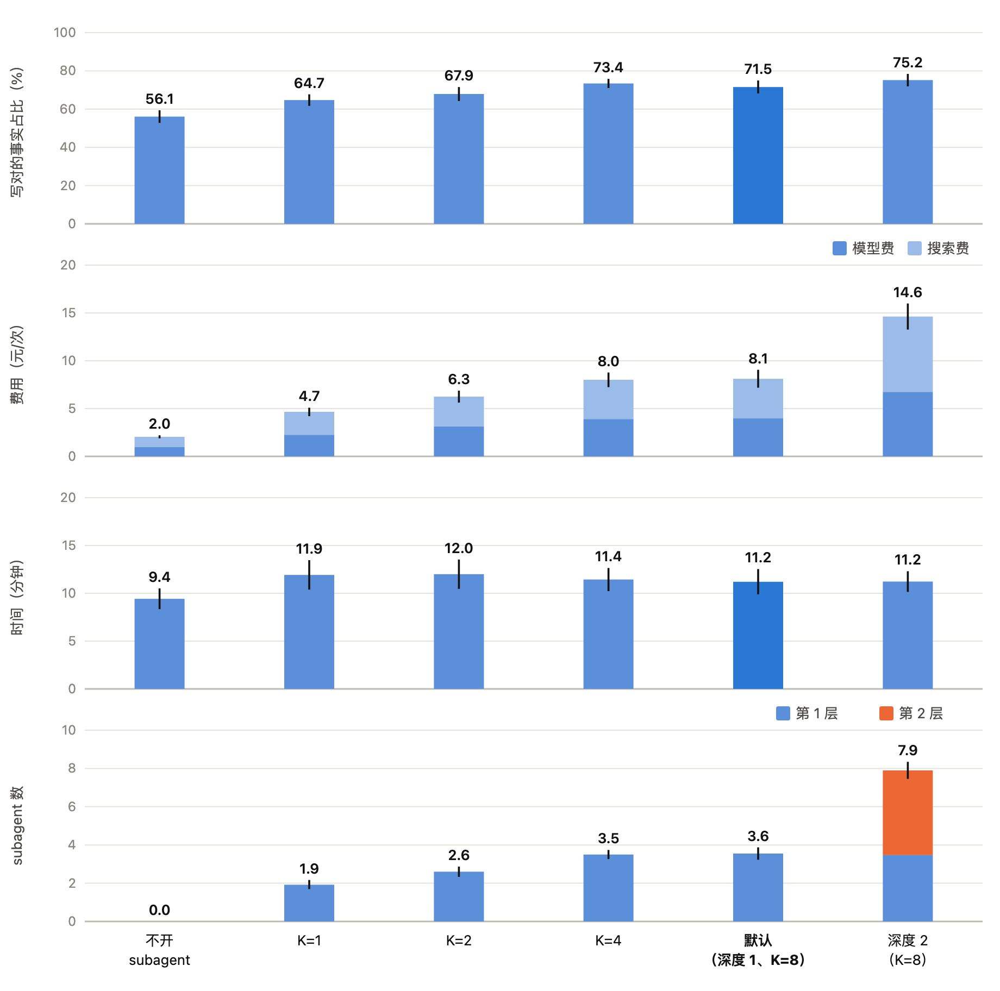

图 31 办公报告题主要的一批：各组的质量、费用、时间和 subagent 数。细线是各组均值的 95% 区间；每组 39–40 份报告。

表 34 办公报告题主要的一批各组结果（每组 39–40 份报告；差和倍数都是对默认，按配对算，所以和两列均值直接相减会差一点）。

| 指标 | 不开 subagent | K=1 | K=2 | K=4 | 默认（K=8） | 深度 2（K=8） |
|---|---|---|---|---|---|---|
| 写对的事实占比（%） | 56.1 | 64.7 | 67.9 | 73.4 | 71.5 | 75.2 |
| 和默认的差（个百分点） | −15.5 [−19.1, −11.8] | −7.3 [−12.3, −2.3] | −3.7 [−8.6, +1.3] | +1.9 [−2.5, +6.2] | — | +3.6 [−1.1, +8.3] |
| 判断 | 显著变差 | 显著变差 | 没测出差别 | 没有差别 | — | 没测出差别 |
| 只算事先定下的 63 条：和默认的差 | −9.0 [−13.4, −4.7] | −4.7 [−10.1, +0.6] | −3.5 [−8.2, +1.3] | +0.1 [−3.5, +3.6] | — | +2.8 [−0.9, +6.5] |
| 费用（元/次） | 2.04 | 4.65 | 6.25 | 8.01 | 8.12 | 14.63 |
| 其中模型费 | 1.00 | 2.26 | 3.13 | 3.91 | 3.97 | 6.75 |
| 其中搜索费 | 1.04 | 2.39 | 3.12 | 4.10 | 4.14 | 7.88 |
| 费用倍数 | ×0.26 | ×0.57 | ×0.77 | ×1.00 | — | ×1.83 |
| 时间（分钟） | 9.4 | 11.9 | 12.0 | 11.4 | 11.2 | 11.2 |
| subagent 数 | 0.0 | 1.9 | 2.6 | 3.5 | 3.6 | 7.9 |
| 搜索请求数 | 60 | 138 | 180 | 237 | 239 | 455 |

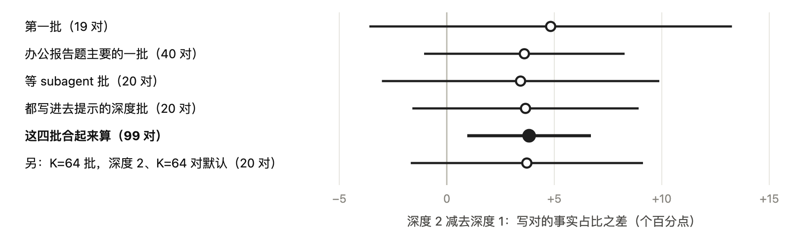

图 32 办公报告题：深度 2 减去深度 1 的写对的事实占比。

说明（图 32）：上面四批只改深度（K=8），空心点是各批的结果，实心点是四批合起来算；最下面一行同时把 K 放到 64，不计入合计。横线是 95% 区间。批的名字见表 12。

表 35 办公报告题的其它设置（差和倍数都是对同一批里的默认；批的名字见表 12）。

| 批 | 设置 | 配对数 | 写对的事实占比之差（个百分点） | 判断 | 只算事先定下的 63 条 | 费用倍数 | 时间倍数 | subagent 数 |
|---|---|---|---|---|---|---|---|---|
| K=64 批 | K=64（深度 1） | 20 | −4.7 [−8.7, −0.8] | 校正后不显著 | −2.1 [−6.5, +2.3] | ×1.04 | ×0.91 | 3.7 |
| 等 subagent 批 | 深度 3（K=8） | 20 | +3.6 [−2.2, +9.3] | 没测出差别 | +0.2 [−5.9, +6.3] | ×2.01 | ×1.15（注 1） | 8.2 |
| K=64 批 | 深度 2、K=64 | 20 | +3.7 [−1.7, +9.1] | 没测出差别（注 2） | +3.0 [−1.7, +7.7] | ×2.81 | ×1.21 | 12.3 |
| K=64 批 | 深度 3、K=64（相当于旧默认） | 20 | +1.4 [−4.1, +6.9] | 没有差别（注 2） | +1.5 [−2.9, +5.9] | ×2.89 | ×1.20 | 16.9 |
| 多查 100/100 那一批 | 默认 + 都写进去提示（只算交出完整报告的） | 32 | +4.8 [+0.9, +8.6] | 显著变好（注 3） | +4.1 [−0.1, +8.2] | ×1.22 | ×1.31 | 4.6 |
| 多查 100/100 那一批 | 不开 subagent + 多查 100/100 | 40 | −9.0 [−13.0, −5.1] | 显著变差 | −8.4 [−12.6, −4.2] | ×0.59 | ×1.08 | 0 |
| 多查 150/250、250/500 那一批 | 不开 subagent + 多查 150/250 | 39 | −6.4 [−10.6, −2.1] | 显著变差 | −3.9 [−8.2, +0.4] | ×0.78 | ×1.63 | 0 |
| 多查 150/250、250/500 那一批 | 不开 subagent + 多查 250/500 | 40 | −11.4 [−15.0, −7.7] | 显著变差 | −8.6 [−13.1, −4.1] | ×0.79 | ×1.62 | 0 |
| 合并稿（两批合起来算） | 两份不开 subagent 的报告合并 | 40 | −0.3 [−3.2, +2.6] | 没有差别 | +1.2 [−1.7, +4.1] | ×0.65 | ×1.52 | 0 |
| 合并稿（两批合起来算） | 四份不开 subagent 的报告合并 | 20 | +7.4 [+3.4, +11.4] | 显著变好 | +7.1 [+3.1, +11.2] | ×1.15 | ×1.73 | 0 |

注 1：这一组只记了整个进程的时长，含等 subagent 结束的时间。注 2：这两组所在的 K=64 批里，深度 1 有两组：默认（K=8）和 K=64。表里是对默认比；改成对这两个深度 1 组的平均比，这两行分别是 +6.1 [+1.1, +11.1] 和 +3.8 [−0.8, +8.3]。注 3：只算交出完整报告的运行；另外两种算法见“方法补充”。

表 36 办公报告题：让不开 subagent 的 agent 多查的那一批各组结果（每题每组 20 次；没交出完整报告的 1 次不算）。

| 指标 | 不开 subagent | 多查 150/250 | 多查 250/500 | 默认 |
|---|---|---|---|---|
| 算进来的运行数 | 40 | 39 | 40 | 40 |
| 写对的事实占比（%） | 55.5 | 64.1 | 59.2 | 70.6 |
| 只算事先定下的 63 条（%） | 72.7 | 78.9 | 74.5 | 83.0 |
| 写错的条数 | 2.0 | 1.5 | 2.2 | 1.9 |
| 搜索请求数 | 61 | 253 | 275 | 234 |
| 打开的网页数（下限） | 58 | 400 | 825 | 174 |
| 其中脚本存盘的 | 6 | 376 | 807 | 15 |
| 其中 web_fetch 逐个打开的 | 29 | 22 | 14 | 104 |
| 其余（命令里直接抓的，至少这么多） | 23 | 2 | 4 | 55 |
| 费用（元/次） | 2.04 | 6.03 | 6.31 | 7.76 |
| 其中模型费 | 0.99 | 1.65 | 1.55 | 3.70 |
| 到最终回答的时间（分钟） | 9.2 | 17.9 | 18.1 | 10.7 |
| 报告字数（万） | 2.2 | 3.4 | 3.2 | 3.7 |
| 主 agent 输入峰值中位（万 token） | 19.0 | 23.6 | 22.8 | 23.7 |
| 发生上下文裁剪的运行 | 0 | 1 | 0 | 0 |

表 37 办公报告题：subagent 交回给主 agent 的消息里写对的事实，有多少没进最终报告（五组各取前 10 次重复，判了 90 份；条数是每份的平均）。

| 组 | 运行数 | 交回的消息里写对 | 最终报告写对 | 交回了但没进最终报告 | 占交回的 | 最终报告里有、消息里没有 |
|---|---|---|---|---|---|---|
| 默认 | 18 | 52.5 | 70.2 | 2.3 | 3.6% | 19.9 |
| 深度 2 | 19 | 63.9 | 76.1 | 3.3 | 5.1% | 15.5 |
| 默认（和下一组同批） | 19 | 60.7 | 71.0 | 3.3 | 5.0% | 13.5 |
| 默认 + 都写进去提示 | 15 | 71.1 | 73.5 | 1.9 | 2.7% | 4.4 |
| 深度 2、K=64 | 19 | 71.3 | 78.8 | 3.7 | 5.4% | 11.2 |

交回的消息只算 subagent 发给主 agent 的文字，它们直接写进工作目录的文件不算，所以“交回的消息里写对”是下限。同批配对：深度 2 对深度 1 没进最终报告的条数 +0.7 [−1.2, +2.5]；加了都写进去提示以后是 −1.7 [−3.5, +0.2]，同时“最终报告里有、消息里没有”的是 −10.2 [−20.7, +0.3]。

#### 两个公开评测集

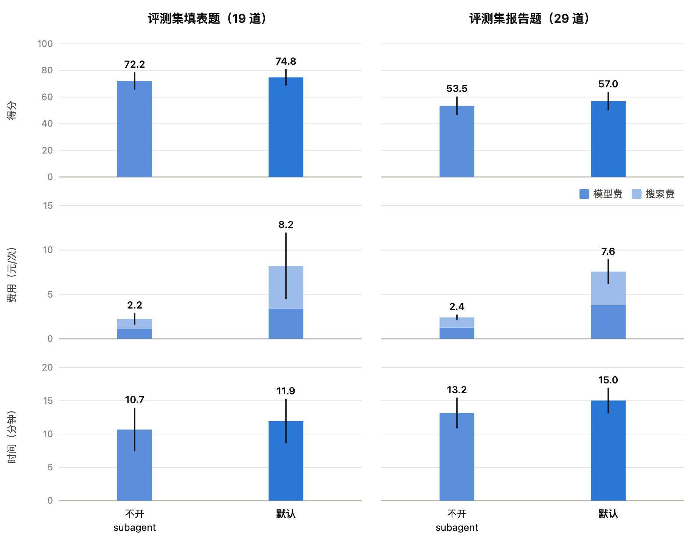

图 33 两个公开评测集：不开 subagent 和默认的得分、费用和时间。只算两组的运行都有效的题。细线是各组均值的 95% 区间。

表 38 两个公开评测集上开不开 subagent（每题每组 1 次；两组的运行都有效的题，评测集填表题 19 道、评测集报告题 29 道）。召回指标准答案要的内容找到了多少。

| 评测集 | 组 | 得分 | 和不开的差 | 召回 | 费用（元/次） | 其中模型费 | 时间（分钟） | subagent 数 |
|---|---|---|---|---|---|---|---|---|
| 评测集填表题 | 不开 subagent | 72.2 | — | 69.9 | 2.24 | 1.12 | 10.7 | 0.0 |
|  | 默认 | 74.8 | +2.7 [−0.5, +5.8] | 75.4 | 8.22 | 3.38 | 11.9 | 3.2 |
| 评测集报告题 | 不开 subagent | 53.5 | — | 48.3 | 2.41 | 1.25 | 13.2 | 0.0 |
|  | 默认 | 57.0 | +3.5 [+1.2, +5.9] | 52.5 | 7.56 | 3.79 | 15.0 | 2.9 |

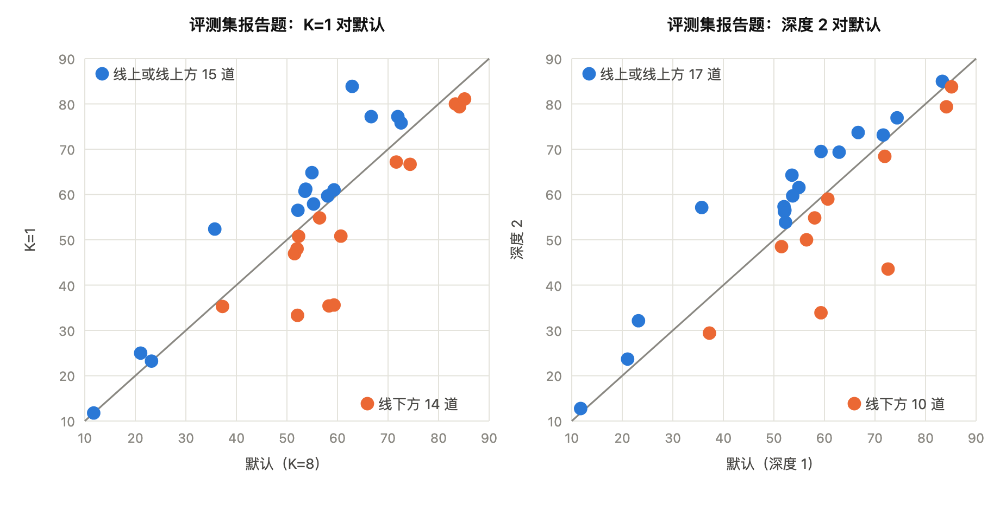

图 34 评测集报告题，每道题一个点：横轴是默认的总分，纵轴是 K=1（左）和深度 2（右）的总分。

表 39 评测集报告题第二批：换 K 和深度（差和倍数都是对同批的默认）。

| 设置 | 总分之差 | 召回之差 | 费用倍数 | 时间倍数 | subagent 数 |
|---|---|---|---|---|---|
| K=1 | −0.6 [−4.4, +3.2] | −1.0 [−5.6, +3.5] | ×0.52 | ×0.94，没测出差别 | 1.2 |
| 深度 2 | +0.6 [−3.4, +4.6] | +0.3 [−4.0, +4.7] | ×1.49 | ×1.12，没测出差别 | 5.9 |

表 40 两个公开评测集补测 K=4 的两批（每题每组 1 次；差和倍数都是对同批的默认，按题配对；带 ★ 的两行是事前写定的主要对比，两个一起校正）。

| 评测集 | 设置 | 配对数 | 质量之差 | 判断 | 召回之差 | 费用倍数 | 时间倍数 | 开的 subagent 数 | 有调用被 K 拒绝的运行 |
|---|---|---|---|---|---|---|---|---|---|
| 评测集填表题 | K=4 ★ | 18 | +1.1 [−3.5, +5.7] | 没测出差别 | +0.7 [−5.9, +7.4] | ×0.88 [0.66, 1.19] | ×0.99 [0.79, 1.25] | 3.5 | 9/24 |
|  | K=1 | 20 | −1.3 [−4.6, +2.1] | 没有差别 | −3.0 [−8.9, +2.8] | ×0.58 [0.46, 0.73] | ×1.21 [0.90, 1.62] | 1.4 | 18/24 |
|  | 深度 2 | 19 | +2.3 [−2.7, +7.2] | 没测出差别 | +0.3 [−3.8, +4.4] | ×1.18 [0.92, 1.52] | ×1.22 [0.99, 1.50] | 5.6 | 11/24 |
|  | 默认 | — | （71.7 分） | — | （75.9） | （10.80 元） | （14.0 分钟） | 3.9 | 0/24 |
| 评测集报告题 | K=4 ★ | 30 | +0.7 [−3.1, +4.5] | 没有差别 | +1.0 [−3.3, +5.3] | ×1.15 [0.99, 1.34] | ×1.11 [0.97, 1.27] | 2.9 | 3/30 |
|  | 默认 | — | （57.7 分） | — | （54.4） | （6.90 元） | （14.5 分钟） | 2.7 | 0/30 |

说明（表 40）：评测集填表题有 11 次运行在日志里出现了评测集的名字或题号，不计分；把它们算进去，K=4 那一行是 −1.0 [−5.7, +3.7]（24 对）。最后两列是这一组自己的数，按全部运行算（含不计分的）。

评测集报告题上 K=4 的搜索请求是默认的 ×1.26 [1.06, 1.50]（没有校正；K=4 这组开的 subagent 也略多），费用和时间的估计值跟着偏高，区间都含 1。

#### 读代码题（含和小编程题三题一起的对比）

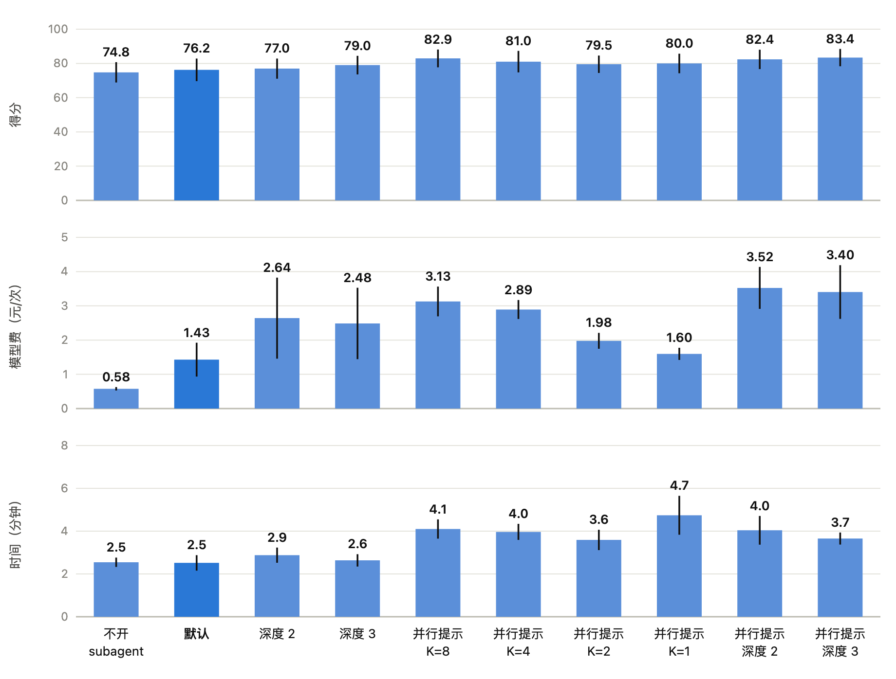

图 35 读代码题（两题平均）：各组的得分、模型费和时间。细线是各组均值的 95% 区间；每组 20 次。

表 41 读代码题各组结果（两题平均，每组 20 次；不联网，费用只有模型费）。

| 指标 | 不开 subagent | 默认 | 深度 2 | 深度 3 | 并行提示，K=8 | 并行提示，K=4 | 并行提示，K=2 | 并行提示，K=1 | 并行提示，深度 2 | 并行提示，深度 3 |
|---|---|---|---|---|---|---|---|---|---|---|
| 得分 | 74.8 | 76.2 | 77.0 | 79.0 | 82.9 | 81.0 | 79.5 | 80.0 | 82.4 | 83.4 |
| 模型费（元/次） | 0.58 | 1.43 | 2.64 | 2.48 | 3.13 | 2.89 | 1.98 | 1.60 | 3.52 | 3.40 |
| 时间（分钟） | 2.5 | 2.5 | 2.9 | 2.6 | 4.1 | 4.0 | 3.6 | 4.7 | 4.0 | 3.7 |
| subagent 数 | 0.0 | 1.8 | 3.5 | 3.7 | 3.6 | 3.5 | 2.2 | 1.8 | 5.4 | 4.9 |

表 42 读代码题和小编程题三道题一起的对比（每个对比 30 对；这是事先定的算法），最后一列是只看两道读代码题。

| 对比 | 得分差（三道题） | 判断 | 模型费倍数 | 时间倍数 | 得分差（只看两道读代码题） |
|---|---|---|---|---|---|
| 默认对不开 subagent | +1.1 [−2.4, +4.5] | 没有差别 | ×1.41 | ×0.91 | +1.4 [−3.9, +6.7] |
| 并行提示（K=8）对默认 | +3.0 [−1.5, +7.4] | 没测出差别 | ×2.75 | ×1.43 | +6.7 [+1.7, +11.7] |
| K=1 对 K=8（都加并行提示） | −0.5 [−4.7, +3.7] | 没有差别 | ×0.64 | ×1.24 | −2.9 [−7.4, +1.5] |
| K=2 对 K=8 | −1.4 [−6.0, +3.2] | 没测出差别 | ×0.74 | ×0.98 | −3.4 [−8.1, +1.3] |
| K=4 对 K=8 | +0.2 [−4.4, +4.8] | 没有差别 | ×0.94 | ×0.96 | −1.9 [−7.2, +3.4] |
| 深度 2 对深度 1（都加并行提示） | −1.4 [−7.1, +4.3] | 没测出差别 | ×1.08 | ×0.99 | −0.6 [−4.8, +3.6] |
| 深度 3 对深度 1 | +1.8 [−2.2, +5.8] | 没测出差别 | ×1.08 | ×1.06 | +0.5 [−3.5, +4.5] |

#### 两道对照题

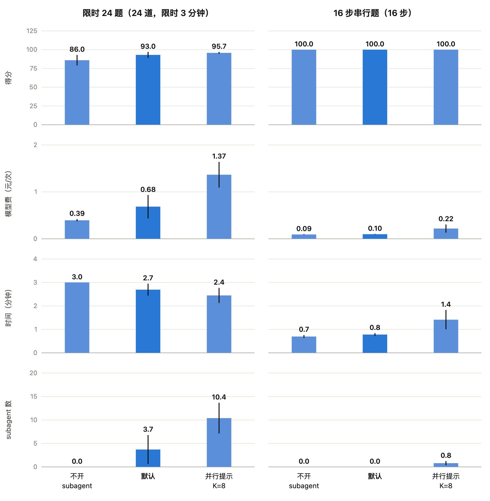

图 36 两道对照题：各组的得分、模型费、时间和 subagent 数。细线是各组均值的 95% 区间；每组 10 次。

表 43 两道对照题各组结果（每组 10 次；不联网，费用只有模型费）。

| 题 | 指标 | 不开 subagent | 默认 | 并行提示，K=8 |
|---|---|---|---|---|
| 限时 24 题 | 得分 | 86.0 | 93.0 | 95.7 |
|  | 测试全过的题数（共 24 道） | 14.5 | 16.7 | 18.0 |
|  | 模型费（元/次） | 0.39 | 0.68 | 1.37 |
|  | 时间（分钟） | 3.0 | 2.7 | 2.4 |
|  | subagent 数 | 0.0 | 3.7 | 10.4 |
| 16 步串行题 | 得分 | 100.0 | 100.0 | 100.0 |
|  | 模型费（元/次） | 0.09 | 0.10 | 0.22 |
|  | 时间（分钟） | 0.7 | 0.8 | 1.4 |
|  | subagent 数 | 0.0 | 0.0 | 0.8 |

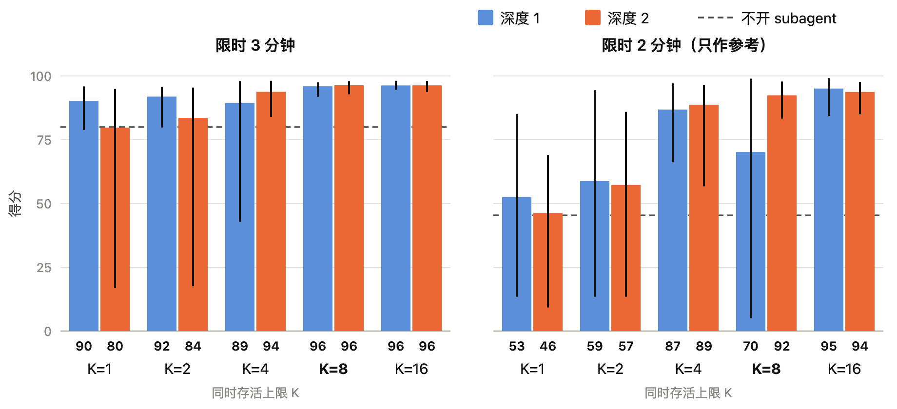

图 37 限时 24 题（题面加并行提示）换 K 和深度以后的得分。

说明（图 37）：虚线是不开 subagent（这一组是 80 分，表 43 那一组是 86 分，各 10 次）；细线是 10 次运行里的最低和最高。右边限时 2 分钟的一版波动很大，只作参考。

#### 不限时 24 题和大型编码题

表 44 大型编码题各组结果（每组 10 次；不联网，费用只有模型费）。

| 指标 | 不开 subagent | 原题面，K=4 | 默认（原题面，K=8） | 原题面，K=16 | 不复核提示，K=1 | 不复核提示，K=2 | 不复核提示，K=4 | 不复核提示，K=8 | 不复核提示，K=16 |
|---|---|---|---|---|---|---|---|---|---|
| 到最终回答的时间（分钟） | 21.6 | 33.8 | 28.4 | 29.3 | 23.9 | 15.1 | 11.9 | 9.6 | 9.9 |
| 文件都写完的时间（分钟） | 11.8 | 9.9 | 5.8 | 4.1 | 20.2 | 11.7 | 8.4 | 6.6 | 4.1 |
| 模型费（元/次） | 4.25 | 14.29 | 19.85 | 21.98 | 5.39 | 6.24 | 6.52 | 7.86 | 8.55 |
| subagent 数（其中复核的） | 0.0（0.0） | 13.2（5.0） | 20.0（10.2） | 24.1（12.1） | 4.0（0.0） | 4.8（0.0） | 6.7（0.0） | 9.5（0.0） | 11.3（0.0） |
| 没通过的隐藏测试（共 3,737 个） | 1.9 | 0.4 | 0.0 | 0.0 | 1.9 | 1.6 | 1.3 | 1.2 | 0.8 |

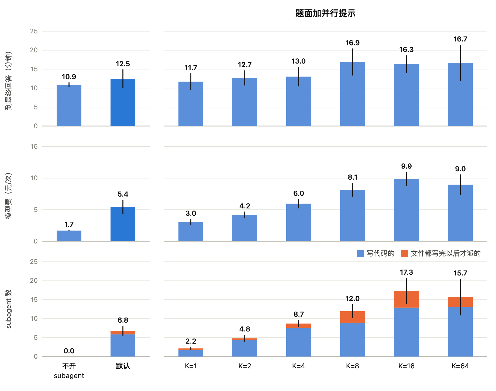

图 38 不限时 24 题：各组到最终回答的时间、模型费和 subagent 数。细线是各组均值的 95% 区间；每组 20 次（K=64 是 10 次，其中 8 次给出了最终回答）。

表 45 不限时 24 题各组结果（不联网，费用只有模型费）。

| 指标 | 不开 subagent | 默认 | 并行提示，K=1 | 并行提示，K=2 | 并行提示，K=4 | 并行提示，K=8 | 并行提示，K=16 | 并行提示，K=64 |
|---|---|---|---|---|---|---|---|---|
| 得分 | 96.9 | 96.7 | 96.4 | 96.9 | 97.0 | 97.4 | 97.5 | 97.3 |
| 到最终回答的时间（分钟） | 10.9 | 12.5 | 11.7 | 12.7 | 13.0 | 16.9 | 16.3 | 16.7（8 次） |
| 文件都写完的时间（分钟） | 5.6 | 4.6 | 7.0 | 7.3 | 6.1 | 4.3 | 5.2 | 4.5 |
| 模型费（元/次） | 1.69 | 5.44 | 3.04 | 4.16 | 5.95 | 8.14 | 9.86 | 8.96 |
| subagent 数（其中文件都写完以后才派的） | 0.0（0.0） | 6.8（1.0） | 2.2（0.4） | 4.8（0.5） | 8.7（1.2） | 12.0（3.1） | 17.3（4.4） | 15.7（2.6） |

### 事前写定的主要对比

主要对比和读法都是在读到结果之前写进方案的。全部 77 个主要对比的结果在表 46（各批自己的统计，同一批的几个对比一起做 Holm 校正），其中显著的 13 个。正文各表里不在这张表上的对比，是事前列明的次要对比或标了“事后”的分析。

不是在开跑之前写定的地方：

- 第一批实验的对比清单是开跑以后、读到结果之前定的。

- 第一批实验里“没交出完整报告的运行不计分”这条规则是看到得分以后加的。表里第一组按原来写定的算法（全部运行）。按后来的规则，深度 2、深度 3 和最后一行分别是 +0.4 [−3.1, +3.8]、−1.1 [−4.4, +2.3]、−2.7 [−8.9, +3.5]（各 19 对）。

- 按事实清单重新判分，是对已经跑完的运行换一种判法；对比写在重新判分之前。

- 不限时 24 题：第二轮的设计是第一轮还在跑的时候写的，第二轮开跑之前已经看过第一轮的结果，20 对的各行是两轮合在一起；K=64 那两行只有 8 对，“没有最终回答的运行不算时间”这条规则是看到结果以后加的。

- 大型编码题 K=16 的深度那一行只有 9 对：有一次运行 27 秒就结束、一个文件没写，去掉它的规则是看到这次运行以后加的。

- 深度 2 配都写进去提示：读法在开跑 5 分钟后改过（区间从 97% 改成 95%，不再跑第二段），当时还没有运行结束。

- 限时 24 题批：限时 3 分钟和 2 分钟两版在方案里是同等的两组主要对比；方案 10 月 3 日 17:20Z（这一批出统计之前）又写明带时限的两批只作参考。正文给 3 分钟的一版、把 2 分钟的一版只放在附录，是看到结果（2 分钟的一版波动很大）以后定的。

另外几点：

- 办公报告题第一批用评分表判，后来改用事实清单，所以两种判法各有一组。

- 限时 24 题“并行提示对不开 subagent”这一行，这一批自己事前写的标准是至少高 10 分且区间不含 0；结果差 0.2 分没到 10 分，表里的判断词按全篇统一的定义写。

- 两份、四份报告合并的两批，对比的定位先后改过（只作描述，或者作主要对比），没有列进这张表。合并稿对默认的结果在表 21；对加了都写进去提示、交出完整报告的默认，两份合并是 −7.0 [−10.6, −3.3]，四份合并是 −0.2 [−3.3, +3.0]。

- K 的各条读法和各批的深度读法，什么时候写的、写的时候看过哪些结果，在表 13 和表 14。10 月 3 日的定 K 规则写在不限时 24 题第二轮的数据读出来之前，但读代码题、办公报告题两条的结果那时已经在手，不算事前写定；按它得到的是 K=4。加上 10 月 4 日为大型编码题补的两条，原题面下是 4，题面加不复核提示时是 8。补测 K=4 之前另写的读法得到的是保持 8，报告的建议照后一条写。

- 表里每一批只列方案里写定的那一个主指标。

- 多查 150/250、250/500 那一批：试跑 8 次以后两种提示的原话都没有改；“打开的网页数”的数法在正式跑之前改过（把脚本存盘的算进去）；读法在正式跑之前按试跑看到的行为调整过（每种提示都对默认的量和深度 2 的量两个参照报告比值），主要对比和校正的范围没有变。

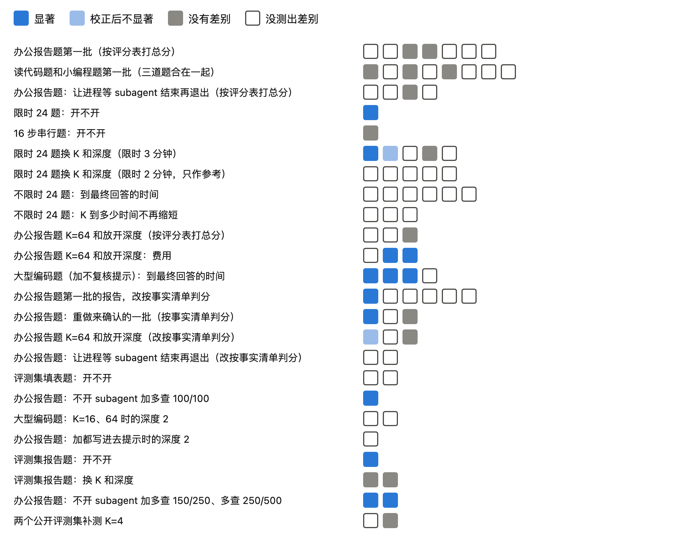

图 39 事前写定的 77 个主要对比，每个方块是一个对比（各行里的顺序同表 46）：显著 13 个，校正后不显著 2 个，没有差别 14 个，没测出差别 48 个。

表 46 事前写定的主要对比和结果。得分和事实占比是差（办公报告题的事实占比是全清单，单位个百分点），时间和费用是倍数；方括号里是 95% 区间。

| 实验 | 对比 | 配对数 | 结果 | 判断 |
|---|---|---|---|---|
| 办公报告题第一批（按评分表打总分） | 默认对不开 subagent | 20 | +2.9 [−0.8, +6.6] | 没测出差别 |
|  | K=1 对 K=8 | 20 | −0.5 [−5.2, +4.1] | 没测出差别 |
|  | K=2 对 K=8 | 20 | −0.5 [−4.6, +3.7] | 没有差别 |
|  | K=4 对 K=8 | 20 | 0.0 [−3.9, +3.8] | 没有差别 |
|  | 深度 2 对深度 1 | 20 | −3.7 [−13.0, +5.5] | 没测出差别 |
|  | 深度 3 对深度 1 | 20 | −4.9 [−13.6, +3.8] | 没测出差别 |
|  | K 的作用在深度 3 和深度 1 下差多少 | 20 | −6.3 [−15.9, +3.3] | 没测出差别 |
| 读代码题和小编程题第一批（三道题合在一起） | 默认对不开 subagent | 30 | +1.1 [−2.4, +4.5] | 没有差别 |
|  | 并行提示对默认 | 30 | +3.0 [−1.5, +7.4] | 没测出差别 |
|  | K=1 对 K=8（加并行提示） | 30 | −0.5 [−4.7, +3.7] | 没有差别 |
|  | K=2 对 K=8（加并行提示） | 30 | −1.4 [−6.0, +3.2] | 没测出差别 |
|  | K=4 对 K=8（加并行提示） | 30 | +0.2 [−4.4, +4.8] | 没有差别 |
|  | 深度 2 对深度 1（加并行提示） | 30 | −1.4 [−7.1, +4.3] | 没测出差别 |
|  | 深度 3 对深度 1（加并行提示） | 30 | +1.8 [−2.2, +5.8] | 没测出差别 |
|  | K 的作用在深度 3 和深度 1 下差多少 | 30 | +4.8 [−2.0, +11.6] | 没测出差别 |
| 办公报告题：让进程等 subagent 结束再退出（按评分表打总分） | 等对不等（深度 2） | 20 | +1.0 [−5.2, +7.1] | 没测出差别 |
|  | 等对不等（深度 3） | 20 | −2.0 [−6.0, +2.1] | 没测出差别 |
|  | 深度 2 对深度 1（都等） | 20 | −1.0 [−4.5, +2.5] | 没有差别 |
|  | 深度 3 对深度 1（都等） | 20 | −2.1 [−6.2, +2.0] | 没测出差别 |
| 限时 24 题：开不开 | 并行提示对不开 subagent | 10 | +9.8 [+2.0, +17.6] | 显著变好 |
| 16 步串行题：开不开 | 并行提示对不开 subagent | 10 | 0（都是满分） | 没有差别 |
| 限时 24 题换 K 和深度（限时 3 分钟） | K=1 对 K=8 | 10 | −5.8 [−9.2, −2.5] | 显著变差 |
|  | K=2 对 K=8 | 10 | −4.1 [−8.1, 0.0] | 校正后不显著 |
|  | K=4 对 K=8 | 10 | −6.6 [−18.7, +5.5] | 没测出差别 |
|  | K=16 对 K=8 | 10 | +0.3 [−1.4, +2.0] | 没有差别 |
|  | 深度 2 对深度 1（五个 K 合起来） | 10 | −2.8 [−7.2, +1.7] | 没测出差别 |
| 限时 24 题换 K 和深度（限时 2 分钟，只作参考） | K=1 对 K=8 | 10 | −17.7 [−49.0, +13.7] | 没测出差别 |
|  | K=2 对 K=8 | 10 | −11.4 [−46.2, +23.3] | 没测出差别 |
|  | K=4 对 K=8 | 10 | +16.6 [−5.4, +38.7] | 没测出差别 |
|  | K=16 对 K=8 | 10 | +24.9 [−2.0, +51.7] | 没测出差别 |
|  | 深度 2 对深度 1（五个 K 合起来） | 10 | +3.0 [−7.2, +13.2] | 没测出差别 |
| 不限时 24 题：到最终回答的时间 | K=1 对 K=8 | 20 | ×0.74 [0.55, 1.00] | 没测出差别 |
|  | K=2 对 K=8 | 20 | ×0.80 [0.60, 1.07] | 没测出差别 |
|  | K=4 对 K=8 | 20 | ×0.81 [0.59, 1.11] | 没测出差别 |
|  | K=16 对 K=8 | 20 | ×1.03 [0.77, 1.39] | 没测出差别 |
|  | K=64 对 K=8 | 8 | ×0.98 [0.74, 1.29] | 没测出差别 |
|  | 深度 2 对深度 1（K=4、8、16 合起来） | 20 | ×0.93 [0.83, 1.05] | 没测出差别 |
| 不限时 24 题：K 到多少时间不再缩短 | K=4 对 K=64 | 8 | ×0.81 [0.64, 1.04] | 没测出差别 |
|  | K=8 对 K=64 | 8 | ×1.02 [0.77, 1.35] | 没测出差别 |
|  | K=16 对 K=64 | 8 | ×1.00 [0.57, 1.76] | 没测出差别 |
| 办公报告题 K=64 和放开深度（按评分表打总分） | K=64 对 K=8（深度 1） | 20 | −3.5 [−7.4, +0.5] | 没测出差别 |
|  | 深度 2、K=64 对默认 | 20 | −2.6 [−6.6, +1.4] | 没测出差别 |
|  | 深度 3、K=64 对默认 | 20 | −1.0 [−4.2, +2.1] | 没有差别 |
| 办公报告题 K=64 和放开深度：费用 | K=64 对 K=8（深度 1） | 20 | ×1.04 [0.88, 1.24] | 没测出差别 |
|  | 深度 2、K=64 对默认 | 20 | ×2.81 [2.27, 3.49] | 显著更贵 |
|  | 深度 3、K=64 对默认 | 20 | ×2.89 [2.18, 3.83] | 显著更贵 |
| 大型编码题（加不复核提示）：到最终回答的时间 | K=1 对 K=8 | 10 | ×2.25 [1.53, 3.31] | 显著更慢 |
|  | K=2 对 K=8 | 10 | ×1.57 [1.39, 1.78] | 显著更慢 |
|  | K=4 对 K=8 | 10 | ×1.22 [1.08, 1.39] | 显著更慢 |
|  | K=16 对 K=8 | 10 | ×1.02 [0.89, 1.16] | 没测出差别 |
| 办公报告题第一批的报告，改按事实清单判分 | 默认对不开 subagent | 20 | +16.5 [+10.1, +22.9] | 显著变好 |
|  | K=1 对 K=8 | 20 | −6.8 [−14.3, +0.7] | 没测出差别 |
|  | K=2 对 K=8 | 20 | −2.7 [−10.6, +5.1] | 没测出差别 |
|  | K=4 对 K=8 | 20 | +2.2 [−5.3, +9.7] | 没测出差别 |
|  | 深度 2 对深度 1 | 19 | +4.8 [−3.6, +13.3] | 没测出差别 |
|  | 深度 3 对深度 1 | 19 | +4.8 [−2.5, +12.2] | 没测出差别 |
| 办公报告题：重做来确认的一批（按事实清单判分） | K=1 对 K=8 | 39 | −7.3 [−12.3, −2.3] | 显著变差 |
|  | K=2 对 K=8 | 40 | −3.7 [−8.6, +1.3] | 没测出差别 |
|  | K=4 对 K=8 | 40 | +1.9 [−2.5, +6.2] | 没有差别 |
| 办公报告题 K=64 和放开深度（改按事实清单判分） | K=64 对 K=8（深度 1） | 20 | −4.7 [−8.7, −0.8] | 校正后不显著 |
|  | 深度 2、K=64 对默认 | 20 | +3.7 [−1.7, +9.1] | 没测出差别 |
|  | 深度 3、K=64 对默认 | 20 | +1.4 [−4.1, +6.9] | 没有差别 |
| 办公报告题：让进程等 subagent 结束再退出（改按事实清单判分） | 深度 2 对深度 1 | 20 | +3.4 [−3.0, +9.9] | 没测出差别 |
|  | 深度 3 对深度 1 | 20 | +3.6 [−2.2, +9.3] | 没测出差别 |
| 评测集填表题：开不开 | 默认对不开 subagent | 19 | +2.7 [−0.5, +5.8] | 没测出差别 |
|  | 并行提示对不开 subagent | 20 | +1.6 [−2.4, +5.7] | 没测出差别 |
| 办公报告题：不开 subagent 加多查 100/100 | 多查 100/100 对默认 | 40 | −9.0 [−13.0, −5.1] | 显著变差 |
| 大型编码题：K=16、64 时的深度 2 | 深度 2 对深度 1（K=16） | 9 | ×0.99 [0.79, 1.25] | 没测出差别 |
|  | 深度 2 对深度 1（K=64） | 10 | ×1.01 [0.74, 1.38] | 没测出差别 |
| 办公报告题：加都写进去提示时的深度 2 | 深度 2 对深度 1（都加都写进去提示） | 20 | +3.7 [−1.6, +8.9] | 没测出差别 |
| 评测集报告题：开不开 | 默认对不开 subagent | 29 | +3.5 [+1.2, +5.9] | 显著变好 |
| 评测集报告题：换 K 和深度 | K=1 对 K=8 | 29 | −0.6 [−4.4, +3.2] | 没有差别 |
|  | 深度 2 对深度 1 | 27 | +0.6 [−3.4, +4.6] | 没有差别 |
| 办公报告题：不开 subagent 加多查 150/250、多查 250/500 | 多查 150/250 对默认 | 39 | −6.4 [−10.6, −2.1] | 显著变差 |
|  | 多查 250/500 对默认 | 40 | −11.4 [−15.0, −7.7] | 显著变差 |
| 两个公开评测集补测 K=4 | 评测集填表题：K=4 对 K=8 | 18 | +1.1 [−3.5, +5.7] | 没测出差别 |
|  | 评测集报告题：K=4 对 K=8 | 30 | +0.7 [−3.1, +4.5] | 没有差别 |

表 47 写下过预计结果的批次：预计和实际。

| 实验 | 事前写下的预计 | 实际 | 对上了吗 |
|---|---|---|---|
| 对照题批（16 步串行题） | 题面加并行提示对不开 subagent，得分差在 ±5 分以内或为负，费用和时间不低于不开 | 得分相同；模型费 ×2.07，时间 ×1.88 | 对上 |
| 限时 24 题批 | 得分随 K 升高，限时 3 分钟时在 K=8 附近到顶，限时 2 分钟时 K=16 仍高于 K=8；K=1 接近或低于不开 subagent；深度 2 不高于深度 1 | 限时 3 分钟：K=1 对 K=8 −5.8 分，K=16 对 K=8 +0.3 分，深度 2 对深度 1 −2.8 分，K=1 对不开 subagent +10.1 [−8.7, +29.0]；限时 2 分钟：K=16 对 K=8 +24.9 [−2.0, +51.7] | 大体对上；K=1 对不开 subagent 的方向和预计相反，区间含 0 |
| 不限时 24 题批 | 不开 subagent 约 6 分钟，题面加并行提示（K=8）约 2.5 分钟；时间随 K 缩短；费用基本不随 K 变；深度 2 不比深度 1 快 | 10.9 和 16.9 分钟；K=1 对 K=8 的时间 ×0.74；模型费 K=16 是 K=1 的 3.2 倍；深度 2 的时间 ×0.93 | 前三项没对上，深度那一项对上 |
| K=64 批（按评分表打总分） | 费用：K=64 约 ×1.0，深度 2、K=64 是 ×2–4，深度 3、K=64 更高；开的 subagent 分别是 3–4 个、8–20 个、更多；得分都没有差别 | 费用 ×1.04、×2.81、×2.89；开 3.7、12.3、16.9 个；评分表总分的区间都含 0 | 基本对上（深度 3 的费用没有比深度 2 更高） |
| 大型编码题批 | 各组得分都在 99.8 分以上 | 99.96–100.00 分 | 对上 |
| K=64 批和等 subagent 批，改按事实清单判分（预计写在重新判分之前） | 按搜索量直线推算，对同批默认：K=64 是 +1.0，深度 2、K=64 +10.5，深度 3、K=64 +11.4，深度 2 +5.8，深度 3 +6.9；估计回报会变平，K=64 的两组只多 4–7 | −4.7、+3.7、+1.4、+3.4、+3.6 | 五个都低于直线推算 |
| 合并稿两批 | 两份合并写对 62%–68%，比默认低 3–9 个百分点；四份合并 72%–80% | 两份 73.3%、69.8%（两批），和默认没有差别；四份 81.4%、77.1% | 两份没对上；四份基本对上（一批略高于预计的上限） |
| 多查 100/100 那一批 | 搜索请求到 200 个以上时，写对的和默认相差 ±5 个百分点以内；用时 25–40 分钟；上下文用到 50–80 万 | 40 次里 12 次到了 200 个，这 12 次和默认相差 −8.7 [−15.1, −2.3]；平均用时 14 分钟；上下文中位 28 万 | 三项都没对上 |
| 大型编码题深度批 | 深度 2 对深度 1，时间 ×1.0–1.3，费用 ×1.0–1.2 | 时间 ×0.99、×1.01，模型费 ×0.99、×1.07 | 对上 |
| 都写进去提示的深度批 | 深度 2 对深度 1 是 +2 到 +6 个百分点，费用 ×1.8–2.2 | +3.7 个百分点，费用 ×1.71 | 质量对上，费用略低 |
| 评测集报告题第二批 | K=1 和深度 2 对默认的差多半都落在 ±5 分以内 | −0.6 [−4.4, +3.2]、+0.6 [−3.4, +4.6] | 对上 |
| 多查 150/250、250/500 那一批 | 多查 150/250：搜索请求 230–300 个，不同网页 90–130 个，写对 64%–69%、比默认低 3–8 个百分点、区间多半不能整个落在 ±8 以内，上下文峰值中位 35–50 万，用时 18–25 分钟，费用 6–8 元。多查 250/500：搜索请求 350–480 个，不同网页 120–180 个，写对 65%–70%、和多查 150/250 相差 ±4 以内，峰值 50–80 万且四分之一以上的运行发生裁剪，用时 30–45 分钟，费用 10–14 元。默认对不开 subagent 多 15–18。试跑以后、正式跑之前补了一条：两种提示写对的都在 64%–71%、比默认低 2–8 个百分点，搜得多的那种高 0–4 个 | 多查 150/250：253 个请求，写对 64.1%、比默认低 6.4，峰值中位 23.6 万，17.9 分钟，6.0 元。多查 250/500：275 个请求，写对 59.2%、比多查 150/250 低 5.0，峰值中位 22.8 万、没有裁剪，18.1 分钟，6.3 元。默认对不开 +15.1。网页数：按预计时的数法（不算脚本存盘的）是 61 和 50 个，算上存盘的是 400 和 825 个 | 多查 150/250 的搜索量、写对的占比、区间和费用对上，网页数和上下文峰值没对上，用时差 0.1 分钟；多查 250/500 都没对上；补的那一条前者对上、后者没对上，搜得多的那种反而低；默认对不开对上 |
| 等 subagent 批 | 进程等 subagent 的组费用和时间更高 | 费用 ×1.01、×0.95，时间 ×1.25、×1.08，区间都含 1 | 没测出 |
| 两个公开评测集补测 K=4 的两批 | 评测集填表题 K=4：逐项 F1 的差在 −3 到 +3 之间，费用 0.85–1.0 倍，时间 0.9–1.15 倍，24 次里 6–10 次有调用被 K 拒绝。K=1：逐项 F1 低 0–5 分，召回低 2–7 分，费用 0.45–0.65 倍，时间 0.9–1.3 倍。深度 2：逐项 F1 的差在 −3 到 +3 之间，费用 1.4–2.0 倍，时间 1.0–1.3 倍。评测集报告题 K=4：总分的差在 −3 到 +3 之间，费用 0.9–1.05 倍，30 次里至多 3 次有调用被 K 拒绝。两个主要对比都读成“没有差别”或“没测出” | 评测集填表题 K=4：+1.1 分，费用 ×0.88，时间 ×0.99，9 次被拒绝。K=1：−1.3 分，召回 −3.0，费用 ×0.58，时间 ×1.21。深度 2：+2.3 分，费用 ×1.18，时间 ×1.22。评测集报告题 K=4：+0.7 分，费用 ×1.15，3 次被拒绝。主要对比一个没测出、一个没有差别 | 多数对上；评测集填表题深度 2 的费用和评测集报告题 K=4 的费用没对上（一个比预计低，一个比预计高） |

### 方法补充

- **进程等不等 subagent。** 两种跑法见“运行环境和 subagent 的机制”，每一批是哪种见表 12。等的那种是给 DSH 命令行入口打的一个补丁：主 agent 一轮结束后，只要还有后台 subagent 没结束就不退出；subagent 结束时 DSH 自己会把结果送给主 agent、让它再跑一轮。主 agent 空闲而 subagent 还没结束的时间累计满 20 分钟就退出。补丁不给模型发任何消息。图 8 只数每层开了几个，六种设置里两种跑法都有；每层开多少和跑法几乎无关（深度 2、K=8 按等 subagent 的跑法是 3.5 和 4.3 个）。

- **事实清单怎么建的。** 两份清单共 195 条，每条都对照官方页面写明标准值和判定规则。63 条是看任何报告之前就定下的评分要点；其余 132 条是看到评分表总分测不出差别以后，参考每题 12 份样本报告补的，主要收 4 份以上样本写到、又有官方出处的事实。12 份样本里 2 份来自不开 subagent 的组，10 份来自开 subagent 的组。

- **为什么每个设置只对同批的默认比。** 同一个默认设置在不同的批里重复跑，均值会差几个百分点（细节八），所以每个设置都只和同一批里的默认组配对，不直接比各自的占比或得分。

- **统计。** 区间是配对差的 t 区间（两道题的任务扣掉题目之间的差别），p 值用符号翻转的随机化检验。主要对比都在看到对应的判分结果之前写定；同一批里的几个主要对比一起做 Holm 校正；没交出完整报告的运行不进对比。公开评测集每题每组只跑 1 次，按题配对。几个 K 合起来的深度对比（限时 24 题、不限时 24 题），先在每次重复里把几个 K 的结果取平均（费用和时间是取对数以后再平均），再配对。大型编码题原题面下 K=4 对 K=8 的得分：K=4 的 10 次里有 4 次各留下 1 个没过的测试，K=8 全过；区间不含 0，按符号翻转的精确检验 p = 0.13，t 区间不含 0 只靠这 4 次运行，按精确检验判成没测出差别。

- **事先没有写定的分析。** 深度 2 四批合起来算的数（图 32）、深度 3 两批合起来算的数、合并稿按档写对的条数、只看两道读代码题的结果、深度 2、3 配 K=64 的两组换对照的数、都写进去提示那一组 40 次全算的数、两批合并稿合起来算的数、不限时 24 题按有没有再派 subagent 分开的数、只算 63 条或只算后补条目的数、费用和 subagent 数的拟合、每条事实的价钱、K 够不够用的统计。

- **时间。** 时间都是到主 agent 给出最终回答为止，只有等 subagent 批的深度 2、深度 3 两组用的是整个进程的时长（这一批没有记下给出最终回答的时刻）；四批合起来算的深度 2 的时间里含这一批。深度 2、3 配 K=64 的两组各有 4 次、3 次，主 agent 回答以后还有 subagent 没结束，进程等到 20 分钟的上限才退出，这段不算在时间里。不限时 24 题 K=64 的 10 次里有 2 次没有给出最终回答（其中 1 次进程被系统杀掉），时间按其余 8 次算，得分按 10 次算。

- **深度 2 在几批里的对比。** 只改深度、K 保持 8 的有四批，每批的估计值在 +3.4 到 +4.8 之间；K=64 批里的深度 2、K=64 也算进去是 +3.8 [+1.3, +6.3]。深度 3 对深度 2，K=8 的两批合起来算是 +0.9 [−3.3, +5.1]，把 K=64 批也算进去是 −0.2 [−3.4, +3.0]。办公报告题主要的一批里，深度 2 的时间是 ×1.02，四批合起来算是 ×1.11。

- **都写进去提示的三种算法。** 40 次里有 8 次主 agent 没等 subagent 回来就结束：6 次没交出完整报告，2 次交的是半成品。判分之前定了两种算法，结论不一样时以后一种为准：只去掉没交出完整报告的是 +0.3 [−6.2, +6.9]（34 对）；再去掉半成品是 +4.8 [+0.9, +8.6]（32 对）。事后加的第三种是 40 次全算、没交出报告的记 0 分：−9.9 [−19.4, −0.4]。

- **读代码题的两种算法。** 事先定的是读代码题和小编程题三道题一起算（表 42）；正文按任务类型分开，读代码题一行只看两道读代码题。两种算法下，开不开 subagent、换 K、换深度的得分差都不显著。只看两道读代码题时 K=1 偏低；把三个深度合在一起看（事后合并）是 −4.0 [−6.6, −1.3]。

- **合并稿。** 两批设计相同的合并稿合在一起算（事后合并）；分开看，两份合并是 +1.6 [−2.2, +5.4] 和 −2.2 [−6.9, +2.5]，四份合并是 +9.8 [+3.3, +16.2] 和 +5.0 [−0.9, +11.0]。第一批拿来合并的报告和对照的默认组是前一天跑的，第二批是同一批；方案里写的是两批不一致时以同批的为准。时间按几份同时写、写完再合并算。合并稿的搜索量倍数是两组均值之比（其余各行是每一对分别算再取几何平均）。和加了都写进去提示、交出完整报告的默认比，两份合并是 −7.0 [−10.6, −3.3]，四份合并是 −0.2 [−3.3, +3.0]。

- **公开评测集。** 评测集填表题按评测集自己的规则逐格判；评测集报告题用评测集自己的判分提示词，判分模型换成了 Opus 5.5，所以分数只在各组之间比，不和论文里的数比。费用倍数是每道题分别算再取几何平均；按两组的平均费用算，评测集填表题是 3.7 倍，评测集报告题是 3.1 倍，有几道题特别贵。把不计分的运行也算进去，评测集填表题的召回是 +4.5 [+0.6, +8.5]（校正后显著）。

- **费用。** 模型费按公开高峰价算（空闲时段是一半）；搜索费 = 搜索请求数 × 0.0173 元。办公报告题默认组在各批的均值是 7.31–8.17 元。“每多开一个 subagent 多花多少”是费用对开的 subagent 数做最小二乘的斜率：办公报告题用题面不加提示的 759 次运行，费用 ≈ 2.5 + 1.44 × 数量（R² 0.75；把是哪种设置也放进去，R² 只到 0.77；27 种开了 subagent 的设置里，平均费用和这条线相差最大的是 15%，不开 subagent 的组比这条线低两成）；其它任务用该任务的全部运行。同样这些运行里，搜索请求数能解释的费用差别更多（R² 0.96；只看模型费是 0.84，对开的数量是 0.76）。开的数量和搜索请求数一起变（相关系数 0.83），这些运行分不开“开了几个”和“查了多少”各占多少；多查 150/250、250/500 那一批没有进这个拟合，它里面不开 subagent、搜索请求到了默认水平的两组，模型费不到默认的一半。不限时 24 题和大型编码题按用途分成两个数量一起拟合（大型编码题 R² 0.95，不限时 24 题 R² 0.76）。

- **用户日志的费用。** 三份日志整场的 token（主 agent 和全部 subagent）按同样的单价算，A、B、C 分别是 20.5、15.0、12.5 元；A、C 有 1,039、1,489 个搜索请求，按同样的单价估 18.0、25.8 元；B 没有联网。A、C 是 9 轮和 17 轮的多轮对话，和实验里的单任务运行不是同一个单位。

- **每条事实的价钱。** 多花的钱和多写对的条数都是同一批里配对的差（每份报告的清单平均 97.5 条）；合并稿在这张表里对的是拿来合并的那几份不开 subagent 的报告：多写对的条数是合并稿减去这几份的平均，多花的钱是合并的全部费用（几份报告加合并那一步）减去一份报告的费用。深度 2 用的是办公报告题主要的一批；按四批合起来算的 +3.7 条算，约 1.8 元一条。

- **多写对的是哪些事实（表 18 怎么算的）。** 先给每条事实定一个难度：它在不开 subagent 的运行里被写对的比例，用第一批和多查 100/100 那一批里不开 subagent 的运行来算（每题 30 份）。按这个比例分成四档，再到办公报告题主要的一批里（每题每组 20 份）数各档默认比不开多写对多少。定难度和数多写对的不用同一批，是因为同一批里碰巧没写到的条目会平白显出涨幅。换一种分法复核（用主要的一批和第一批定难度，在多查 100/100 那一批里数），四档占多写对的 10%、54%、33%、3%。

- **两套条目为什么差一截（细节八那一格怎么算的）。** 问题是：后补的 132 条上开 subagent 的效果比事先定下的 63 条大一倍，有多少只是因为后补的条目更难？把条目按难度并成三档（不开 subagent 时写对的比例不到一半、一半到九成、九成以上；每档里两套条目都不少于 10 条），在两批里各量一次（主要的一批、多查 100/100 那一批）。先看同一档里两套条目各涨多少：两批、三档共六个比较，有五个相差不到 4 个百分点，另一个是 +5.2 对 +16.9。再算难度能解释两套条目涨幅之差的多少：假设后补的条目在每一档都只涨 63 条在这一档的涨幅，按后补条目在各档的条数加权算出一个涨幅，看它把两套条目的差距补上了多少，两批是 75% 和 110%；反过来用后补条目各档的涨幅配 63 条在各档的条数，是 60% 和 83%。上面是两道题的条目放在一起算的。分题算（前一种算法）：旅行攻略题是 72%，另一批里两套条目涨得几乎一样多（+21.9 对 +23.5）；CPU 选型题是 50% 和 1%。

- **多查 150/250 和多查 250/500。** 不开 subagent 的两组各在题面末尾加一句：“写报告之前，请至少做 150 次网页搜索，并打开至少 250 个网页核对内容。”和数字换成 250、500 的同一句；和同批的不开 subagent、默认各 40 次一起跑。事前写定：搜索请求数在默认的 0.7–1.4 倍、打开的网页数不低于默认的 0.6 倍，算查到了默认的量。两种的搜索请求是默认的 1.08 和 1.17 倍（组均值之比），网页数是 2.3 和 4.8 倍，都算查到了；网页数这一条靠的是把脚本存盘的网页算进去（数法在试跑以后、正式跑之前改的），按改之前的数法只有默认的 0.36 和 0.29 倍。离深度 2 的搜索量（455 个请求）还差四成左右。有 1 次运行没交出完整报告，不进对比；把它也算进去（记 0 分），多查 150/250 对默认是 −8.2 [−13.7, −2.6]，对同批不开 subagent 的组是 +6.9 [+2.2, +11.7]。多查 250/500 有 1 次运行一次搜索工具都没用，全靠脚本下载。按不开 subagent 的三组拟合，搜索请求数每翻一倍多写对 1.9 个百分点；按这条线推到默认的搜索量，比默认低 9.8 个百分点（区间 6.9–12.7）；换成按打开的网页数拟合，是每翻一倍 1.4 个百分点、推到默认的网页数低 11.3 个（两个量的对数相关 0.72，分不开）。费用的拟合和默认组各批的合计（细节一）没有把这一批算进去。

- **打开的网页数。** 模型打开网页有三种办法：用 web_fetch 工具一个一个打开；在 shell 命令里直接抓（命令里写出了网址）；写脚本成批下载、存在工作目录里（按留下的文件数，同名不同后缀的算一个）。后两种会重叠（脚本要下载的网址有的也写在命令里），所以总数给下限：“web_fetch 和命令里出现过的不同网址数”与“web_fetch 打开的加存盘的”，取大的那个。表 36 里前两行“其中”是存盘的和 web_fetch 打开的，第三行是下限里剩下的部分，三行相加就是下限。按上限（“web_fetch 和命令里出现过的不同网址数”和存盘的直接相加）算，多查 100/100 的那一组是默认的 70%。存到磁盘的网页只有被检索到的片段进了模型的上下文。

- **汇总时丢了多少。** 从主 agent 的会话日志里取出 subagent 交回的全部消息，用同一份事实清单、同一个判分模型判一遍，再和最终报告的判分逐条对：消息里写对、最终报告里没写对的算“没进最终报告”。交回的文字不到 1,000 字符的运行不判。

- **K 够不够用。** 一次运行里同时活着的 subagent 最多到过几个、有没有调用被 K 拒绝，都从会话日志里数。按题的相关系数的区间用 Fisher 变换算。K 放到 64 时的两个数，来自大型编码题题面加不复核提示的组和不限时 24 题题面加并行提示的组。

- **留下来可以再用的材料。** 两份事实清单（195 条，带出处和判定规则）和判分提示词；大型编码题（规格和 3,737 个隐藏测试）；24 道小题和隐藏测试；16 步串行题；加在题面末尾的四种提示；跑批、判分和统计的脚本。题面、清单和评分标准的原文在本页后面。

### 材料和脚本在哪

- 实验目录在张子雅的电脑上：~/harness/subagent-experiment/。方案（每一批开跑前写的设计、读法和预想）是其中的 experiment-plan-dsec-v2.md。

- 题目、隐藏测试和加在题面末尾的提示句在 tasks/；改上限和改进程行为的补丁在 patches/。

- 跑批、判分、统计和生成这份报告的脚本在 scripts/：跑批 dsec_matrix.py（早先各批）、dsec_matrix_v4.py 和 dsec_matrix_v5.py，判分 judge_facts.py、ws_score.py、drb2_score.py，配对统计 paired_stats.py，生成报告 build_clean.py。

- 每次运行的原始会话日志在开发机上：/weka-hg/prod/deepseek/permanent/zhangziya/private/dsec-exp/results/runs/，一批一个目录。各批的运行表和统计结果在实验目录的 results/ 下。

- 可以直接再用的：两份事实清单（195 条，带出处和判定规则）和判分提示词；大型编码题的规格和隐藏测试；24 道小题；16 步串行题。

### 打分机制

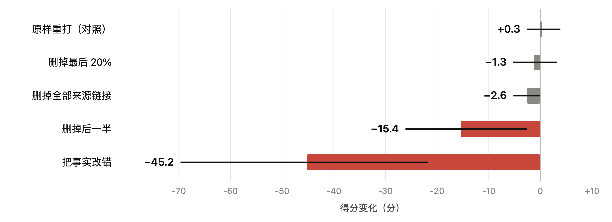

按事实清单重评：o1 96 条、o2 99 条事实，每条都对照官方页面写明标准值和判定规则；Opus 5.5 逐条判每份报告对这一条是写对、写错、只写了“待核验”还是没写，看不到组别。先判 24 份样本报告，和写清单的 agent 通读这些样本时的逐条归类对照（另一个模型的归类，不是人工），一致率 97.3% 和 96.2%；另取 26 份判了两遍，逐条一致率 99.0%。这是看了正式结果以后加的分析。新跑 240 次确认实验用同一份清单、同一种判法（判了 239 份报告，另 24 份判两遍，一致率 98.4%），对比是开跑前写定的。

表格收集题（WideSearch）的判分：按评测集自己的规则逐格判——主键列和需要判断同义的列由 Opus 5.5 判，数值列按给定的容差，其余精确匹配；逐项 F1 是“交出的格子里做对的比例”（精确率）和“标准答案的格子里做对的比例”（召回率）的调和平均。24 份判了两遍，逐项 F1 平均相差 0.12 分，最多 1.5 分。这个评测集是公开的，模型拿题面去搜会搜到评测集本身，所以做了两件事：在容器里屏蔽答案所在的网站；日志里出现评测集名字或题号的运行一律不计分（筛题 65 次里 6 次，对比 72 次里 8 次，三组分别 3、3、2 次）。把这 8 次也算进去，结论不变（出厂默认 +2.3 [−0.1, +4.8]，加鼓励句 −0.7 [−5.7, +4.2]）。

补判：K=64 那一批（80 份）和进程等subagent回来那一批（100 份）的报告，用同一份事实清单、同一种判法判了一遍，另 24 份判两遍（逐条一致率 99.5%、99.2%）。这次判分在开发机上跑（以前在本机）；取 12 份确认实验的报告两处各判一遍对照：“写对 / 没写对”的一致率 98.9%，和本机自己重判一遍（99.1%）相同，写对条数平均相差 0.25 条；“待核验”和“没写”之间的互换略多，所以这两项不跨批比较。

让单agent多查的对照：154 份报告用同一份事实清单、同一种判法在开发机上判，另 24 份判两遍，逐条一致率 98.3%。

调研报告题（DeepResearch Bench II）的判分：用评测集自己的判分提示词（逐字相同），每次判 50 条评分项，每条判“满足 / 没提到 / 依据了不许用的来源”，总分是满足的占比。和评测集不同的是判分模型：这里用 Opus 5.5（评测集用的是另一家的模型），所以分数不能和论文里的数直接比，只在各组之间比。12 份判了两遍，逐条一致率 98.1%，总分平均相差 1.2 分，最多 4.5 分。66 道中文题里有 2 道（都是健康类）判分模型一律拒绝作答，抽题时跳过了；抽到的 30 道是按固定的随机顺序取的，每个主题最多 2 道。每道题不许使用的来源写在题面里；容器里屏蔽了评测集所在的网站；运行日志里出现评测集名字、或者把不许用的来源的内容读了进来的运行不计分（60 次里 2 次，两组各 1 次；把它们算进去是 +3.5 [+1.2, +5.8]，结论不变）。

### 题目

各题的题面原文。读代码题的鼓励版在题面末尾另加一句“独立的子任务尽量交给 subagent 并行做。”；48 模块的包的不复核组另加一句“文件都写完以后，不要再另开子代理去复核、验证或补测试；需要检查就自己检查。”

- **o1 新加坡攻略**：帮我做一份新加坡 4 天自由行攻略，我从北京出发，两个人，预算中等。包括：行前准备（签证/入境卡/电话卡/支付）、交通、住宿区域推荐、每日行程（按上午/下午/晚上）、餐饮推荐、预算表。关键事实（价格、开放时间、政策）请附来源链接，查不到的写“待核验”，不要编造。输出到 singapore.md。

- **o2 国产服务器 CPU 选型报告**：帮我写一份国产服务器 CPU 选型对比报告，对象是鲲鹏 920、海光 7000 系列、飞腾 S5000C。需要：主要规格、公开的性能测试数据（注明测试条件和来源）、常见商业软件和数据库的兼容情况、适用场景建议。关键数据附来源链接，查不到的写“待核验”，不要编造。输出到 report.md。

- **c1 子代理两个上限**：这个仓库是 DeepSeek Harness 的源码。请调研：子代理（subagent）的“同时存活数量上限”和“递归深度上限”分别在哪里实现、默认值是多少、在什么时机检查、各自对哪些子代理不起作用。写到 answer.md，每条结论附文件路径和行号。

- **w1 记忆溯源插件**：这个仓库是 DeepSeek Harness 的源码。我想做一个dsh的插件，用于记忆来源追溯与修改，能够在一个会话或者项目进行时随时review这个对话和项目产生的窗口记忆和长期记忆，以及实现长期记忆在跨会话项目的调用和管理。帮我研究这里的实现路径以及技术难度。写到 report.md，不超过 3000 字，关键结论附文件路径和行号。

- **p4 四道 Python 练习**：exercises/ 下有 4 道互相独立的 Python 练习：bowling、book-store、poker、react。每道题的要求在各自目录的 README.md，要实现的是目录里的 bowling.py、book_store.py、poker.py、react.py。各目录里的 *_test.py 只是部分测试，判分会用更完整的测试，所以要按 README 写对，不要只为通过现有测试；不要修改测试文件，不要上网查现成答案。本机是 Python 3.12，可以用 python3 -m pytest 运行测试。最后在 RESULT.md 里每道题写一行完成情况。

- **24 道限时练习**：exercises/ 下有 24 道互相独立的 Python 练习，每道一个目录。每道题的要求在目录里的 README.md，要实现的是目录里那个不带 _test 的 .py 文件。各目录里的 *_test.py 只是部分测试，判分会用更完整的测试，所以要按 README 写对；不要修改测试文件，不要上网查现成答案。本机是 Python 3.12，可以用 python3 -m pytest 运行测试。限时 3 分钟，到时间进程会被强制结束，按到时为止各题文件的状态判分，所以做完一道就保存一道。

- **16 步依赖题**：当前目录里有一个 16 步的数据处理任务，数据在 data/orders.csv。从 start.md 开始做：每一步按说明算出一个整数答案；下一步的说明在哪个文件，由这一步的答案决定，所以只能按顺序一步一步做。每算完一步，就把答案写进 answers.md，单独一行，格式 `步号: 答案`（例如 `1: 1234`）。本机有 Python 3.12。限时 10 分钟，到时间进程会被强制结束，已经写进 answers.md 的才算数。

- **24 道练习不限时**：exercises/ 下有 24 道互相独立的 Python 练习，每道一个目录。每道题的要求在目录里的 README.md，要实现的是目录里那个不带 _test 的 .py 文件。各目录里的 *_test.py 只是部分测试，判分会用更完整的测试，所以要按 README 写对；不要修改测试文件，不要上网查现成答案。本机是 Python 3.12，可以用 python3 -m pytest 运行测试。

- **48 模块的 Python 包**：工作目录里是一个 Python 包 toolkit 的骨架。spec/ 是规格说明（先读 spec/README.md）；toolkit/ 里每个函数只有签名，还没有实现；tests/ 里是一部分测试。请按规格把整个包实现完：12 个子包共 48 个模块、12 个子包的入口函数（各自的 __init__.py）和命令行（__main__.py）。只用标准库。本机是 Python 3.12，可以用 python3 -m pytest 运行测试。tests/ 只是部分测试，判分会用更完整的测试，所以要按规格写对；不要修改 spec/ 和 tests/。

办公题的事实清单：每条的标准值都在官方页面上核对过原文（2026-10-04），点“来源”打开对应页面。判分时逐条判报告对这一条是写对、写错、只写了“待核验”还是没写。

#### o1 新加坡攻略的事实清单（96 条）

| **编号** | **类别** | **问题** | **标准值** |
|---|---|---|---|
| F01 | 签证与入境 | 持中国普通护照去新加坡旅游要不要签证？免签一次最多能停留多久？ | 免签；最长停留 30 天（工作、新闻报道或停留超过 30 天仍须事先办签证） [来源](https://beijing.mfa.gov.sg/consular-services/visa-information/) |
| F02 | 签证与入境 | 中新互免普通护照签证从哪一天起生效？ | 2024-02-09 [来源](https://beijing.mfa.gov.sg/consular-services/visa-information/) |
| F03 | 签证与入境 | 入境新加坡时，护照至少要有多长有效期？ | 至少 6 个月 [来源](https://www.ica.gov.sg/enter-transit-depart/entering-singapore) |
| F04 | 签证与入境 | SG Arrival Card（SGAC，电子入境卡）最早什么时候可以提交？ | 抵达前 3 天内（含抵达当天） [来源](https://www.ica.gov.sg/enter-transit-depart/entering-singapore/sg-arrival-card) |
| F05 | 签证与入境 | 提交 SGAC 要不要钱？ | 免费；ICA 不认可收费代办 [来源](https://www.ica.gov.sg/enter-transit-depart/entering-singapore/sg-arrival-card) |
| F06 | 签证与入境 | SGAC 的官方提交渠道是什么？ | ICA 官网的 SGAC e-Service（eservices.ica.gov.sg/sgarrivalcard）或 MyICA Mobile 应用 [来源](https://www.ica.gov.sg/enter-transit-depart/entering-singapore/sg-arrival-card) |
| F07 | 签证与入境 | 入境后护照上盖不盖入境章？停留期限以什么为准？ | 不盖章；ICA 用电子邮件发电子访问准证（e-Pass），停留期限以 e-Pass 为准（2022-03-11 起） [来源](https://www.ica.gov.sg/enter-transit-depart/entering-singapore/visa_requirements) |
| F08 | 签证与入境 | 带多少现金入境新加坡必须申报？ | 现金及无记名可转让票据合计超过 S$20,000（或等值外币） [来源](https://www.ica.gov.sg/enter-transit-depart/entering-singapore) |
| F09 | 签证与入境 | ICA 对短期旅客入境时随身证明的要求是什么？ | 应备有足够资金（sufficient cash）和续程/回程证明（机票等） [来源](https://www.ica.gov.sg/enter-transit-depart/entering-singapore) |
| F10 | 通信与支付 | 在新加坡坐地铁、公交，能不能直接刷境外发行的银行卡？哪些卡可以？ | 能。带非接触标识的 Visa、Mastercard、American Express、NETS 卡，以及绑了这些卡的手机钱包 [来源](https://simplygo.com.sg/faqs/cards-and-charms/simplygo/contactless-bank-cards/) |
| F11 | 通信与支付 | 用境外发行的银行卡刷地铁公交，要收多少行政费？ | 每使用一天收 S$0.60（境外发行的 Mastercard、Visa） [来源](https://simplygo.com.sg/faqs/cards-and-charms/simplygo/contactless-bank-cards/) |
| F12 | 通信与支付 | 买一张 EZ-Link 交通卡多少钱？里面有多少可用余额？ | 售价 S$10，其中储值 S$5、卡费 S$5（卡费不退） [来源](https://simplygo.com.sg/travel-cards/) |
| F13 | 通信与支付 | Singapore Tourist Pass（游客通行证）1 日票多少钱？ | S$17 [来源](https://simplygo.com.sg/travel-cards/) |
| F14 | 通信与支付 | Singapore Tourist Pass 3 日票多少钱？ | S$29 [来源](https://simplygo.com.sg/travel-cards/) |
| F15 | 通信与支付 | Singapore Tourist Pass 能不能用来坐圣淘沙捷运（Sentosa Express）？ | 不能。不含 Sentosa Express、RWS8、M2 Khatib 巴士、快速巴士等 [来源](https://thesingaporetouristpass.com.sg/type-of-passes/) |
| F16 | 通信与支付 | Singtel hi! Tourist 游客卡里，30 天、含中国在内亚太漫游的那一档多少钱？ | S$15（30 天；本地 500GB；18GB 亚太漫游含中国；8GB 全球漫游） [来源](https://www.singtel.com/personal/products-services/mobile/prepaid-plans/hi-tourist) |
| F17 | 通信与支付 | 在新加坡坐公交、地铁能不能付现金？找不找零？ | 只有巴士可以付现金，不找零，要备好正好的车资；地铁不收现金 [来源](https://www.smrt.com.sg/public-transport/getting-around/visiting-singapore/how-to-pay/) |
| F18 | 通信与支付 | 游客购物退税（TRS/eTRS）的最低消费金额是多少？ | 同一商家同一天消费满 S$100（含 GST） [来源](https://www.customs.gov.sg/at-customs/departing-singapore/tourist-refund-scheme/) |
| F19 | 通信与支付 | 退税凑满最低金额时，最多可以合并几张发票？ | 同一天、同一商家（同一 GST 注册号和店名）最多 3 张 [来源](https://www.customs.gov.sg/at-customs/departing-singapore/tourist-refund-scheme/) |
| F20 | 机场与市内交通 | 从樟宜机场坐地铁进市区怎么换乘？ | 从樟宜机场站（CG2）坐到丹那美拉 Tanah Merah（EW4），换东西线往 Tuas Link 方向；也可以坐到 Expo（CG1/DT35）换滨海市区线 [来源](https://www.changiairport.com/en/at-changi/transport-and-directions/leaving-the-airport.html) |
| F21 | 机场与市内交通 | 樟宜机场站的地铁首班车是几点？ | 周一至周六 5:31；周日及公共假日 5:59 [来源](https://www.changiairport.com/en/at-changi/transport-and-directions/leaving-the-airport.html) |
| F22 | 机场与市内交通 | 从樟宜机场站坐地铁进市区（往 Tuas Link 方向），末班车是几点？ | 23:18（每日） [来源](https://www.changiairport.com/en/at-changi/transport-and-directions/leaving-the-airport.html) |
| F23 | 机场与市内交通 | 从樟宜机场打出租车到市区，大约多久、多少钱？ | 约 30 分钟，S$25–45（打表） [来源](https://www.changiairport.com/en/at-changi/transport-and-directions/leaving-the-airport.html) |
| F24 | 机场与市内交通 | 从樟宜机场出发的出租车，机场附加费是多少？ | 17:00–23:59 为 S$8；其他时段 S$6 [来源](https://www.changiairport.com/en/at-changi/transport-and-directions/leaving-the-airport.html) |
| F25 | 机场与市内交通 | 新加坡出租车的午夜附加费是多少、什么时段？ | 00:00–05:59，加收计价器车资的 50% [来源](https://www.changiairport.com/en/at-changi/transport-and-directions/leaving-the-airport.html) |
| F26 | 机场与市内交通 | 新加坡出租车的高峰附加费是多少？ | 加收计价器车资的 25%（周一至五 6:00–9:29；周六日及公假 10:00–13:59；每日 17:00–23:59） [来源](https://www.changiairport.com/en/at-changi/transport-and-directions/leaving-the-airport.html) |
| F27 | 机场与市内交通 | 地铁、公交成人刷卡的最低车资是多少（2026 年 10 月现行）？ | S$1.28（3.2 公里以内） [来源](https://www.ptc.gov.sg/fares/public-transport-fares-and-passes/) |
| F28 | 机场与市内交通 | 地铁、公交成人刷卡的最高车资是多少（2026 年 10 月现行）？ | S$2.57（超过 40.2 公里） [来源](https://www.ptc.gov.sg/fares/public-transport-fares-and-passes/) |
| F29 | 机场与市内交通 | 成人坐巴士付现金，车资是多少（2026 年 10 月现行）？ | S$2.10–3.20（按距离） [来源](https://www.ptc.gov.sg/fares/public-transport-fares-and-passes/) |
| F30 | 机场与市内交通 | 地铁的早鸟优惠是什么？ | 工作日 7:45 前入闸，地铁车资最多便宜 50 分（最低 S$0.78） [来源](https://www.lta.gov.sg/content/ltagov/en/getting_around/public_transport/plan_your_journey.html) |
| F31 | 机场与市内交通 | 新加坡公共交通下一次涨价从哪天起、成人刷卡每程涨多少？ | 2026-12-26 起；成人刷卡每程涨 12 分（3.2 公里以内）或 13 分（超过 3.2 公里），整体 7.0% [来源](https://www.ptc.gov.sg/media-centre/newsroom/fare-review-exercise-2026/) |
| F32 | 机场与市内交通 | 新加坡出租车起步价是多少？ | 标准型 S$4.40–5.20（各公司不同） [来源](https://www.lta.gov.sg/content/ltagov/en/getting_around/point_to_point_transport_and_cross_border_services/taxi_fares_payment_methods.html) |
| F33 | 机场与市内交通 | 坐圣淘沙捷运（Sentosa Express）进岛多少钱？ | S$4（标准入岛费） [来源](https://www.sentosa.com.sg/en/getting-to-sentosa/) |
| F34 | 机场与市内交通 | 圣淘沙捷运首班车、末班车是几点？ | 首班 7:00，末班 24:00 [来源](https://www.sentosa.com.sg/en/getting-to-sentosa/) |
| F35 | 机场与市内交通 | 从 VivoCity 走跨海步行道（Sentosa Boardwalk）进圣淘沙要不要钱？ | 免费 [来源](https://www.sentosa.com.sg/en/getting-to-sentosa/) |
| F36 | 机场与市内交通 | 新加坡缆车双线（Mount Faber Line + Sentosa Line）往返成人票多少钱？ | S$35（官网原价；官网线上价 S$32.90） [来源](https://mountfaberleisure.com/attraction/singapore-cable-car/) |
| F37 | 机场与市内交通 | 新加坡缆车每天运营到几点？ | 8:45–22:00，最后登车 21:30 [来源](https://mountfaberleisure.com/attraction/singapore-cable-car/) |
| F38 | 机场与市内交通 | 坐公共交通去万态（Mandai）的动物园、夜间野生动物园，地铁坐到哪一站、怎么接驳？ | 地铁到 Khatib（NS14），换 Mandai Khatib 巴士（M2）；也可以从 Ang Mo Kio/Springleaf 坐 138 路、从 Choa Chu Kang 坐 927 路 [来源](https://www.mandai.com/en/plan-your-visit/getting-to-and-around/getting-to-mandai-wildlife-reserve.html) |
| F39 | 景点门票 | 滨海湾花园 花穹 + 云雾林 双馆票，非居民成人多少钱？ | S$46 [来源](https://www.gardensbythebay.com.sg/en/things-to-do/attractions/flower-dome.html) |
| F40 | 景点门票 | 滨海湾花园 OCBC Skyway（空中步道）非居民成人票多少钱？ | S$14 [来源](https://www.gardensbythebay.com.sg/en/things-to-do/attractions/ocbc-skyway.html) |
| F41 | 景点门票 | 滨海湾花园 Supertree Observatory（擎天树观景台）非居民成人票多少钱？ | S$14 [来源](https://www.gardensbythebay.com.sg/en/things-to-do/attractions/supertree-observatory.html) |
| F42 | 景点门票 | 滨海湾花园的户外花园（含 Supertree Grove 擎天树丛）要不要门票？ | 免费 [来源](https://www.gardensbythebay.com.sg/en/things-to-do/attractions/supertree-grove.html) |
| F43 | 景点门票 | 新加坡动物园非居民（游客）成人票多少钱？ | S$49 [来源](https://www.mandai.com/en/tickets-and-passes/single-attractions/singapore-zoo.html) |
| F44 | 景点门票 | 夜间野生动物园（Night Safari）非居民（游客）成人票多少钱？ | S$58 [来源](https://www.mandai.com/en/tickets-and-passes/single-attractions/night-safari.html) |
| F45 | 景点门票 | 河川生态园（River Wonders）非居民成人票多少钱？ | S$45 [来源](https://www.mandai.com/en/tickets-and-passes/single-attractions/river-wonders.html) |
| F46 | 景点门票 | 新加坡飞禽公园（Bird Paradise）非居民成人票多少钱？ | S$49 [来源](https://www.mandai.com/en/tickets-and-passes/single-attractions/bird-paradise.html) |
| F47 | 景点门票 | 万态“任选 2 个景点 1 日”套票成人多少钱？ | S$88 [来源](https://www.mandai.com/en/tickets-and-passes/multi-attractions.html) |
| F48 | 景点门票 | 万态“6 个景点 1 日”套票成人多少钱？ | S$118 [来源](https://www.mandai.com/en/tickets-and-passes/multi-attractions.html) |
| F49 | 景点门票 | 新加坡环球影城（USS）成人一日票多少钱？ | S$76 起（非高峰日）。官网按日期分三档：非高峰 S$76、高峰 S$83、超高峰 S$89；2026 年 10 月抽查的各天都是高峰价 S$83 [来源](https://www.rwsentosa.com/en/play/universal-studios-singapore/tickets) |
| F50 | 景点门票 | 新加坡海洋馆（Singapore Oceanarium，原 S.E.A. 海洋馆）成人票多少钱？ | S$55（13–59 岁；官网写 From SGD55，抽查的各天都是 S$55） [来源](https://www.rwsentosa.com/en/play/singapore-oceanarium) |
| F51 | 景点门票 | 新加坡植物园要不要门票？ | 免费（只有园内的国家胡姬花园收费） [来源](https://sbg.nparks.gov.sg/visit/general-info/) |
| F52 | 景点门票 | 植物园内的国家胡姬花园（National Orchid Garden）标准成人票（非本地居民）多少钱？ | S$15 [来源](https://sbg.nparks.gov.sg/visit/general-info/) |
| F53 | 景点门票 | 新加坡国家美术馆（National Gallery Singapore）外国游客普通门票多少钱？ | S$20 [来源](https://www.nationalgallery.sg/sg/en/visit/visitor-information.html) |
| F54 | 景点门票 | 滨海湾金沙 SkyPark 观景台成人票多少钱？ | 非高峰时段（9:30–16:30）S$35；高峰时段（17:00–22:00）S$39 [来源](https://www.marinabaysands.com/attractions/skypark-observation-deck.html) |
| F55 | 景点门票 | 新加坡河游船（Singapore River Cruise，约 40 分钟）成人票多少钱？ | S$28 [来源](https://rivercruise.com.sg/river-cruise/) |
| F56 | 景点门票 | 星耀樟宜 Canopy Park（星空花园）标准入场票多少钱？ | S$8（成人、儿童同价） [来源](https://www.jewelchangiairport.com/en/attractions/canopy-park.html) |
| F57 | 景点开放时间 | 滨海湾花园花穹、云雾林每天几点开到几点？ | 每天 9:00–21:00 [来源](https://www.gardensbythebay.com.sg/en/plan-your-visit/opening-hours.html) |
| F58 | 景点开放时间 | 花穹、云雾林最后入场时间分别是几点？ | 云雾林 20:00；花穹 20:30 [来源](https://www.gardensbythebay.com.sg/en/plan-your-visit/opening-hours.html) |
| F59 | 景点开放时间 | 滨海湾花园户外花园（含 Supertree Grove）每天几点开到几点？ | 每天 5:00–次日 2:00 [来源](https://www.gardensbythebay.com.sg/en/plan-your-visit/opening-hours.html) |
| F60 | 景点开放时间 | OCBC Skyway 每天几点开到几点？ | 每天 9:00–21:00，最后入场 20:30 [来源](https://www.gardensbythebay.com.sg/en/plan-your-visit/opening-hours.html) |
| F61 | 景点开放时间 | 滨海湾花园 Garden Rhapsody 灯光音乐秀每晚几点、要不要钱？ | 每天 19:45 和 20:45 两场；免费 [来源](https://www.gardensbythebay.com.sg/en/things-to-do/calendar-of-events/garden-rhapsody.html) |
| F62 | 景点开放时间 | 花穹 2026 年 10 月哪天维护闭馆？ | 2026-10-06（全天） [来源](https://www.gardensbythebay.com.sg/en/things-to-do/attractions/flower-dome.html) |
| F63 | 景点开放时间 | 云雾林 2026 年 10 月哪天维护闭馆？ | 2026-10-26（全天） [来源](https://www.gardensbythebay.com.sg/en/things-to-do/attractions/cloud-forest.html) |
| F64 | 景点开放时间 | 新加坡动物园每天几点开到几点？ | 每天 8:30–18:00，最后入场 17:00 [来源](https://www.mandai.com/en/singapore-zoo.html) |
| F65 | 景点开放时间 | 夜间野生动物园（Night Safari）每天几点开到几点？ | 每天 18:00–24:00，最后入场 23:15（步道和游园车 19:00 开始） [来源](https://www.mandai.com/en/night-safari.html) |
| F66 | 景点开放时间 | 新加坡植物园每天几点开到几点？ | 每天 5:00–24:00 [来源](https://sbg.nparks.gov.sg/visit/general-info/) |
| F67 | 景点开放时间 | 国家胡姬花园每天几点开到几点？ | 每天 8:30–19:00，最后售票和入场 18:00 [来源](https://sbg.nparks.gov.sg/visit/general-info/) |
| F68 | 景点开放时间 | 新加坡国家美术馆每天几点开到几点？ | 每天 10:00–19:00，最后入场 18:30 [来源](https://www.nationalgallery.sg/sg/en/visit/visitor-information.html) |
| F69 | 景点开放时间 | 星耀樟宜雨漩涡（Rain Vortex）灯光音乐秀每晚几点？ | 周一至周四 20:00、21:00；周五至周日、公共假日及前夕 20:00、21:00、22:00 [来源](https://www.jewelchangiairport.com/en/attractions/rain-vortex.html) |
| F70 | 景点开放时间 | 星耀樟宜雨漩涡每天几点开到几点？ | 每天 10:00–22:00 [来源](https://www.jewelchangiairport.com/en/attractions/rain-vortex.html) |
| F71 | 景点开放时间 | 滨海湾金沙 Spectra 光影水舞秀每晚几点、要不要钱？ | 周日至周四 20:00、21:00；周五、周六 20:00、21:00、22:00；免费，约 15 分钟 [来源](https://www.marinabaysands.com/attractions/spectra.html) |
| F72 | 景点开放时间 | 滨海湾金沙 SkyPark 观景台每天几点开到几点？ | 9:30–22:00（非高峰 9:30–16:30，最后入场 16:00；高峰 17:00–22:00，最后入场 21:30） [来源](https://www.marinabaysands.com/attractions/skypark-observation-deck.html) |
| F73 | 景点开放时间 | 艺术科学博物馆（ArtScience Museum）每天几点开到几点？ | 每天 9:00–18:00，最后入场 17:00 [来源](https://www.marinabaysands.com/museum.html) |
| F74 | 景点开放时间 | 牛车水佛牙寺龙华院每天几点开到几点？ | 每天 7:00–17:00 [来源](https://www.buddhatoothrelictemple.org.sg/) |
| F75 | 景点开放时间 | 苏丹回教堂对游客开放参观的时间是什么？ | 周六至周四 10:00–12:00、14:00–16:00；周五不开放 [来源](https://www.sultanmosque.sg/visitors-info/) |
| F76 | 餐饮与消费规则 | 新加坡消费税（GST）税率是多少？ | 9%（2024-01-01 起） [来源](https://www.iras.gov.sg/taxes/goods-services-tax-(gst)/basics-of-gst/current-gst-rates) |
| F77 | 餐饮与消费规则 | 新加坡餐厅、酒店账单上的服务费一般是多少？ | 通常 10% [来源](https://www.iras.gov.sg/taxes/goods-services-tax-(gst)/specific-business-sectors/hotel-and-food-beverage) |
| F78 | 餐饮与消费规则 | 菜单或房价标“++”时，标价 S$100 实际要付多少？ | S$119.90（先加 10% 服务费，再按含服务费的金额加 9% GST，合计约 +19.9%） [来源](https://www.iras.gov.sg/taxes/goods-services-tax-(gst)/specific-business-sectors/hotel-and-food-beverage) |
| F79 | 餐饮与消费规则 | 在新加坡要不要给小费？ | 不是惯例，不强制；餐厅、酒吧、酒店餐饮账单通常已含 10% 服务费 [来源](https://calc2026.agc.gov.sg/visiting-singapore/practical-information/) |
| F80 | 餐饮与消费规则 | 在小贩中心吃完饭要不要自己归还托盘？不还会怎样？ | 必须自己归还托盘和餐具并清理桌面；2021-09-01 起执法，初犯书面警告，再犯可被罚款 [来源](https://www.nea.gov.sg/our-services/public-cleanliness/clean-tables/clean-tables-campaign) |
| F81 | 餐饮与消费规则 | 老巴刹（Lau Pa Sat）沙爹街每天几点营业？ | 平日 19:00–次日 3:00；周末 15:00–次日 3:00 [来源](https://www.laupasat.sg/satay-street/) |
| F82 | 餐饮与消费规则 | 新加坡的自来水能不能直接喝？ | 能，可以直接饮用，不用再过滤 [来源](https://www.pub.gov.sg/Public/WaterLoop/Water-Quality) |
| F83 | 法规与注意事项 | 能不能带电子烟入境新加坡？ | 不能。电子烟是禁止进口的物品，持有、使用也违法 [来源](https://www.ica.gov.sg/enter-transit-depart/entering-singapore/what-you-can-bring) |
| F84 | 法规与注意事项 | 个人持有、使用电子烟，最高罚多少？ | 最高罚款 S$10,000（2026-05-01 起，TVCA）；含依托咪酯等成分的，最高罚 S$20,000 或监禁 10 年 [来源](https://www.gov.sg/stopvaping-penalties/) |
| F85 | 法规与注意事项 | 能不能带口香糖入境新加坡？ | 不能。口香糖禁止进口（经 HSA 批准的牙科、药用口香糖除外） [来源](https://www.customs.gov.sg/doing-business/import-operations/import-procedures/controlled-and-prohibited-goods-for-imports/) |
| F86 | 法规与注意事项 | 带香烟入境新加坡有没有免税额度？ | 没有。香烟和烟草制品没有免税额度，也没有 GST 进口减免，带入都要缴税 [来源](https://www.customs.gov.sg/at-customs/arriving-in-singapore/duty-free-concession-gst-relief/) |
| F87 | 法规与注意事项 | 带酒入境新加坡，免税的条件和额度是什么？ | 满 18 岁、入境前在新加坡境外停留至少 48 小时、不是从马来西亚入境；五种组合选一种，合计最多 2 升（如 1 升烈酒 + 1 升葡萄酒） [来源](https://www.customs.gov.sg/at-customs/arriving-in-singapore/duty-free-concession-gst-relief/) |
| F88 | 法规与注意事项 | 带新买的物品入境新加坡，GST 进口减免额度是多少？ | 在新加坡境外停留 48 小时或以上：S$500；不足 48 小时：S$100 [来源](https://www.customs.gov.sg/at-customs/arriving-in-singapore/duty-free-concession-gst-relief/) |
| F89 | 法规与注意事项 | 在新加坡地铁站内和车厢里能不能吃东西、喝水？ | 不能。地铁范围内禁止饮食，最高罚款 S$500 [来源](https://sso.agc.gov.sg/SL/RTSA1995-RG1?ProvIds=P1IV-#pr14-) |
| F90 | 法规与注意事项 | 在新加坡订 Airbnb 这类短租民宿合不合法？ | 不合法。私人住宅不得用于少于连续 3 个月的短期住宿；游客应住酒店（没有最短住宿限制）或服务式公寓（最短 7 天） [来源](https://www.ura.gov.sg/guidelines/property-and-business-owners/property/short-term-accommodation/) |
| F91 | 其他 | 新加坡用什么插头/插座？ | Type G（英标 13A 三脚方插） [来源](https://www.consumerproductsafety.gov.sg/consumers/product-safety-tips/home-appliances-furniture-and-indoor-product-safety/types-of-mains-plugs-suitable-for-use-in-singapore/) |
| F92 | 其他 | 新加坡的电压和频率是多少？ | 230V、50Hz [来源](https://calc2026.agc.gov.sg/visiting-singapore/practical-information/) |
| F93 | 其他 | 在新加坡报警打什么电话？ | 999 [来源](https://www.gov.sg/contact-us/) |
| F94 | 其他 | 在新加坡叫救护车、报火警打什么电话？ | 995 [来源](https://www.gov.sg/contact-us/) |
| F95 | 其他 | 中国驻新加坡大使馆的领事保护与协助电话是多少？ | +65 6475 0165（24 小时） [来源](https://sg.china-embassy.gov.cn/chn/lxwm/) |
| F96 | 其他 | 新加坡和北京有没有时差？ | 没有。新加坡标准时间是 UTC+8 [来源](https://sso.agc.gov.sg/SL/IA1965-N1) |

#### o2 国产服务器 CPU 选型报告的事实清单（99 条）

| **编号** | **类别** | **问题** | **标准值** |
|---|---|---|---|
| G01 | 鲲鹏 920 规格 | 鲲鹏 920 的指令集架构 | ARMv8.2（AArch64） [来源](https://www.hisilicon.com/cn/products/kunpeng/huawei-kunpeng/huawei-kunpeng-920) |
| G02 | 鲲鹏 920 规格 | 鲲鹏 920 的制程工艺 | 7 [来源](https://www.hisilicon.com/cn/products/kunpeng/huawei-kunpeng/huawei-kunpeng-920) |
| G03 | 鲲鹏 920 规格 | 鲲鹏 920 单芯片最多多少核 | 64 [来源](https://www.hisilicon.com/cn/products/kunpeng/huawei-kunpeng/huawei-kunpeng-920) |
| G04 | 鲲鹏 920 规格 | 鲲鹏 920 官方标称的主频 | 2.6 GHz / 3.0 GHz（7260、5250、5220、3210 为 2.6 GHz；7265F 等 F 型号为 3.0 GHz） [来源](https://www.hisilicon.com/cn/products/kunpeng/huawei-kunpeng/huawei-kunpeng-920) |
| G05 | 鲲鹏 920 规格 | 鲲鹏 920 的最大功耗（也就是 7260 的 TDP） | 180 [来源](https://www.hisilicon.com/cn/products/kunpeng/huawei-kunpeng/huawei-kunpeng-920) |
| G06 | 鲲鹏 920 规格 | 鲲鹏 920 最多支持几路互联、最多多少物理核 | 最多 4 路（2S & 4S），最高 256 个物理核 [来源](https://www.hikunpeng.com/zh/compute/kunpeng920) |
| G07 | 鲲鹏 920 规格 | 鲲鹏 920 每颗处理器的内存通道数和内存类型 | 8 个 DDR4 通道 [来源](https://www.hisilicon.com/cn/products/kunpeng/huawei-kunpeng/huawei-kunpeng-920) |
| G08 | 鲲鹏 920 规格 | 鲲鹏 920 支持的最高内存速率 | 2933 [来源](https://www.hikunpeng.com/zh/compute/kunpeng920) |
| G09 | 鲲鹏 920 规格 | 鲲鹏 920 的 PCIe 代际 | PCIe 4.0 [来源](https://www.hisilicon.com/cn/products/kunpeng/huawei-kunpeng/huawei-kunpeng-920) |
| G10 | 鲲鹏 920 规格 | 鲲鹏 920 的 PCIe 通道（lane）数 | 40 [来源](https://www.hikunpeng.com/zh/compute/kunpeng920) |
| G11 | 鲲鹏 920 规格 | 鲲鹏 920 7260 的核心数和主频 | 64 核，2.6 GHz [来源](https://www.hikunpeng.com/zh/compute/kunpeng920) |
| G12 | 鲲鹏 920 规格 | 鲲鹏 920 5250 的核心数 | 48 [来源](https://www.hikunpeng.com/zh/compute/kunpeng920) |
| G13 | 鲲鹏 920 规格 | 鲲鹏 920 5220 的核心数和内存通道数 | 32 核，4 个内存通道 [来源](https://www.hikunpeng.com/zh/compute/kunpeng920) |
| G14 | 鲲鹏 920 规格 | 鲲鹏 920 5250 和 5220 的 TDP | 5250：150 W；5220：115 W [来源](https://www.hikunpeng.com/zh/compute/kunpeng920) |
| G15 | 鲲鹏 920 规格 | 鲲鹏 920 的缓存 | 每核 L1 64 KB 指令 + 64 KB 数据，L2 512 KB；L3 每核 1 MB（7260 为 64 MB，全系 24~64 MB） [来源](https://www.hikunpeng.com/zh/compute/kunpeng920) |
| G16 | 鲲鹏 920 规格 | 鲲鹏 920 7260 支不支持超线程（SMT） | 不支持，每核 1 个线程 [来源](https://www.spec.org/cpu2017/results/res2020q2/cpu2017-20200529-22566.txt) |
| G17 | 鲲鹏 920 规格 | 鲲鹏 920 的虚拟化限制：支不支持 AArch32（在 KVM 里跑 32 位 Linux）、支不支持嵌套虚拟化 | 都不支持 [来源](https://www.hikunpeng.com/document/detail/zh/kunpengfaq/productfaq/hardwarefaq/hardware_faq_0001.html) |
| G18 | 鲲鹏 920 规格 | 鲲鹏 920 对国密 SM3/SM4 的硬件支持方式 | 集成 SM3/SM4 硬件加速器（另有 AES、SHA-2、RSA）；没有 SM3/SM4 指令 [来源](https://www.hikunpeng.com/document/detail/zh/kunpengfaq/productfaq/hardwarefaq/hardware_faq_0001.html) |
| G19 | 鲲鹏 920 规格 | 鲲鹏 920 旧型号 6426、4826 现在对应哪两个型号 | 6426 → 7260，4826 → 5250 [来源](https://support.huawei.com/enterprise/zh/doc/EDOC1100088652/ecfd64a5) |
| G20 | 海光 7000 规格 | 海光 7000 系列的指令集 | x86（x86-64） [来源](https://www.hygon.cn/product/cpu) |
| G21 | 海光 7000 规格 | 海光官网和招股书给出的 7000 系列单颗最多核心数 | 32 [来源](https://www.hygon.cn/product/cpu) |
| G22 | 海光 7000 规格 | 海光 7000 系列最多支持多少个内存通道、多少个 PCIe 通道 | 8 个内存通道，128 个 PCIe 通道 [来源](https://static.sse.com.cn/stock/disclosure/announcement/c/202203/001043_20220307_T2KW.pdf) |
| G23 | 海光 7000 规格 | 海光 7000 系列单颗 CPU 最大支持多少内存 | 2 [来源](https://www.hygon.cn/product/cpu) |
| G24 | 海光 7000 规格 | 海光 7285 的核心数和线程数 | 32 核 64 线程 [来源](http://static.sse.com.cn/stock/disclosure/announcement/c/202203/001043_20220304_5PQP.pdf) |
| G25 | 海光 7000 规格 | 海光 7285 的基准主频 | 2.0 [来源](http://static.sse.com.cn/stock/disclosure/announcement/c/202203/001043_20220304_5PQP.pdf) |
| G26 | 海光 7000 规格 | 海光 7285 的功耗（或 7200 系列的典型功耗） | 7285：190 W；7200 系列典型功耗 175–225 W [来源](http://static.sse.com.cn/stock/disclosure/announcement/c/202203/001043_20220304_5PQP.pdf) |
| G27 | 海光 7000 规格 | 海光 7285 的制程工艺 | 14 [来源](http://static.sse.com.cn/stock/disclosure/announcement/c/202203/001043_20220304_5PQP.pdf) |
| G28 | 海光 7000 规格 | 海光 7200 系列（含 7285）的内存最高频率和 PCIe 代际 | DDR4 最高 2666 MHz；PCIe Gen3（128 lane） [来源](https://static.sse.com.cn/stock/disclosure/announcement/c/202203/001043_20220307_T2KW.pdf) |
| G29 | 海光 7000 规格 | 海光 7285 的发布时间 | 2020 年第一季度 [来源](http://static.sse.com.cn/stock/disclosure/announcement/c/202203/001043_20220304_5PQP.pdf) |
| G30 | 海光 7000 规格 | 海光一号、海光二号分别对应哪些型号系列 | 海光一号：31xx / 51xx / 71xx；海光二号：32xx / 52xx / 72xx [来源](https://static.sse.com.cn/stock/disclosure/announcement/c/202203/001043_20220307_T2KW.pdf) |
| G31 | 海光 7000 规格 | 海光 7390 的核心数和线程数 | 32 核 64 线程 [来源](https://www.hygon.cn/product/productlist?category=category2) |
| G32 | 海光 7000 规格 | 海光 7390 的基准主频和最大加速频率 | 基准 2.7 GHz，最大加速 3.3 GHz [来源](https://www.hygon.cn/product/productlist?category=category2) |
| G33 | 海光 7000 规格 | 海光 7390 的内存规格 | DDR4，最高 3200 MHz，8 通道 [来源](https://www.hygon.cn/product/productlist?category=category2) |
| G34 | 海光 7000 规格 | 海光 7390 的 PCIe 规格 | PCIe 4.0，128 条通道 [来源](https://www.hygon.cn/product/productlist?category=category2) |
| G35 | 海光 7000 规格 | 海光 7380 的基准主频和最大加速频率 | 基准 2.2 GHz，最大加速 3.0 GHz [来源](https://www.hygon.cn/product/productlist?category=category2) |
| G36 | 海光 7000 规格 | 海光官网所列 7000 系列型号（7390、7380 等）支持的 CPU 插槽数 | 1P / 2P（最多双路） [来源](https://www.hygon.cn/product/productlist?category=category2) |
| G37 | 海光 7000 规格 | 海光 C86-4G（OPN 7490）每颗多少核 | 64 核（每核 2 线程） [来源](https://www.spec.org/cloud_iaas2018/results/res2026q1/cloudiaas2018-20251201-00035.html) |
| G38 | 海光 7000 规格 | 海光 C86-4G（OPN 7490）用什么内存 | DDR5 [来源](https://www.spec.org/cloud_iaas2018/results/res2026q1/cloudiaas2018-20251201-00035.html) |
| G39 | 飞腾 S5000C 规格 | 飞腾腾云 S5000C 用的处理器核 | FTC862 [来源](https://www.phytium.com.cn/homepage/production/13/) |
| G40 | 飞腾 S5000C 规格 | 飞腾腾云 S5000C 的指令集 | 兼容 ARMv8 [来源](https://www.phytium.com.cn/homepage/production/13/) |
| G41 | 飞腾 S5000C 规格 | 飞腾腾云 S5000C 有哪几种核数形态 | 64 核、32 核、16 核三种 [来源](https://www.phytium.com.cn/homepage/production/13/) |
| G42 | 飞腾 S5000C 规格 | 飞腾腾云 S5000C 的主频 | 64 核版 2.1~2.3 GHz；32 核、16 核版 2.3 GHz [来源](https://www.phytium.com.cn/homepage/production/13/) |
| G43 | 飞腾 S5000C 规格 | 飞腾腾云 S5000C 的二级、三级缓存 | 64 / 32 / 16 核版：L2 32 / 16 / 8 MB，L3 32 / 16 / 8 MB [来源](https://www.phytium.com.cn/homepage/production/13/) |
| G44 | 飞腾 S5000C 规格 | 飞腾腾云 S5000C 的内存接口 | 64 / 32 / 16 核版分别有 8 / 4 / 2 个 DDR5 接口 [来源](https://www.phytium.com.cn/homepage/production/13/) |
| G45 | 飞腾 S5000C 规格 | 飞腾腾云 S5000C 的 PCIe 规格 | PCIe 5.0；64 / 32 / 16 核版分别 96 / 80 / 48 lanes [来源](https://www.phytium.com.cn/homepage/production/13/) |
| G46 | 飞腾 S5000C 规格 | 飞腾腾云 S5000C 的多路支持 | 最多 128 核心互联（64 核版即双路） [来源](https://www.phytium.com.cn/homepage/production/13/) |
| G47 | 飞腾 S5000C 规格 | 飞腾腾云 S5000C-E 最多多少核 | 80 [来源](https://www.phytium.com.cn/homepage/production/18/) |
| G48 | 飞腾 S5000C 规格 | 飞腾腾云 S5000C-E 的主频 | ≥2.6 GHz [来源](https://www.phytium.com.cn/homepage/production/18/) |
| G49 | 飞腾 S5000C 规格 | 飞腾腾云 S5000C-E 的内存接口和 PCIe 规格 | 8 个 DDR5 接口；48 lanes PCIe 5.0 [来源](https://www.phytium.com.cn/homepage/production/18/) |
| G50 | 飞腾 S5000C 规格 | 飞腾腾云 S5000C-E 的多路支持 | 2~4 路互联 [来源](https://www.phytium.com.cn/homepage/production/18/) |
| G51 | 基准测试 | SPEC CPU2017：2 颗鲲鹏 920 7260（128 核，TaiShan 200 2280）用 GCC + 麒麟 V10 跑出的 SPECrate2017_int_base | 318 [来源](https://www.spec.org/cpu2017/results/res2020q2/cpu2017-20200529-22566.txt) |
| G52 | 基准测试 | 318 这条成绩的编译器、操作系统和测试时间 | GCC 9.1.0；kylin release 10（银河麒麟 V10）；Test date May-2020，2020-06-30 发布 [来源](https://www.spec.org/cpu2017/results/res2020q2/cpu2017-20200529-22566.txt) |
| G53 | 基准测试 | 鲲鹏 920 这几条 SPEC CPU2017 结果的 Test Sponsor / 测试方是谁 | 鹏城实验室（Peng Cheng Laboratory） [来源](https://www.spec.org/cpu2017/results/res2020q2/cpu2017-20200529-22566.txt) |
| G54 | 基准测试 | SPEC CPU2017：同一平台（2 颗 7260）换毕昇编译器 + openEuler 后的 SPECrate2017_int_base | 389 [来源](https://www.spec.org/cpu2017/results/res2021q4/cpu2017-20211012-29727.txt) |
| G55 | 基准测试 | 389 这条成绩的编译器、操作系统和测试时间 | 毕昇编译器 BiSheng 1.3.3；openEuler 20.03 (LTS-SP2)；Test date Sep-2021 [来源](https://www.spec.org/cpu2017/results/res2021q4/cpu2017-20211012-29727.txt) |
| G56 | 基准测试 | SPEC CPU2017：4 颗鲲鹏 920 7260（256 核，TaiShan 200 2480）的 SPECrate2017_int_base | 628 [来源](https://www.spec.org/cpu2017/results/res2020q2/cpu2017-20200529-22564.txt) |
| G57 | 基准测试 | SPEC CPU2017：2 颗鲲鹏 920 7260 的 SPECrate2017_fp_base（有两条） | 263 和 257 [来源](https://www.spec.org/cpu2017/results/res2020q3/cpu2017-20200621-22956.txt) |
| G58 | 基准测试 | SPEC CPU2017：4 颗鲲鹏 920 7260 的 SPECrate2017_fp_base（有两条） | 516 和 501 [来源](https://www.spec.org/cpu2017/results/res2020q3/cpu2017-20200621-22957.txt) |
| G59 | 基准测试 | SPEC CPU2017 官方结果库里鲲鹏的结果一共几条 | 7 条（int rate 3 条：318、389、628；fp rate 4 条：263、257、516、501；全部是 7260） [来源](https://www.spec.org/cgi-bin/osgresults?conf=cpu2017&op=fetch&field=CPU&pattern=Kunpeng&icase=1) |
| G60 | 基准测试 | SPEC CPU2017 官方结果库里海光、飞腾各有几条结果 | 都是 0 条 [来源](https://www.spec.org/cgi-bin/osgresults?conf=cpu2017&op=fetch&field=CPU&pattern=Hygon&icase=1) |
| G61 | 基准测试 | 鲲鹏 920 这几条 SPEC CPU2017 结果的内存配置 | 2 路的四条（318、389、263、257）都是 512 GB（16 × 32 GB）；4 路的三条（628、516、501）都是 1 TB（32 × 32 GB）；都是 PC4-2933 [来源](https://www.spec.org/cpu2017/results/res2020q2/cpu2017-20200529-22566.txt) |
| G62 | 基准测试 | 海光招股书披露的海光 7200 系列（7285）双路 SPECrate2017_int_base / fp_base | 348 / 308 [来源](https://static.sse.com.cn/stock/disclosure/announcement/c/202203/001043_20220307_T2KW.pdf) |
| G63 | 基准测试 | 348 / 308 这组数据出自哪份测试报告 | 北京交通大学软件评测实验室出具的《测试报告》，报告编号 2109BZKKK001（招股书的表注） [来源](https://static.sse.com.cn/stock/disclosure/announcement/c/202203/001043_20220307_T2KW.pdf) |
| G64 | 基准测试 | 海光招股书拿 7285 和 Intel 至强铂金比较时，Intel 的数字是怎么来的 | Intel 只有 4 路成绩，按约 2 倍（1.97–2.01 倍）折算成双路后再比 [来源](http://static.sse.com.cn/stock/disclosure/announcement/c/202203/001043_20220304_5PQP.pdf) |
| G65 | 基准测试 | SPEC Cloud IaaS 2018：飞腾腾云 S5000C-E 平台（中国电信天翼云 TeleCloudOS V4.0）的 Performance Score | 168.2 [来源](https://www.spec.org/cloud_iaas2018/results/res2026q2/cloudiaas2018-20260508-00037.html) |
| G66 | 基准测试 | 168.2 这条结果的副本数、相对扩展性、平均实例开通时间 | 160 copies；85.9%；47 s [来源](https://www.spec.org/cloud_iaas2018/results/res2026q2/cloudiaas2018-20260508-00037.html) |
| G67 | 基准测试 | 168.2 这条结果的计算节点配置 | 12 个计算节点，每节点 2 颗 S5000C-E（每颗 80 核，2600 MHz），2048 GB ECC DDR5 5600MT/s；整机长城擎天 RF6260 V5；CTyunOS V4.0 25.07；KVM [来源](https://www.spec.org/cloud_iaas2018/results/res2026q2/cloudiaas2018-20260508-00037.html) |
| G68 | 基准测试 | 168.2 这条结果页上的 Test Date | 2026-03-30 [来源](https://www.spec.org/cloud_iaas2018/results/res2026q2/cloudiaas2018-20260508-00037.html) |
| G69 | 基准测试 | SPEC Cloud IaaS 2018：海光 C86-4G（OPN 7490）平台（浪潮 InCloudOS V8）的 Performance Score | 154.9 [来源](https://www.spec.org/cloud_iaas2018/results/res2026q1/cloudiaas2018-20251201-00035.html) |
| G70 | 基准测试 | 154.9 这条结果的条件 | 126 copies；相对扩展性 91.6%；平均开通 27 s；9 个计算节点，每节点 2 颗 × 64 核、3000 MHz；Test Date 2025-10-29；KOS 5.8 [来源](https://www.spec.org/cloud_iaas2018/results/res2026q1/cloudiaas2018-20251201-00035.html) |
| G71 | 基准测试 | SPEC Cloud IaaS 2018：鲲鹏 920 在 2025 年的两条结果 | 153.7（鲲鹏 920-7260，山东大学 ICP 3.7，136 copies，95.2%，30 s）；148.6（鲲鹏 920-7260T，中国电信 TeleCloudOS 4.0，125 copies，89.0%，29 s） [来源](https://www.spec.org/cloud_iaas2018/results/cloud_iaas2018/) |
| G72 | 基准测试 | SPEC Cloud IaaS 2018：2022 年含海光 7285 的那条浪潮结果（48.7 分），计算节点是什么 | 混合平台：7 台 Intel Xeon Gold 5218，加 1 台海光 C86 7285、1 台飞腾 S2500 [来源](https://www.spec.org/cloud_iaas2018/results/res2023q1/cloudiaas2018-20221117-00017.html) |
| G73 | 基准测试 | 截至 2026 年 10 月初，SPEC Cloud IaaS 2018 已公布结果里最高的 Performance Score | 168.2（飞腾 S5000C-E 平台；共 19 条结果，次高是海光 C86-4G 的 154.9） [来源](https://www.spec.org/cloud_iaas2018/results/cloud_iaas2018/) |
| G74 | 基准测试 | SPECvirt_sc2013：鲲鹏 920 双路服务器（武汉长江计算 R220K V2）的成绩 | 1509 @ 84 VMs [来源](https://www.spec.org/virt_sc2013/results/res2024q4/virt_sc2013-20241106-00145-perf.html) |
| G75 | 基准测试 | 海思官网宣称的鲲鹏 920 SPECint 分数 | 超过 930（英文页写的是 estimated，基准是 SPECint_rate_base2006；页面没给测试条件） [来源](https://www.hisilicon.com/en/products/kunpeng/huawei-kunpeng/huawei-kunpeng-920) |
| G76 | 认证与安全可靠测评 | 安全可靠测评：鲲鹏 920 的等级和所在公告 | Ⅰ 级；2023 年第 1 号（2023-12-26） [来源](https://www.itsec.gov.cn/aqkkcp/cpgg/202312/t20231226_162074.html) |
| G77 | 认证与安全可靠测评 | 安全可靠测评：鲲鹏 920 V200 的等级和所在公告 | Ⅱ 级；2024 年第 1 号（2024-05-20） [来源](https://www.itsec.gov.cn/aqkkcp/cpgg/202405/t20240520_172866.html) |
| G78 | 认证与安全可靠测评 | 安全可靠测评：海光 2 号 C86（含 7285 / 7280 / 7260 / 7250）的等级和所在公告 | Ⅰ 级；2023 年第 1 号（2023-12-26） [来源](https://www.itsec.gov.cn/aqkkcp/cpgg/202312/t20231226_162074.html) |
| G79 | 认证与安全可靠测评 | 安全可靠测评：海光 C86-3G 的等级和所在公告 | Ⅰ 级；2023 年第 1 号（2023-12-26） [来源](https://www.itsec.gov.cn/aqkkcp/cpgg/202312/t20231226_162074.html) |
| G80 | 认证与安全可靠测评 | 安全可靠测评：海光 C86-4G 的等级和所在公告 | Ⅱ 级；2024 年第 1 号（2024-05-20） [来源](https://www.itsec.gov.cn/aqkkcp/cpgg/202405/t20240520_172866.html) |
| G81 | 认证与安全可靠测评 | 安全可靠测评：海光 C86-4G-L 的等级和所在公告 | Ⅰ 级；2024 年第 1 号（2024-05-20） [来源](https://www.itsec.gov.cn/aqkkcp/cpgg/202405/t20240520_172866.html) |
| G82 | 认证与安全可靠测评 | 安全可靠测评：飞腾腾云 S5000C 的等级和所在公告 | Ⅱ 级；2024 年第 1 号（2024-05-20） [来源](https://www.itsec.gov.cn/aqkkcp/cpgg/202405/t20240520_172866.html) |
| G83 | 认证与安全可靠测评 | 安全可靠测评：飞腾腾云 S5000C-E 的等级和所在公告 | Ⅱ 级；2025 年第 1 号（2025-03-14） [来源](https://www.itsec.gov.cn/aqkkcp/cpgg/202503/t20250314_216512.html) |
| G84 | 认证与安全可靠测评 | 安全可靠测评结果的有效期 | 自发布之日起三年 [来源](https://www.itsec.gov.cn/aqkkcp/cpgg/202312/t20231226_162074.html) |
| G85 | 认证与安全可靠测评 | 安全可靠测评 2026 年第 3 号（2026-09-20）里华为、海光的服务器 CPU 及其等级 | 鲲鹏 950：Ⅲ 级；海光 C86-4G/H：Ⅱ 级 [来源](https://www.itsec.gov.cn/aqkkcp/cpgg/202609/t20260920_275291.html) |
| G86 | 生态与兼容 | Microsoft SQL Server 对处理器架构的要求（鲲鹏、飞腾能不能装） | 只支持 x64；ARM 平台（鲲鹏、飞腾）不受支持 [来源](https://learn.microsoft.com/en-us/sql/linux/sql-server-linux-setup) |
| G87 | 生态与兼容 | Oracle Database 19c 有没有官方的 Linux for Arm（aarch64）版本，从哪个版本起、最低什么操作系统 | 有；自 19c Release 19.19 起；最低 Oracle Linux 8.6 + UEK7 [来源](https://docs.oracle.com/en/database/oracle/oracle-database/19/ladbi/oracle-linux-8-distributions-for-arm.html) |
| G88 | 生态与兼容 | Oracle Database 19c Linux for Arm 版对 CPU 的要求 | 要求具备 Neoverse N1 能力的 CPU；Oracle 推荐 Ampere Altra / Altra Max [来源](https://docs.oracle.com/en/database/oracle/oracle-database/19/ladbi/server-hardware-checklist-for-oracle-database-installation.html) |
| G89 | 生态与兼容 | 达梦 DM8 支持哪些国产 CPU 平台（三家在不在内） | 飞腾、海光、鲲鹏都在支持之列（另有龙芯、申威、兆芯等） [来源](https://eco.dameng.com/community/training/3ff249fe15626e207849672201c9aeb1) |
| G90 | 生态与兼容 | OceanBase 官方文档列出的服务器架构（三家在不在内） | x86_64（包括海光）；ARM_64（鲲鹏、飞腾） [来源](https://www.oceanbase.com/docs/enterprise-oceanbase-database-cn-10000000000371523) |
| G91 | 生态与兼容 | openGauss 官方对鲲鹏、飞腾、海光的说法 | 支持鲲鹏服务器和通用 x86 服务器；在飞腾 / 海光等服务器上安装需要重新适配编译 [来源](https://docs.opengauss.org/zh/docs/common/faq/faq.html) |
| G92 | 生态与兼容 | 银河麒麟高级服务器操作系统 V10 SP3（2403）发布说明列出的三家处理器型号 | 飞腾：FT-2000+/64、腾云 S2500、腾云 S5000C；鲲鹏：920、920 V200；海光：海光 1 号、海光 2 号、C86-3G、C86-4G [来源](https://www.kylinos.cn/issueNote/serverNote/2068954413609967617.html) |
| G93 | 生态与兼容 | 银河麒麟高级服务器操作系统 V11 支不支持飞腾 S5000C-E | 支持（V11 2503 的架构支持里列了 S5000C、S5000C-E） [来源](https://www.kylinos.cn/issueNote/serverNote/2066705970141257729.html) |
| G94 | 生态与兼容 | VMware ESXi 正式版支持什么处理器（鲲鹏、飞腾能不能装） | ESXi 8.0 的硬件要求只列 64 位 x86 处理器；鲲鹏、飞腾（ARM）不在其中 [来源](https://techdocs.broadcom.com/cn/zh-cn/vmware-cis/vsphere/vsphere/8-0/esx-upgrade/upgrading-esxi-hosts-upgrade/esxi-requirements-upgrade/esxi-hardware-requirements-upgrade.html) |
| G95 | 生态与兼容 | 微软 Windows Server 对海光处理器的官方支持情况 | 只有 Windows Server 2019 的处理器要求里列了 Hygon C86 7xxx，并注明仅限中国市场；2012 R2、2016、2022、2025 都是 N/A [来源](https://learn.microsoft.com/en-us/windows-hardware/design/minimum/windows-processor-requirements) |
| G96 | 生态与兼容 | 飞腾官网“软件适配认证”列表里，适配飞腾腾云 S5000C 的认证记录有多少条 | 541 条（全库 7063 条；S5000C-E 为 0 条） [来源](https://www.phytium.com.cn/product/) |
| G97 | 其他 | 鲲鹏 920 是哪一年发布的 | 2019 年（新华社通稿的日期是 2019-01-07） [来源](https://www-file.huawei.com/-/media/corporate/pdf/annual-report/annual_report_2019_cn.pdf) |
| G98 | 其他 | 海光被列入美国实体清单的时间 | 2019 年 6 月（2019-06-24 生效） [来源](https://www.federalregister.gov/documents/full_text/text/2019/06/24/2019-13245.txt) |
| G99 | 其他 | 海光 CPU 的技术来源 | 基于 AMD 授权技术（2016 年 3 月启动海光一号设计）；被列入实体清单后 AMD 不再提供技术服务，后续自行迭代 [来源](https://static.sse.com.cn/stock/disclosure/announcement/c/202203/001043_20220307_T2KW.pdf) |

### 评分标准

读代码题和办公题评分表的原文，判分模型按这些逐条打分（原文里的“子代理”就是 subagent）。办公题的主要结果用的是上面的事实清单，这份评分表只用于正文里“评分表总分”那一段。写代码小题、两道对照题和代码构建题用隐藏测试或对答案判分；两个公开评测集用评测集自己的判分规则，见“打分机制”。

#### 读代码题：计分

##### c1：22 个要点

- 每个要点判"对 / 错 / 没提到"：对记 1 分，错和没提到记 0 分。

- 得分 = 对的要点数 ÷ 22 × 100，两次判分取平均。满分 22。

- 另记两项，不计分，报告里单列：
  - 答错的要点数，即判"错"的个数；
  - 编造位置数：答案里写的"路径:行号"在快照里找不到的次数。由脚本数，打分模型不用数。

- 给分要求：
  1. 内容和适用对象都要对。名字、数字写对了，但说错了它管哪些子代理、什么时候检查，判错。
  1. 一句话覆盖几个要点时分别给分；一个要点分散在几处写，合起来判。
  1. 要求写出位置的要点（P3、P9、P18）要写出文件。行号落在答案键范围内、前后 5 行内或指向同一个声明或函数，都算对；文件写错判错。其他要点不要求位置。
  1. 多写的正确内容不加分。多写的错误内容，只有和某个要点矛盾时才把那个要点判错，例如说"深度上限只在加载配置时检查"，P17 判错。
  1. 标了"待核验"的要点，内容对算对，内容错算错。

##### w1：A/B/C/D 四类（沿用办公题 v1.3）

- A、C、D 每条 0/1/2 分：
  - 2 分：完全做到，找不到问题；
  - 1 分：做到了一部分，或者有任何一处问题（遗漏、前后矛盾、说错、个别结论没来源）；
  - 0 分：基本没做到。

- B 每条：正确 +2，标了"待核验" +1，没提到 0，错误 −2；标了"待核验"但内容错了，记 0。

- 带 ★ 的是严重项：出错时在总分之外单独记一次"严重错误"，报告里单列。

- A7（结果写进 report.md）由脚本判定，打分模型不用打。

- 得分 = 各条得分之和 ÷ 满分 × 100，两次判分取平均。满分 = 26 条 × 2 = 52（A 14、B 24、C 8、D 6，A7 计入）。B 有负分，总分可以是负数。

- 篇幅：
  - 题面限 3000 字。计数方法：汉字数，加上英文单词、数字、路径片段的段数，每段算 1。
  - 超过 3300 的部分在判分前由脚本截掉，文末注明"已截断"。评分只看截断后的文本，截掉的内容不计入任何一条。
  - 不因为没写满 3000 字扣分。

##### 判定细则

第 1、3、5、6 条沿用办公题 v1.3 的同号细则，例子换成了代码题的；第 2、4 条替换了办公题里只适用于网页来源的两条（价格常变、测试条件不同的数字）；第 7 条是新加的；第 8 条照抄 judge.py 评分说明的第 7 条。

1. **编造和归错分开记。**
  - 编造：快照里不存在的包、文件、导出的函数或方法、配置项、事件类型，被当成现有的写出来。w1 记 C3 严重错误；c1 把对应要点判错。
  - 归错：名字或数字在快照里有，但说错了它管谁、在什么时机、往哪个方向生效。例如把只管可续聊子代理的 maxActiveSubagents 说成管所有子代理，把默认不装的 tool-session-query 说成默认可用。归错按"错误"记（c1 判错，w1 对应 B 条 −2），不记严重错误。

1. **以快照为准。**
  - 行号和答案键不完全一致，但落在前后 5 行内或指向同一个声明、函数，算对。
  - 仓库文档和实现不一致时以实现为准。例如 docs/cookbook/extension-cookbook.md:113 说根目录 AGENTS.md 由 section provider 读入，实现（packages/context/agent-instructions）是在第一次请求前注入一条 user 消息。照文档写、又没指出不一致的，按错误记。

1. **"待核验"的写法。** w1 里标了"待核验"或"未核实"、内容其实对的，B 条 +1；内容错的记 0：不给 +1，也不按错误扣 2 分。

1. **新设计不算编造。** w1 要设计一个还不存在的插件。报告里新起的工具名、事件名、包名，写明是新增或建议的，不算编造；说成仓库里已经有，按编造记。

1. **有问题就不能给满分。** A、C、D 类条目，打分理由里写出了任何问题、瑕疵或遗漏的，最多 1 分。

1. **结论和正文矛盾算可用性问题。** 例如摘要里的难度和正文难度表对同一个模块说法不同，D2 最多 1 分。

1. **B 条只按内容判。**
  - 写到了但没附位置，照样按内容给分，缺的位置扣在 C1。
  - 一条里写对了要求的部分，又写了和正确值矛盾的内容，按错误记 −2。

1. **不要因为文件长、来源多、排版好就加分。**

#### 读代码题：c1 子代理两个上限在哪里实现

题面：这个仓库是 DeepSeek Harness 的源码。请调研：子代理（subagent）的“同时存活数量上限”和“递归深度上限”分别在哪里实现、默认值是多少、在什么时机检查、各自对哪些子代理不起作用。写到 answer.md，每条结论附文件路径和行号。

22 个要点由 tasks/answer-keys.md 的 c1 六条拆出：第 1 条 P1–P3，第 2 条 P4–P7，第 3 条 P8–P11，第 4 条 P12–P16，第 5 条 P17–P20，第 6 条 P21–P22。"可续聊"即 continuable，"一次性"即 one-shot。

| 编号 | 要点 | 正确内容与给分条件 | 来源 |
|---|---|---|---|
| P1 | 同时存活上限叫什么 | maxActiveSubagents，限制同时存活的子代理数。给分：写出这个配置名，并说明它是同时存活数量上限 | packages/subagent/subagent/src/index.ts:193-194、203 |
| P2 | 同时存活上限的默认值 | 8。给分：写出 maxActiveSubagents 默认 8 | packages/subagent/subagent/src/index.ts:193、203；packages/subagent/subagent/README.md:51 |
| P3 | 同时存活上限定义在哪 | Host 上 dsh-subagent 服务（SubagentRuntime）的 Config，文件 packages/subagent/subagent/src/index.ts（接口 192-197 行，schema 201-204 行）。给分：写出这个文件，行号在 191-204 前后 5 行内，或指明是 SubagentRuntime 的 Config。只给出检查处（continuation-activation.ts）、没有定义处的，不给分 | packages/subagent/subagent/src/index.ts:191-204；packages/subagent/subagent/README.md:51 |
| P4 | 深度上限叫什么 | maxDepth，限制委派的递归深度。给分：写出这个配置名，并说明是深度上限 | packages/subagent/subagent/src/index.ts:195-196、202 |
| P5 | 深度上限的默认值 | 1：只允许直接子代理；0 表示不能委派。给分：写出默认 1。写成 3 或其他值判错 | packages/subagent/subagent/src/index.ts:195、202；packages/subagent/subagent/README.md:47 |
| P6 | 两个上限在同一个 Config | maxDepth 和 maxActiveSubagents 同在 SubagentRuntime 的 Config，即 Host 的 subagent 设置。给分：写明两者在同一个 Config 或同一个服务设置里，或给出 packages/subagent/subagent/src/index.ts 191-204 行内的定义位置 | packages/subagent/subagent/src/index.ts:192-204；packages/subagent/subagent/README.md:47 |
| P7 | 委派工具行可以单独设深度 | tool-subagent 的每行配置都可以写 maxDepth：写死一个非负整数，或写 'provider-managed'（不发上限，交给进程外 provider）；不写时每次委派读 Host 当前设置（默认 1）。给分：写出工具行可以显式设置深度，数值或 provider-managed 至少提到一种 | packages/subagent/tool-subagent/src/index.ts:93-103、130、514；packages/subagent/subagent/src/index.ts:239-250；packages/subagent/tool-subagent/README.md:53、63 |
| P8 | 同时存活上限何时检查 | 新建可续聊子代理、冷恢复已落盘的可续聊子代理时检查，在重建 Agent 之前预占名额。给分：新建和冷恢复两种时机都要写到。说成每次调用 subagent 工具都检查（包括一次性子代理），判错 | packages/subagent/subagent/src/continuation-activation.ts:484-489；packages/subagent/subagent/src/continuation.ts:161、436；packages/subagent/subagent/README.md:51、53 |
| P9 | 同时存活上限的检查代码 | continuation-activation.ts 的 ActivationPool.reserve：池里已占名额数 ≥ 上限就抛错，否则占一个名额并返回释放函数；materialize 里调用 pool.reserve(this.maxActiveSubagents())。给分：写出 ActivationPool.reserve（或 reserve 的调用点）和文件 continuation-activation.ts | packages/subagent/subagent/src/continuation-activation.ts:40-56、489 |
| P10 | 达到同时存活上限的报错 | 报错文字 subagent limit reached (active child limit: N); wait for an existing child to finish or complete this work with the current agents，错误码 ACTIVATION_LIMIT_REACHED；满了直接拒绝，不排队。给分：写出报错文字开头或错误码之一。说成排队等待，判错 | packages/subagent/subagent/src/continuation-activation.ts:47-50；packages/subagent/subagent/README.md:55 |
| P11 | 名额池怎么共享 | 名额池沿连续的可续聊父子关系共享：每个非可续聊的父代理（如根代理）有一个池，它的可续聊子代理及这些子代理的可续聊后代共用这个池；一次性父代理下面的可续聊子代理另开一个池；不同根会话的池互不相干。给分：写出根代理（或非可续聊父代理）的可续聊后代共用一个池。说成每个父代理（包括可续聊的父代理）都各有 N 个名额，或整个进程所有会话共用 N 个，判错；"每个非可续聊父代理各有一个池"是对的 | packages/subagent/subagent/src/continuation-activation.ts:40、65、488、604-612；packages/subagent/subagent/src/index.ts:193；packages/subagent/subagent/README.md:51 |
| P12 | 不计入：前台一次性子代理 | run_in_background: false 的前台调用走 ctx.subagents.start()（一次性），不进名额池。给分：写出前台或一次性子代理不计入 | packages/subagent/subagent/src/continuation.ts:76-81；packages/subagent/tool-subagent/src/index.ts:563-567；packages/subagent/tool-subagent/README.md:61；packages/subagent/subagent/README.md:51 |
| P13 | 不计入：一次性后台任务 | 工具行 backgroundMode: one-shot 时，run_in_background: true 启动的是普通后台 job，内部仍调 ctx.subagents.start()，不进名额池。给分：写出一次性后台任务（后台 job）不计入。只写"一次性子代理不计入"、没提后台的，不给这一点 | packages/subagent/tool-subagent/src/index.ts:544-556；packages/subagent/tool-subagent/README.md:59；packages/subagent/subagent/README.md:51 |
| P14 | 不计入：workflow 的 agent() 子代理 | workflow 脚本里的 agent() 由 workflow-ptc 用 ctx.subagents.start()（一次性）启动，不进名额池。给分：明确写出 workflow 开的子代理不受 maxActiveSubagents 限制。只在深度部分提到 workflow 的，不给这一点 | packages/workflow/workflow-ptc/src/host.ts:197-211；packages/subagent/subagent/README.md:51 |
| P15 | 不计入：外部 provider | codex、claude-code 等进程外 provider 没有 prepareContinuable，只能一次性运行，不进名额池。给分：写出外部（进程外）provider 不计入，点名 codex 或 claude-code 之一即可 | packages/subagent/subagent-codex/src/index.ts:64；packages/subagent/subagent-claude-code/src/index.ts:74；packages/subagent/subagent/src/index.ts:596-609；packages/subagent/subagent/README.md:51 |
| P16 | 不计入：池的所有者本身 | 拥有名额池的非可续聊父代理（如根代理）自己不占名额。给分：写出根代理或池的所有者自己不计入 | packages/subagent/subagent/README.md:51；packages/subagent/subagent/src/continuation-activation.ts:604-612；.agents/notes/implemented/feature/2026-09-15-continuable-activation-capacity.md:13 |
| P17 | 深度上限何时检查 | 每次启动子代理时检查，读的是当前设置，改了下一次委派就生效；工具在上限处仍可见，超限的调用返回错误结果。给分：写出每次启动或每次委派都检查。说成只在加载配置时检查，判错 | packages/subagent/tool-subagent/src/index.ts:97-98、100-101、514；packages/subagent/tool-subagent/README.md:63；packages/subagent/subagent/README.md:47 |
| P18 | 深度上限的检查代码 | child-agent.ts 的 resolveChildDepth：子代理深度 = 父代理深度 + 1，maxDepth 有值且子代理深度大于它时抛 SubagentDepthError。给分：写出 resolveChildDepth 和文件 child-agent.ts | packages/subagent/subagent/src/child-agent.ts:50-58 |
| P19 | 超过深度上限的报错 | subagent depth N exceeds maxDepth M（SubagentDepthError）。给分：写出这句报错（N、M 可写成具体数字）或 SubagentDepthError | packages/subagent/subagent/src/child-agent.ts:33-38 |
| P20 | 一次性和可续聊两条路径都查深度 | 一次性子代理在共享驱动 startInProcessRun 里检查，spawn、fork 两个进程内 provider 都用它；可续聊子代理在 startContinuable 里检查。给分：写出两条路径都检查，给出两个调用点之一并说明两条都查也算对。说成可续聊或后台子代理不查深度，判错 | packages/subagent/subagent-in-process-driver/src/index.ts:104-111；packages/subagent/subagent/src/continuation.ts:104-112；packages/subagent/subagent-spawn-in-process/src/index.ts:58；packages/subagent/subagent-fork-in-process/src/index.ts:78 |
| P21 | workflow 的总数上限 | workflow-ptc 的 maxTotalAgents，默认 1000：一次 workflow 运行最多启动的 agent() 数。给分：写出 1000，并说明是 workflow 的上限 | packages/workflow/workflow-ptc/src/index.ts:37-38、108 |
| P22 | workflow 的并发上限 | maxConcurrentAgents 默认 0，表示自动取 min(16, max(1, 可用 CPU 数 − 2))。给分：写出 min(16, 核数 − 2)，带不带 max(1, …) 都算对，并说明是 workflow 的并发上限 | packages/workflow/workflow-ptc/src/index.ts:35-36、107、141-143 |

不计分、答出来也不算错的内容：深度上限对 workflow 的 agent() 和 provider-managed 的工具行不起作用；冷恢复不重新检查深度；maxActiveSubagents 最小 1、maxDepth 最小 0；名额满了不排队；调低上限不会停掉已驻留的子代理。依据见 c1-points.md 末尾两节。

#### 读代码题：w1 记忆溯源插件的实现路径

题面：这个仓库是 DeepSeek Harness 的源码。我想做一个dsh的插件，用于记忆来源追溯与修改，能够在一个会话或者项目进行时随时review这个对话和项目产生的窗口记忆和长期记忆，以及实现长期记忆在跨会话项目的调用和管理。帮我研究这里的实现路径以及技术难度。写到 report.md，不超过 3000 字，关键结论附文件路径和行号。

题面来源：用户日志 s18 的原话（data/user-sessions/s18-memory-plugin/extracted/session.v3.jsonl 第 7 行，原本是一条 /goal 命令）。改动只有四处：去掉 /goal；前面加"这个仓库是 DeepSeek Harness 的源码。"；原话末尾补一个句号；后面加篇幅和引用要求。

##### A 硬性覆盖

| 编号 | 条目 |
|---|---|
| A1 | 宿主插件 API：说明插件怎样接进 DSH（Cordis 插件），以及要用到的扩展点，例如 system prompt section、工具注册、agent.inject()、session/event 监听、SessionEventMap 扩展、agent/pre-step，至少两种，并落到具体包或文件 |
| A2 | 会话日志和窗口记忆：说明模型每一步看到的窗口怎样由会话日志推导、怎样读出来供 review；说明压缩后窗口怎样变化 |
| A3 | 长期记忆：存在哪里（宿主存储、外部 MCP、文件等），怎样跨会话、跨项目检索和调用，现有能力能用到什么程度 |
| A4 | 溯源和修改的限制：能追溯到什么（日志、压缩摘要引用的原事件等），能改、能删到什么程度（只追加、只能替换遮蔽或用 message projection 改写内容、自定义事件的限制等） |
| A5 | 界面扩展：会话或项目进行中怎样随时 review，例如 Web 客户端的会话节点、侧栏、工具卡片、命令，落到具体包 |
| A6 | 分阶段的实现路径和难度分级：给出实现顺序，每个模块有难度等级和理由 |
| A7 | 结果写进 report.md（脚本判定） |

##### B 关键事实

每条都在快照里读到行，并核对了适用对象。

| 编号 | 事实 | 正确值 | 来源 |
|---|---|---|---|
| B1 | 仓库里现有的记忆能力 | 没有现成的记忆插件：packages// 下 316 个目录没有一个名字含 memory，出厂组合里也没有 memory server。跨会话长期记忆目前只有 3 个默认关闭的第三方 MCP memory 参考配置（Memorix、MCP Reference Memory、Engram），要用 --patch 或写进用户补丁层（如 $DSH_HOME/cordis.patch.yml）显式加载，经 dsh-mcp-client 接入，工具名为 mcp____。给分：写出没有内置的记忆包或长期记忆服务即 +2。错误：说已有内置的记忆插件或长期记忆服务；把 MCP 示例说成默认启用 | packages// 目录清单；docs/user/guide/mcp-memory.md:5、11、17-21、31、33；apps/cli/config/examples/mcp-memory/memorix.cordis.yml、mcp-reference-memory.cordis.yml、engram.cordis.yml |
| B2 | 扩展手册建议怎样做记忆 | 扩展手册的"产品功能—插件机制"对照表里，Memory 对应"section provider + tool"：用 system prompt section 提供记忆内容，用工具读写。这是设计建议，仓库里没有按它实现的记忆插件。给分：写出这条对应关系即 +2。错误：说手册或仓库里已有现成的 memory API 或插件 | docs/cookbook/extension-cookbook.md:104、126；section 注册接口 packages/core/system-prompt/src/index.ts:454 |
| B3 | 会话日志的位置和格式 | 默认在 $DSH_HOME/sessions（没设 DSH_HOME 时为 ~/.dsh/sessions）下，先按工作目录分项目目录（形如 --<路径编码>--），再按会话 id 分目录。当前文件名 session.v4.jsonl.zstd：JSONL，每行一个事件，默认 zstd 压缩（配 compression: none 时为 .jsonl；sdk-minimal 组合就这样配，写到这一点不算错），格式版本 4。第一行是 header：type: session、version、id、createdAt、cwd、parentSession、isSeeded、origin、delegationDepth、agentPreset。给分：目录和格式（JSONL 加 zstd，或写出文件名）都写到且无误即 +2；只写到其中一项记 0。错误：说成数据库；说默认不压缩；版本写成 3 | packages/bundle/base/cordis.patch.yml:130-133；packages/util/home-paths/src/index.ts:12、79-100；packages/session/session-persistence-jsonl/src/format.ts:79-95、225-269、298-305；packages/session/session-persistence-jsonl/src/index.ts:68、82-101；packages/session/session-format/src/filename.ts:14-17；packages/core/session/src/types.ts:89；packages/bundle/sdk-minimal/cordis.patch.yml:154-158 |
| B4 | 会话日志能不能改 | 会话的权威记录是只追加的事件日志，消息历史由日志推导；已提交的事件不改写，改动只能靠追加新事件。SessionEventMap 可以通过声明合并加入新的事件类型。给分：写出只追加、历史由日志推导即 +2，可扩展这一点可以不写。错误：说能直接修改或删除日志里的旧事件 | packages/core/session/src/types.ts:276-281；packages/core/session/README.md:12、88 |
| B5 | 新事件类型和 ignorable | 读取会话时，本构建不认识的事件类型（不在 KNOWN_SESSION_EVENT_TYPES 里）如果没带 ignorable: true，整份日志拒绝重建；ignorable 只该用在丢了也不影响重建的纯记录上。给分：写出"不认识的类型不带 ignorable 会被拒绝读取"（或"旧版本读到新类型会拒绝"）即 +2。错误：说不认识的事件会被静默跳过 | packages/core/session/src/types.ts:500-511；packages/session/session-persistence/src/storage-contract.ts:55-80；AGENTS.md:135 |
| B6 | 插件自己写会话事件的后果 | 已知类型表由仓库内声明的 SessionEventMap 生成，仓库外插件新增的类型按定义不在表里。插件运行中写事件用的 Session.append 只写 type、seq、time、data 和 surface 字段，没有参数能加 ignorable；ignorable 只在用 seed 创建或恢复会话时从已有记录里原样保留。所以仓库外插件经 Session.append 把记忆写成自定义会话事件，追加时不报错，这份会话下次加载却会被拒绝。可行的做法是把事件类型加进仓库并重新生成已知类型表，或者把记忆放在会话日志之外。给分：写出这条限制即 +2，说法不限。只说"自定义事件要标 ignorable"、没指出插件经 Session.append 加不上的，不算写出这条限制（记 0），也不算错。错误：说插件经 Session.append 写的事件可以带 ignorable；说仓库外插件不带 ignorable 的自定义事件下次加载时会被跳过或照常读取 | packages/core/session/src/known-event-types.ts:1-21；packages/core/session/src/index.ts:205-233、722-750；packages/session/session-persistence/src/storage-contract.ts:55-80；packages/session/session-persistence-jsonl/src/index.ts:675、807；.agents/notes/implemented/architecture/2026-08-30-retain-ignorable-external-session-events.md:13-15 |
| B7 | 模型窗口能怎样改 | 只有 5 类事件能成为模型可见窗口（surface）里的节点：system/message、developer/message、user/message、assistant/message、tool/result。节点进窗口只有 append（追加）和 replace 两种：replace 用一个新节点替换 startSeq 到 endSeq 一段，新节点的 sourceEventSeqs 要列出所有被遮蔽的节点。没有删除节点或日志事件的操作。其他事件（含插件自定义事件）不能带 surfaceOp 和 sourceEventSeqs，不会成为窗口节点。另有一种只改内容、不增删节点的方式：SessionEventMap 里标了 @messageProjection 的事件，由所属插件经 ctx.sessions.registerMessageProjection() 注册纯函数，改写已有消息的内容，消息身份不变，原事件仍在日志里；仓库里目前只有 compaction-image-offload 的 image/offload（从之后的请求里去掉选中的图片）。仓库外插件也能注册这种函数，但它的事件类型不在已知类型表里，会话下次加载会被拒绝（见 B6）。给分：写对下面任一点即 +2：①非 surface 事件（或插件自定义事件）不能带 surfaceOp、sourceEventSeqs，不会成为窗口节点；②窗口节点只能追加或替换，没有删除；③可以用 message projection 事件改写已有消息的内容，不增删节点。错误：说可以直接删除窗口里的节点或日志里的事件；说自定义事件本身会作为一条新消息出现在模型上下文里 | packages/core/session/src/types.ts:433-444、449-464、486-491、512-515；packages/core/session/src/surface.ts:34-46、308-318、529-537、573-583；packages/core/session/README.md:50、54；packages/core/session/src/index.ts:942-950；packages/core/session/src/known-event-types.ts:84-87；packages/compaction/compaction-image-offload/src/projection.ts:16-26；.agents/notes/implemented/architecture/2026-09-11-plugin-owned-message-projections.md:13-15 |
| B8 | 压缩怎样处理原文 | 只遮蔽、不删除：压缩用一条带 surfaceOp: { op: 'replace', startSeq, endSeq } 的 user/message 摘要替换旧区间，原事件留在日志里，只是不再出现在推导出的消息中，回放结果不变；摘要的 sourceEventSeqs 列出了被遮蔽的事件，可以据此找回原文。给分：写出遮蔽不删、原文还在日志里即 +2。错误：说压缩会删除或改写原消息 | packages/compaction/compaction/README.md:12、95-97、143；packages/compaction/compaction-basic/src/region.ts:506-509；packages/core/session/README.md:12、150 |
| B9 | AGENTS.md 怎样进入上下文 | dsh-agent-instructions（base 默认启用，预算 maxBytes 65536）在会话第一次请求前（第一个 agent/pre-step），把 $DSH_HOME/AGENTS.md 和从项目根到工作目录的各级 AGENTS.md、CLAUDE.md 拼成一条用 包着的持久 user/message，放在本轮用户消息之后；之后 read、write、edit 碰到更深的目录时补上新文件，改过的替换，删掉的发移除通知。它不是 system prompt 的一节。给分：写出"作为 user 消息、第一次请求前注入、会进日志"这种注入方式即 +2。错误：说成 system prompt 的一节。docs/cookbook/extension-cookbook.md:113 是这样写的，但与实现不符；指出了这处不一致的不算错 | packages/context/agent-instructions/README.md:12、28、32、86、102；packages/context/agent-instructions/src/index.ts:1-5、315-341；packages/bundle/base/cordis.patch.yml:289-292 |
| B10 | 跨会话检索默认能不能用 | 默认不能。base 里 session-query-sqlite 设 openAt: never：ctx.sessionQuery 仍可按 id 精确读、读标题和父子关系，但搜索调用报 SESSION_QUERY_SEARCH_DISABLED。模型侧的会话检索工具 tool-session-query 不在任何 bundle 补丁里，仓库里只有测试快照 snapshots/session/session-query-spill/cordis.yml 加载它；装上后也只放行 cwd 和调用方完全相同的会话，不能跨项目查。给分：写出全文检索默认关闭，或检索工具默认不装，即 +2。错误：说跨会话搜索默认可用；说装上 tool-session-query 就能跨项目检索 | packages/bundle/base/cordis.patch.yml:141-153；packages/bundle/web-app/cordis.patch.yml:22-30；packages/session-query/tool-session-query/README.md:12 |
| B11 | 宿主侧持久存储 | ctx.storageDomain（dsh-storage、storage-domain、storage-json）保存不进会话历史的应用数据：按 schema 校验的键值域，写入落盘后才返回；只供宿主代码用，不加工具、提示或会话事件，模型看不到；base 用 json 后端，目录 $DSH_HOME/storages。给分：写出它能存不进会话日志的持久数据、模型看不到即 +2。错误：说它自带检索或全文搜索；说写进去的数据会自动进入模型上下文或会话日志 | packages/storage/storage/README.md:12；packages/storage/storage-domain/README.md:12；packages/bundle/base/cordis.patch.yml:165-176 |
| B12 | 注入的记忆会不会留在日志里 | 会。进入模型请求的内容都必须能从会话日志重建（仓库规则"Model-visible ⟺ logged"）。agent.inject() 把上下文排进下一步，作为持久的 user/message 写进日志；按 types.ts 的说明，文件变更通知、子目录 AGENTS.md、技能内容也是这样注入的。所以召回的记忆一旦注入，原文就永久留在日志里，可以追溯；之后只能在窗口里用 replace 遮蔽或用 message projection 改写（见 B7），日志里的原文不会消失。给分：写出注入的内容会作为 user/message（或 system/message）持久记录，或写出"模型可见即入日志"，即 +2。错误：说注入只是临时的、不进日志；说可以只在请求里临时拼接而不记日志 | AGENTS.md:138；packages/core/session/README.md:88；packages/core/agent/src/runtime-types.ts:233-241；packages/core/session/src/types.ts:302-309 |

##### C 来源与诚实

| 编号 | 条目 |
|---|---|
| C1 | 关键结论附了"路径:行号"：抽 10 条关键结论（不足 10 条全抽），全部附了记 2 分，一半以上附了记 1 分，不到一半记 0 分 |
| C2 | 抽查 5 处"路径:行号"：脚本按运行编号固定抽取（不足 5 处全抽），给出快照里该处前后各 5 行原文。片段支持文中那句说法算"支持"；路径不存在或行号超出文件算"找不到"，按不支持计。5 处都支持记 2 分；支持的处数不少于一半（部分支持算半处）记 1 分；其余记 0 分；文中没有任何"路径:行号"记 0 分 |
| C3 ★ | 没有编造的包名、文件、API、配置项或事件类型：把快照里不存在的东西当成现有的写出来，发现一处即记严重错误。写明是新增或建议的不算（判定细则 4）；名字存在但说错作用或范围的是归错，扣在对应 B 条，不算编造 |
| C4 | 难度判断有依据：每个难度等级都指出难在哪段代码或哪条限制；没核实的写明"待核验"或"未核实" |

##### D 可用性

| 编号 | 条目 |
|---|---|
| D1 | 实现路径能照着做：分阶段，每阶段写清用哪些扩展点或包、产出什么、先做什么 |
| D2 | 结论和正文一致：摘要、难度表和正文对同一件事说法相同（判定细则 6） |
| D3 | 不堆砌：围绕题目，没有大段重复、与记忆插件无关的仓库介绍或大段照抄代码 |

#### 办公题评分表：计分

- A、C、D 每条 0/1/2 分：
  - 2 分：完全做到，找不到问题；
  - 1 分：做到了一部分，或者有任何一处问题（遗漏、前后矛盾、算错、个别数字没来源）；
  - 0 分：基本没做到。

- B 每条：正确 +2，标了"待核验" +1，没提到 0，错误 −2；标了"待核验"但内容错了，记 0。

- 带 ★ 的是严重项：错了在总分之外单独记一次"严重错误"，报告里单列。

判定细则：

1. **编造和归错分开记。**
  - 编造：数字或政策在引用的来源里没有，在其他可靠来源里也找不到。记严重错误（o1 C3、o2 C4）。
  - 归错：来源上确实有这个数字，但归错了类别、型号或年份，例如把居民价写成游客价。记对应 B 条"错误"（−2），不记严重错误。

1. **价格和开放时间常变。** 和答案键不一致时，先看答案写的查询日期和来源；那个来源当天确实是这个值，就算对。

1. **"待核验"的写法。** 标了"待核验"、但其实能查到的，按 B 规则给 +1，不另扣分。标了"待核验"、但写的内容是错的（例如"烟酒有免税限额"，实际香烟没有免税额度），记 0 分：不给 +1，也不按错误扣 2 分。

1. **测试条件不同的数字放在一起。** 明确写了"不可比、只看方向"的粗算，不算违反 o2 C3；没写就算。

1. **有问题就不能给满分。** A、C、D 类条目，打分理由里写出了任何问题、瑕疵或遗漏的，最多 1 分。

1. **结论和正文矛盾算可用性问题。** 例如摘要和正文对同一件事说法不同，D 类相应条目最多 1 分。

#### 办公题评分表：o1 新加坡 4 天自由行攻略

题面：帮我做一份新加坡 4 天自由行攻略，我从北京出发，两个人，预算中等。包括：行前准备（签证/入境卡/电话卡/支付）、交通、住宿区域推荐、每日行程（按上午/下午/晚上）、餐饮推荐、预算表。关键事实（价格、开放时间、政策）请附来源链接，查不到的写“待核验”，不要编造。输出到 singapore.md。

##### A 硬性覆盖

| 编号 | 条目 |
|---|---|
| A1 | 行前准备里签证、入境卡、电话卡、支付四项都有 |
| A2 | 交通：机场到市区、市内交通都有 |
| A3 | 住宿区域推荐至少 2 个区域，说明各自适合什么情况 |
| A4 | 每日行程 4 天，每天按上午 / 下午 / 晚上分 |
| A5 | 餐饮推荐 |
| A6 | 预算表：两人、中等预算，分项且有合计。合计可以是区间。机票、酒店、餐饮查不到实价时，可以给估算，但要写明是估算和依据。只给公式、没有任何数字的合计记 1 分 |
| A7 | 结果写进 singapore.md |

##### B 关键事实

价格以 2026-10-01 的页面为准。"逐字匹配"指脚本抓了原文、找到了对应文字；"人工核对"指 10/1 人点开确认过。

| 编号 | 事实 | 正确值 | 来源 | 核对 |
|---|---|---|---|---|
| B1 ★ | 中国普通护照入境新加坡要不要签证、能停留多久 | 免签，最长停留 30 天，2024-02-09 起；工作或停留超过 30 天仍要签证 | [新加坡驻华大使馆·签证信息](https://beijing.mfa.gov.sg/consular-services/visa-information/)；[新加坡外交部公告](https://hongkong.mfa.gov.sg/mission-updates/mutual-30-day-visa-exemption-arrangement-between-singapore-and-the-people-s-republic-of-china/)；[ICA 签证要求](https://www.ica.gov.sg/enter-transit-depart/entering-singapore/visa_requirements)（需签证名单里没有中国普通护照） | 大使馆页逐字匹配；另两页人工核对 |
| B2 ★ | 入境卡怎么交、什么时候交、要不要钱 | 抵达前 3 天内（含抵达当天）提交；渠道是 ICA 网站的 SGAC 电子服务或 MyICA 应用；免费，ICA 不认可收费代办 | [ICA SG Arrival Card](https://www.ica.gov.sg/enter-transit-depart/entering-singapore/sg-arrival-card) | 逐字匹配 + 人工核对 |
| B3 | 电压和插座类型 | 230V 单相、50Hz（允许 ±6%，写 220–240V 算对）；插座 Type G（13A 三脚带保险丝插头） | [SP Group 用电接入手册（PDF）](https://www.spgroup.com.sg/dam/jcr:66289889-80d2-4559-a479-a804d5323f19/How%20to%20Apply%20for%20Electricity%20Connection.pdf)；[新加坡消费品安全局·适用插头类型](https://www.consumerproductsafety.gov.sg/consumers/product-safety-tips/home-appliances-furniture-and-indoor-product-safety/types-of-mains-plugs-suitable-for-use-in-singapore/) | 逐字匹配 |
| B4 | 地铁、公交能不能直接刷银行卡 | 能。带非接触标识的 Visa、Mastercard、American Express、NETS 卡和手机钱包都可以；境外发行的 Visa、Mastercard 每使用一天收 S$0.60 | [SimplyGo·非接触银行卡 FAQ](https://simplygo.com.sg/faqs/cards-and-charms/simplygo/contactless-bank-cards/) | 逐字匹配 |
| B5 | 樟宜机场到市区的方式和价格 | 地铁：樟宜机场站（CG2）坐到丹那美拉（EW4）换东西线，首班车周一至周六 5:31、周日及公共假日 5:59。出租车：到市区约 30 分钟，S25–45；另加机场附加费，17:00–23:59 为 S8、其他时段 S$6；午夜加收 50%，高峰加收 25% | [樟宜机场·离开机场](https://www.changiairport.com/en/at-changi/transport-and-directions/leaving-the-airport.html) | 逐字匹配 |
| B6 | 消费税率；餐厅服务费 | GST 9%，2024-01-01 起。餐厅另收 10% 服务费是常见做法，没找到官方页面：只看答案有没有写、写了有没有标来源，不核对数值 | [IRAS·GST 税率调整（消费者）](https://www.iras.gov.sg/taxes/goods-services-tax-(gst)/gst-rate-change/gst-rate-change-for-consumers1) | GST 逐字匹配 |
| B7 | 2–3 个主要景点的门票和开放时间 | 见下方列表 | 见下方列表 | 逐字匹配；滨海湾花园、万态两页人工看过页签 |
| B8 | 入境违禁和申报（题面没有明确要求，不提记 0） | 电子烟被禁止。2026-05-01 起按 TVCA（Tobacco and Vaporisers Control Act）处罚：个人涉普通违禁产品最高罚 S10,000；涉依托咪酯等产品最高罚 S20,000 或监禁 10 年。口香糖不能带入。香烟和烟草制品没有免税额度，带入都要缴税。易错：新加坡海关的 GST 进口减免（S500/S100，以在新加坡境外停留是否满 48 小时为界）是入境新加坡时的额度，不是游客购物后带回中国的免税额度；写成"购物带回国的免税额度"算归错，记 −2 | [gov.sg·电子烟罚则](https://www.gov.sg/stopvaping-penalties/)；[ICA·可携带物品](https://www.ica.gov.sg/enter-transit-depart/entering-singapore/what-you-can-bring)；[新加坡海关·免税额度](https://www.customs.gov.sg/at-customs/arriving-in-singapore/duty-free-concession-gst-relief/) | 逐字匹配 |

B7 的答案键。写明查询日期和来源、数值和当天页面一致，就算对：

- **滨海湾花园**（[花穹页·价目表](https://www.gardensbythebay.com.sg/en/things-to-do/attractions/flower-dome.html)，[开放时间与闭馆](https://www.gardensbythebay.com.sg/en/plan-your-visit/opening-hours.html)）
  - 花穹 + 云雾林双馆票，非居民成人 S$46。
  - 两馆每天 9:00–21:00；最后入场云雾林 20:00、花穹 20:30。
  - 花穹 2026-10-06 维护闭馆。
  - 易错：价目表里的 S$12 花穹单馆票在"Singapore Resident"页签下，非居民页签没有单馆票。

- **万态**（[单园门票](https://www.mandai.com/en/tickets-and-passes/single-park-admission.html)）
  - "Tourists"价目表：新加坡动物园成人 S49，夜间野生动物园成人 S58。
  - 同页另有本地居民价（平日、高峰日不同），不要混用。

- **环球影城**（[门票页](https://www.rwsentosa.com/en/play/universal-studios-singapore/tickets)）：S$76 起，随日期浮动。

- **新加坡植物园**（[游客信息](https://sbg.nparks.gov.sg/visit/general-info/)）
  - 每天 5:00–24:00，免费。
  - 园内国家胡姬花园标准票（非本地居民）成人 S$15。

##### C 来源与诚实

| 编号 | 条目 |
|---|---|
| C1 | 价格、开放时间、政策类事实都附了来源（抽 10 条，按比例给分） |
| C2 | 来源链接能打开，且页面内容支持这条事实（抽 5 条；能否打开可以用脚本先查） |
| C3 ★ | 没有编造的精确数字或政策（发现一处即记严重错误；归错类别不算，见判定细则 1） |
| C4 | 查不到或来源矛盾的写了"待核验"，并说明原因 |

##### D 可用性

| 编号 | 条目 |
|---|---|
| D1 | 每天的行程地理上顺路，避开了闭馆日 |
| D2 | 预算表加总正确，和行程内容一致 |
| D3 | 内容符合"北京出发、两人、中等预算" |
| D4 | 拿来就能用：重点突出，没有大段重复或无关内容 |

#### 办公题评分表：o2 国产服务器 CPU 选型对比报告

题面：帮我写一份国产服务器 CPU 选型对比报告，对象是鲲鹏 920、海光 7000 系列、飞腾 S5000C。需要：主要规格、公开的性能测试数据（注明测试条件和来源）、常见商业软件和数据库的兼容情况、适用场景建议。关键数据附来源链接，查不到的写“待核验”，不要编造。输出到 report.md。

##### A 硬性覆盖

| 编号 | 条目 |
|---|---|
| A1 | 三款都有主要规格（架构、核数、主频、制程、内存、PCIe） |
| A2 | 有公开的性能测试数据，且写了测试条件和来源 |
| A3 | 商业软件和数据库的兼容情况，三款都覆盖 |
| A4 | 适用场景建议 |
| A5 | 结果写进 report.md |

##### B 关键事实

全部逐字匹配。

| 编号 | 事实 | 正确值 | 来源 |
|---|---|---|---|
| B1 | 鲲鹏 920：架构、核数、主频、制程 | ARM v8.2；7nm；最多 64 核；主频按型号，7260/5250/5230 为 2.6GHz，7265F/5255F/5225F 为 3.0GHz（海思页面正文写"可达 2.6GHz"，规格栏写"2.6 GHz / 3.0 GHz"）；最大功耗 180W；支持 2 路、4 路。只写 2.6 或只写 3.0 都算对 | [海思·鲲鹏 920](https://www.hisilicon.com/cn/products/kunpeng/huawei-kunpeng/huawei-kunpeng-920)；[TaiShan 200（2480）白皮书](https://e-file.huawei.com/marketingcloud/pep/asset/20000001/Material/5ee3d5dc62e64e5a9bb50f8f0c62d275/M3T1A669N1122240793129574558/TaiShan%20200%20%E6%9C%8D%E5%8A%A1%E5%99%A8%20%E7%99%BD%E7%9A%AE%E4%B9%A6%20_%E5%9E%8B%E5%8F%B7%202480_.pdf) 表 4-1；[TaiShan 200 Pro-2280 规格](https://e.huawei.com/cn/products/computing/kunpeng/taishan/taishan-200-pro-2280) |
| B2 | 海光 7000 系列：指令集、代表型号的核数和主频 | x86。能查到的官方资料是海光招股说明书（上会稿，2022-03）：7000 系列最多 32 核、最多 8 个内存通道、128 个 PCIe；7285 为 32 核 64 线程、2.0GHz；7200 系列典型功耗 175–225W。7300/7400 系列没找到厂商公开的规格。引用招股书算对；用百科、经销商页面的规格，要写明来源可信度，当成官方数据记错误 | [海光招股说明书（上会稿）](https://static.sse.com.cn/stock/disclosure/announcement/c/202203/001043_20220307_T2KW.pdf) 产品规格表、竞品对比表 |
| B3 | 飞腾 S5000C：核心、核数、主频 | 飞腾 FTC862 核；64 / 32 / 16 核三种；主频 64 核版 2.1~2.3GHz，32、16 核版 2.3GHz；L2、L3 各 32 / 16 / 8MB。易错：列表页写"2.1GHz"；有第三方文章写"64 路 PCIe 5.0"，以产品页为准 | [飞腾·腾云 S5000C](https://www.phytium.com.cn/homepage/production/13/) |
| B4 | 三款的内存和 PCIe | 鲲鹏 920：8 通道 DDR4，PCIe 4.0（支持 CCIX）。海光 7200 系列：8 通道 DDR4，最高 2666MHz；128 lane PCIe Gen3。飞腾 S5000C：64 / 32 / 16 核版分别 8 / 4 / 2 个 DDR5 接口，PCIe 5.0 分别 96 / 80 / 48 lanes | 同 B1–B3 |
| B5 | 至少一组带测试条件的公开性能数据，数值、条件、来源三者对得上 | SPEC 官方结果：2 颗鲲鹏 920 7260（TaiShan 200 2280），SPECrate2017_int_base 318，GCC 9.1.0 + 麒麟 V10，鹏城实验室，2020-05；同一硬件换毕昇编译器 1.3.3 + openEuler 20.03 LTS-SP2 后为 389（2021-09）。海光招股书：7200 系列双路 int_base 348、fp_base 308，北京交通大学软件评测实验室报告 2109BZKKK001，没写操作系统和编译器 | [SPEC 结果 22566](https://www.spec.org/cpu2017/results/res2020q2/cpu2017-20200529-22566.txt)；[SPEC 结果 29727](https://www.spec.org/cpu2017/results/res2021q4/cpu2017-20211012-29727.txt)；海光招股书 |
| B6 | 至少 3 条能在厂商或软件方页面查到的兼容信息 | SQL Server on Linux 只支持 x64 处理器（鲲鹏、飞腾装不了）。Oracle 19c 从 19.19 起支持 Linux for Arm（aarch64），列出的系统是 Oracle Linux 8。达梦 DM8 官方页面列出支持飞腾、海光、鲲鹏。OceanBase V2.2.30 文档：x86_64 含海光，ARM_64 只支持鲲鹏、飞腾 | [Microsoft Learn](https://learn.microsoft.com/en-us/sql/linux/sql-server-linux-setup)；[Oracle 文档](https://docs.oracle.com/en/database/oracle/oracle-database/19/ladbi/oracle-linux-8-distributions-for-arm.html)；[达梦](https://eco.dameng.com/community/training/3ff249fe15626e207849672201c9aeb1)；[OceanBase](https://www.oceanbase.com/docs/enterprise-oceanbase-database-cn-10000000000371523) |

##### C 来源与诚实

| 编号 | 条目 |
|---|---|
| C1 | 规格和性能数字都附了来源 |
| C2 | 来源链接能打开，且页面内容支持这条数据（抽 5 条） |
| C3 ★ | 没有把测试条件不同的数字当成可比数据直接比较（写明了"不可比、只看方向"的不算，见判定细则 4）。例：拿海光 348（没写编译器）和鲲鹏 389（毕昇编译器）直接比高低 |
| C4 ★ | 没有编造的数字（发现一处即记严重错误） |
| C5 | 查不到的写了"待核验" |

##### D 可用性

| 编号 | 条目 |
|---|---|
| D1 | 场景建议和前面列的数据一致 |
| D2 | 写清了不确定的地方（哪些数据缺、哪些不可比） |
| D3 | 拿来就能用：有对比表，结论清楚 |
